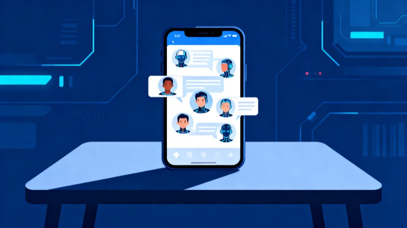

> 一篇**杂谈**短文，3 分钟读完。记录一个正在发生的移动端 Agent 竞争动向。

Nous Research 旗下开源 Agent 社区的焦点产品 **Hermes** 移动端应用近日进入内测阶段，**名额放出即被抢空**，目前已无法申请。11 月 3 日 Nous 官方称移动端内测需求超出预期，正在努力增加测试名额。

## 两种产品形态

| 形态 | 说明 | 门槛 |
|---|---|---|
| **远程连接模式** | 通过 SSH 等方式连接，把手机变成操作本地/远程主机上 Agent 的入口 | 需自备服务器 |
| **云端托管模式** | Nous 官方云托管智能体，手机上直接创建、调用、管理 Agent | 需 Nous 账号 + 订阅套餐 |

## 手机上能做什么

相比桌面端，移动端把不少原本只在桌面的能力搬了下来：

- **多 Agent 拉群**：像桌面端 Bot Mode 一样，选多个 Agent 加入同一群组交流，也可向一个或多个 Agent 分配任务
- **内置终端**：SSH 连接远程设备，手机上直接操作
- **定时任务**：Routines 页面可查看、暂停、创建定时任务
- **Artifacts 页面**：集中查看 Agent 生成的代码、文档、图片，游戏开发和图像生成任务可直接预览素材
- **文件管理器**：浏览代码库和相关文件
- **Agent 创建**：自定义名称、Soul 及代码仓库来源

## 扩展能力也在

Skills 可查看已安装/learned 的技能、可开关、可自建，也能从 Skill Hub 逛。

第三方连接、Plugins 和 MCP Servers 有独立管理入口，可查看已接入服务并调整启用状态。

Agent 的图标、颜色、外观可自定义，甚至能直接上传图片当头像。

## 关键功能：Device Access

这是最值得关注的部分——通过权限控制，向 Agent 开放手机上的**日历、联系人、位置和健康数据**。

> ⚠️ 隐私提示：共享的数据会传输到用户自己的服务器以及所使用的 AI 服务提供商。日历、位置、健康数据这类敏感权限，需要谨慎开启。

## 官方云的价格

通过 Nous 云服务新建智能体，账户至少需要 2 美元余额。

| 套餐 | 配置 | 并发会话 | 价格 |
|---|---|---|---|
| 标准版 | 2 共享 CPU / 2GB 内存 | 10 | $0.60/天 |
| 专业版 | 4 共享 CPU / 4GB 内存 | 20 | $1.08/天 |
| 旗舰版 | 4 共享 CPU / 8GB 内存 | 20 | $2.50/天 |

标准版连用 30 天约 $18，旗舰版约 $75。对需要长期跑多个 Agent 的用户，这笔费用不算低。

## 我的观察

**Hermes 移动端的产品定位明显受了 Grok Bot、Muse 等应用影响，向 Personal Agent 方向倾斜。** 原文对它的评价很直接：

> 显而易见，Hermes移动端正在把原本分散在服务器、桌面端和手机上的使用环节连接起来。但其产品定位似乎受到了Grok Bot、Muse等应用的影响，朝着Personal Agent的方向略显倾斜。

这和 OpenClaw 今年 6 月底推出的官方手机应用形成了对照——那次的早期反馈并不理想，界面设计、设备配对和实际使用体验都受到质疑。Hermes 显然吸取了这个教训，打磨更久才开内测。

**Device Access 是这类产品的真正分水岭。** 前面提到的多 Agent 拉群、终端、定时任务，桌面端早就能做；移动端只是换了个入口。真正让移动端 Agent 区别于"远程桌面"的就是能不能读到手机本身的数据——而这一旦打开，隐私边界就不是产品设计问题，而是用户自己的判断题了。

---

*来源：智东西（2026-11-04） · 原文链接：https://c.m.163.com/news/a/LATQ69MO051180F7.html*
