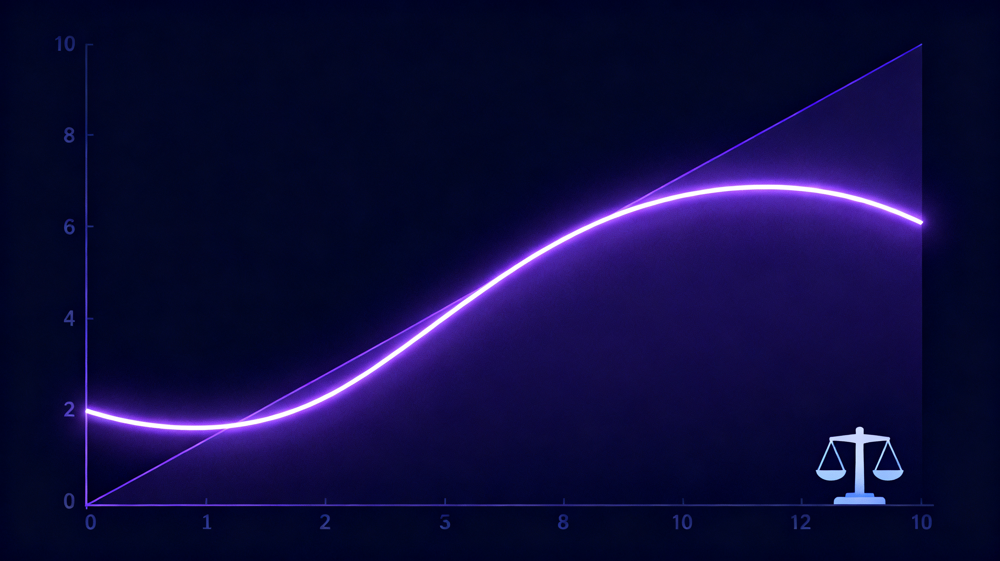

## 一句话总结

> ⭐ 谷歌发布首款决策模型 **Gemini Decision 1**（模型 ID `gemini-decision-1`，输入 **$0.10/1M**、⭐ **输出 0 元**）。⭐ 我把官方 benchmark 表扒下来逐项核对：⭐ **9 项里 7 项第一，JevBench 92.2%**，⭐ **但真正值得看的不是准确率，而是 Top-1 ECE = 0.0250**——⭐ 比 TypeSafe Jev 1.14 的 0.0494 **低一半**，⭐ 比 Flash-Lite 的 0.2104 **低 88%**。⭐ 结合我 11-10 在 M4 Pro 上把 **OpenJev-9B 塞进 oMLX** 的实测数据，⭐ 这篇讲清三件事：⭐ **决策模型到底在解决什么**、⭐ **校准误差为什么比准确率更重要**、⭐ **本地 6GB 和云端 $0.10/百万该怎么选**。



---

## 一、先看官方数据（我扒了原图核对）

Google 博客的 benchmark 表是**图片**，我把它下下来直接看了。**原文引用的数字全部准确**：

| Benchmark | 指标 | **Gemini Decision 1** | TypeSafe Jev 1.14 | GPT-6 Luna | Gemini 3.5 Flash-Lite |
|---|---|---|---|---|---|
| **JevBench** | Public split | **92.2%** ✅ | 90.0% | 90.9% | 86.6% |
| **Amazon ESCI** | Macro-F1 | **58.7%** ✅ | 56.7% | 54.7% | 47.2% |
| **New Yorker Caption** | Text-only | **79.7%** ✅ | 72.0% | 68.4% | 73.7% |
| Mind2Web Multimodal | — | 86.2% | **86.8%** | 81.8% | 78.0% |
| **PubMedQA** | — | **79.8%** ✅ | 78.2% | 74.4% | 77.6% |
| **Global-MMLU-Lite** | Non-English | **86.0%** ✅ | 85.0% | 79.6% | 78.8% |
| When2Call | — | 79.9% | **82.0%** | 70.4% | 60.9% |
| **MMAU** | — | **71.8%** ✅ | — | — | 67.7% |
| **Video-MME** | No subtitles | **69.1%** ✅ | — | — | 63.3% |
| **Top-1 ECE** | 7 shared evals, 越低越好 | **0.0250** ✅ | 0.0494 | 0.0721 | 0.2104 |
| **Total price** | 7 shared evals | $0.88 | **$0.68** | $0.93 | $4.14 |

**两个关键点原文没强调：**

**① 输的那两项恰好是 Agent 最相关的。** Mind2Web Multimodal（-0.6）和 **When2Call（工具调用判断，-2.1）**——而 When2Call 正是 Gemini Decision 1 重点宣传的"Agent 工具选择"场景。**在这个赛道上，专用决策模型 TypeSafe Jev 依然领先。**

**② 总成本不是最低。** $0.88 vs Jev 的 $0.68。宣传里说"比 Flash-Lite 便宜近 5 倍"是对的（$4.14 → $0.88），但**跟 Jev 比并没有更便宜**。

---

## 二、决策模型到底在解决什么问题

### 传统做法的浪费

要做一个"判断这封邮件是不是垃圾邮件"，传统路径是：

```
调用生成式大模型 → 生成一段文本 → 正则/解析提取答案 → 丢弃 99% 的 token
```

**你花了完整的生成成本（prefill + 逐 token decode），只为了最后得到一个 yes/no 和一个概率。**

### 决策模型的做法

```
一次前向传播 → 直接对候选选项打分 → 返回概率 + 置信度
```

不生成任何答案文本。**输出 token 数为 0。**

### Gemini Decision 1 的规格（官方 pricing 页核实）

| | |
|---|---|
| 模型 ID | `gemini-decision-1` |
| 输入 | **$0.10 / 1M tokens**（免费层免费） |
| 输出 | **不适用（0 output tokens）** |
| 上下文 | 262,144 tokens（256K） |
| 单请求问题数 | 最多 **1,000** |
| 选项数 | 2–255（choice 类型） |
| 题型 | `noul`（是/否）、`choice`（多选）、`score`（有序评分） |
| 延迟 | 端到端 **150–250ms**；模型计算 50–100ms（≤16K 上下文） |
| **不支持** | context caching、Batch API、Flex/Priority 推理 |

**计费细节**：共享输入 token 只算一次，**每个问题单独加自己的 instructions/criteria/格式 token**。

**不支持 context caching 意味着**：重复输入每次全量计费。对"同一段长文 + 100 个问题"这个最典型的批量场景，仍然非常划算；但对"同一段文反复问 1000 遍"就不行。

### 接口形态

```bash
curl -X POST "https://generativelanguage.googleapis.com/v1beta/decisions" \
  -H "x-goog-api-key: $GEMINI_API_KEY" \
  -H "Content-Type: application/json" \
  -d '{
    "model": "gemini-decision-1",
    "input": "The blue mug I ordered on Monday arrived cracked on Wednesday.",
    "questions": {
      "is_damaged": {"type": "noul", "instructions": "Did the item arrive damaged?"}
    }
  }'
```

返回：

```json
{
  "answers": {
    "is_damaged": {"type": "noul", "noul": 0.99, "confidence": 0.99}
  },
  "usage": {"total_input_tokens": 100, "total_output_tokens": 0}
}
```

**三种题型的返回字段跟 JEV 完全一致**（`noul` / `confidence` / `probabilities` / `legend`）。这点很重要——它意味着**任何用 JEV 写的代码，换成 Gemini Decision 1 不用改一行**。

---

## 三、⭐ 校准误差：这才是决策模型的命门

### 准确率回答不了的问题

准确率只告诉你"判对了几成"。但**决策模型的实际用途是"要不要交给人"**：

```python
if model.noul < 0.7:
    route_to_human()   # 阈值判断
```

**这个阈值只有在概率是"可信的"时候才有意义。**

### ECE 是什么

**Expected Calibration Error（预期校准误差）**：把所有预测按概率分桶，看"我说是 80% 的那批，实际对的比例是不是接近 80%"，然后取加权平均。

**ECE = 0.0250 意味着**：模型说 80% 的那批题，实际正确率大约在 77.5%–82.5% 之间。

**ECE = 0.2104（Flash-Lite）意味着**：说 80% 的那批，实际可能只有 70%——**严重过度自信**。

### 这在 Agent 里的后果

| 场景 | ECE 高的后果 |
|---|---|
| 安全检测 | 模型说"这个请求 95% 安全"，实际 80% 安全 → **危险请求漏过** |
| 工具路由 | 模型说"这个工具 90% 能解决"，实际 60% → **频繁失败重试** |
| 人工审核阈值 | 阈值设 0.9，但模型的高分不可信 → **该转人工的不转** |

官方四家的 ECE 差距：

```
Gemini Decision 1  ████░░░░░░░░░░░░░░░░  0.0250
TypeSafe Jev 1.14  ████████░░░░░░░░░░░░░░  0.0494
GPT-6 Luna         ███████████░░░░░░░░░░░░  0.0721
Flash-Lite         ████████████████████████  0.2104
```

**Gemini Decision 1 的 ECE 只有 Jev 的一半，只有 Flash-Lite 的 1/8。**

---

## 四、⭐ 我的本地实测：9B 的 OpenJev 长什么样

11-10 我把 `autotrust/JEV-9B`（蒸馏自 TypeSafe Jev 1.13）转成 MLX 跑进了 oMLX。用 SK 海力士 underfill 那个场景实测：

| 候选 | OpenJev-9B（本地） | 判定 |
|---|---|---|
| 直接命中（Namics 供货原句） | **0.9653** | 相关 |
| 无关（珊瑚礁） | **0.0065** | 无关 |
| 同主题但不含答案（HBM4 发布） | **0.0065** | 无关 |
| ⭐ **有线索但无答案** | **0.1313** | **无关（干脆利落）** |

**第四行是重点。** 我拿它跟 0.8B 的 Jev-Style 比过：

| | Jev-Style 0.8B | OpenJev 9B |
|---|---|---|
| 直接命中 | 0.9748 | 0.9653 |
| 无关 | 0.0487 | 0.0065 |
| **有线索无答案** | **0.5522** ❌ 卡在 0.5 | **0.1313** ✅ 干脆判掉 |

**0.8B 在中间地带判不出来**（0.5522 正好卡在阈值上）。而这恰恰是决策模型最难的部分——"这条有没有线索但不是答案"。

**9B 在这个中间地带的表现，是它比小模型贵的真正原因。**

**顺带一个重要发现**：0.8B 那个模型（`Jev-Style`，独立项目，跟 TypeSafe 无关）问的是"**这个陈述为真吗**"，而 SAG2 / TypeSafe JEV 问的是"**这段是不是必要证据**"。**语义不同，用错问法会让所有候选都落到 0.96–0.97，完全没有判别力。**

---

## 五、本地 vs 云端：怎么选

### 三条路线对比

| | Gemini Decision 1 | 本地 OpenJev-9B | 本地 Jev-Style-0.8B |
|---|---|---|---|
| 成本 | $0.10/1M 输入，输出 0 | 电费 | 电费 |
| 体积 | 云端 | **6.36 GB**（NVFP4） | 0.78 GB |
| 延迟 | **150–250ms**，1000 问不涨 | 0.45–0.68s/判定 | 44–60ms/判定 |
| 批量（40 候选 / 220K tok） | **~150–250ms** | **65–180s** | 未实测 |
| 准确率（JevBench） | **92.2%** | 未在 JevBench 上跑 | 60.6%（换算自 0.8B 消融） |
| ECE | **0.0250** | 未测 | 未测 |
| 中间地带 | — | **0.1313** ✅ | 0.5522 ❌ |
| 隐私 | 数据出本机 | ✅ 全本地 | ✅ 全本地 |

### 我的实测数据说明什么

我用 **SAG2** 这个真实检索场景做过压测（每轮 40 个候选、220K tokens 的 JEV 批量打分）：

```
本地 OpenJev-9B:  144.4s / 170.7s / 154.6s   ← 三轮扩展
Gemini Decision 1: ~150–250ms（且 1000 问延迟基本不涨）
```

**这是数量级差距。** 本地慢的原因我查过：**瓶颈在 prefill（读完 220K tokens 的候选段落），不在模型前向**。换更小的模型省不了这个——0.8B 走 oMLX 还是 `engine=batched`（没有 decision head 读出路径），而且判别力不行。

### 三条建议路线

**① 大量、批量、长输入 → 云端**

SAG2 那种"一次 40 个候选、220K tokens"的场景，本地 144s vs 云端 0.2s。**$0.022/轮**（220K tokens × $0.10/1M）在成本上完全不是问题。

**② 高频、低延迟、单条判定 → 看隐私**

本地 0.45–0.68s 对交互式场景有点慢（云端 150–250ms）。但如果数据不能出本机，或者要做**离线批处理**，本地是对的。

**③ 关键路径 → 混合**

云端主用 + 本地兜底。**这正是我在自己 OpenClaw 里已经这么干的**——MiniMax M3.1 Flash 撞 429「Token Plan 用量上限」时，Azure GPT-5.6-Sol 顶上。决策模型层同理：Gemini Decision 1 为主，OpenJev-9B 兜底。

### ⚠️ 免费层的一个坑

官方 pricing 页写明免费层的 **"Used to improve our products: Yes"**——**免费层的输入会被用于谷歌产品改进**。敏感数据别走免费层。

---

## 六、这跟你的 Agent 架构怎么接

### 场景 A：SAG2 的 JEV 后端（现成）

SAG2 的 `JevClient` 直接 POST 到 `{endpoint}/systemone`，payload 结构跟 Gemini 的 `/v1/decisions` **同构**。理论上改一个环境变量就能切：

```dotenv
# 现在（本地 OpenJev，走 oMLX + 剥空白的代理）
JEV_BASE_URL=http://127.0.0.1:8766/v1

# 换成云端
JEV_BASE_URL=https://generativelanguage.googleapis.com/v1beta
```

**但注意两点**：① `/v1beta/decisions` 跟 `/v1beta/systemone` 路径不同，要改；② 认证头不同（`x-goog-api-key` vs `Bearer`）。

### 场景 B：心跳的推送闸门

你现在用"三问过滤"人工判断：

> ① 人必须行动或能用这个结果吗？② 带新的可行动信息吗？③ 去掉它人会漏掉什么吗？

**这正是 `choice` 类型**——三个选项一次调用评完。1000 条待推消息可以一次请求评完，本地 9B 要跑几十秒，云端 200ms。

### 场景 C：模型路由

Google 自己就在用这个做 Gemini Notebook 的实时路由（**延迟最多降 40%**）。你的 OpenClaw 现在是"主模型 + fallback"两级，可以加一个决策层在中间判断"这个请求需要深度推理还是快答"。

---

## 七、三个判断

### ① 决策模型是一个真实的品类，不是包装

`output token = 0` 这个设计有实打实的好处：
- **成本结构完全不同**——按输出计费的模型，决策任务是最亏的（付了 decode 的钱，拿到一个 yes/no）
- **延迟是另一个量级**——150–250ms 且 1000 问不涨，这在做批量筛选时是决定性的
- **多模态是原生支持的**，不需要额外 pipeline

### ② 但"校准"是比"准确率"更重要的分水岭

92.2% vs 90.0% 只差 2.2 个点，**但 ECE 0.0250 vs 0.0494 差一倍**。

**在"要不要交给人"这个决策上，ECE 直接决定阈值怎么设。** 一个 ECE 0.05 的模型说 0.9，你不能信；ECE 0.025 的模型说 0.9，你可以。

### ③ 本地不是被云端淘汰，而是找到了自己的位置

0.8B 跑 44–60ms 但判别力不行；9B 判别力好但 0.45–0.68s；云端 150–250ms 且全指标领先。

**本地真正的价值是隐私和离线，不是速度。** 6.36 GB 换一个"数据不出本机 + 断网可用"，对很多场景是划算的。

**而对 SAG2 这种"每轮 220K tokens 批量打分"的场景，本地是真的不行**——144 秒 vs 0.2 秒，这个差距不是靠优化能填的。

---

## 八、如果要接，我的顺序

1. **先申请一个 Gemini API key**（AI Studio 免费层就能拿，先用免费层测量，别一上来就付费）
2. **拿 SAG2 做对照实验**：同一批候选，本地 OpenJev-9B vs 云端 Decision 1，比耗时 + 判别力（尤其中间地带）
3. **把心跳的推送闸门改成 Decision 1 调用**——这是最小、最独立的试点，一个 `choice` 类型的问题，几十行代码
4. **本地 OpenJev-9B 留作兜底**，跟 Azure fallback 一个思路

---

### 相关链接

- 官方公告：https://blog.google/innovation-and-ai/technology/developers-tools/gemini-decisions-api/
- API 文档：https://ai.google.dev/gemini-api/docs/decisions-api
- 定价：https://ai.google.dev/gemini-api/docs/pricing
- 模型页：https://ai.google.dev/gemini-api/docs/models/gemini-decision-1
- JEV 模型：https://huggingface.co/autotrust/JEV-9B
- SAG2 论文：arXiv [2610.22588](https://arxiv.org/abs/2610.22588)
- 配套实测：[SAG2 全本地化实测](https://www.samvortex.com/research/sag2-local-knowledge-base-2026-11-08/)
