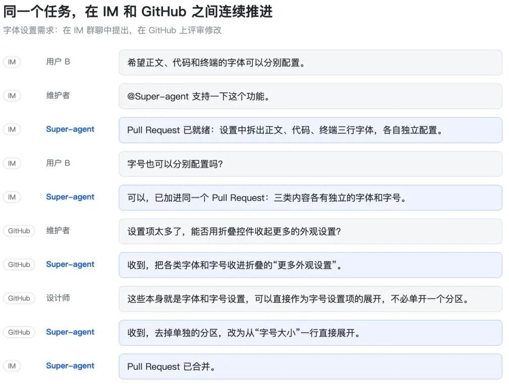
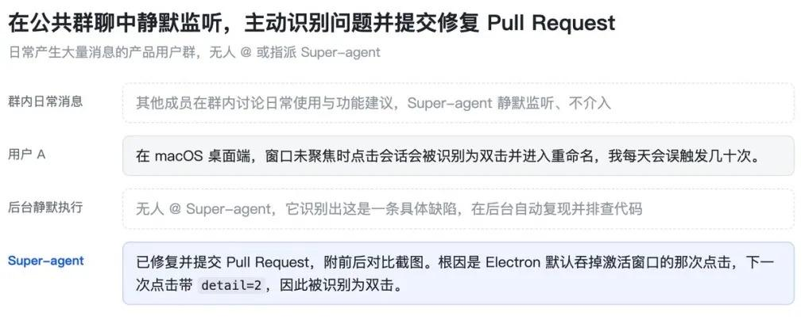
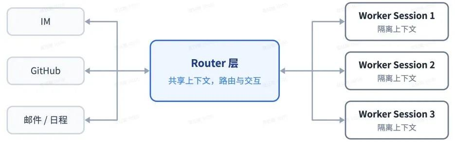
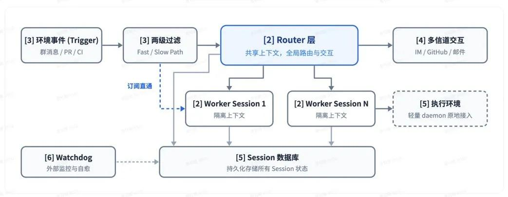
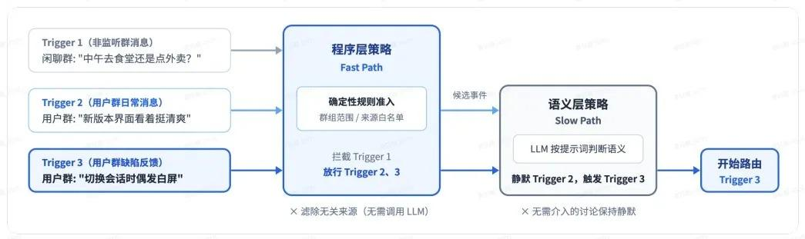
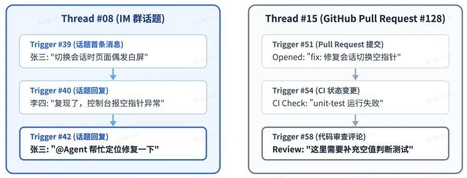
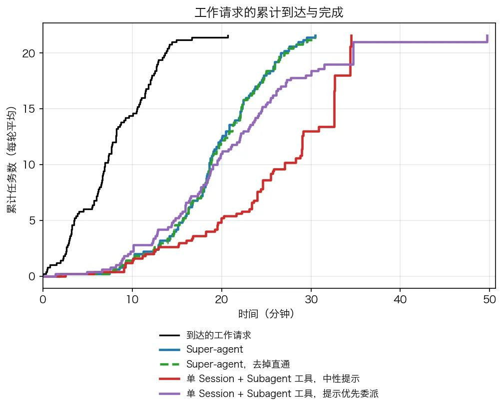
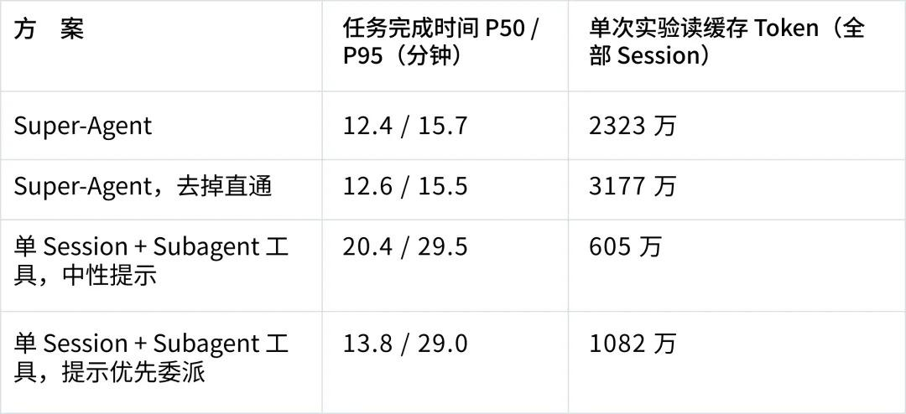
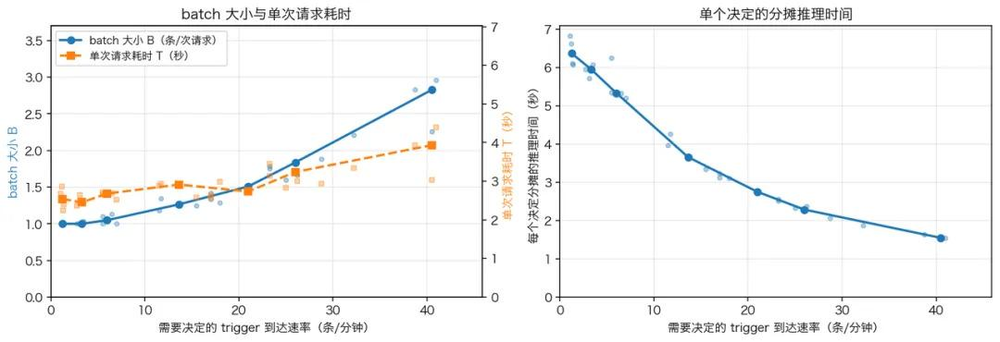

## 一句话总结

> DeepSeek 明确指出**主流 Agent 仍以单一 Session 为基本单位**，一个人通常只能同时跟进 3 至 5 个活跃 Session。他们提出的解法是把 Agent 从"被动响应指令的单任务工具"升级为"持续在线、能并行处理多项任务的自主协作者"——**核心是 Router / Worker 双层架构**，配套事件驱动、链式召回、投机执行、异步 ReAct Loop 与独立 Watchdog 五件套。论文原话：*"随着大模型执行单个任务时越来越不需要人的干预，限制生产力进一步提升的因素正逐渐转向人的注意力。"*

---

## 一、⭐ 为什么要做 Super-agent：单会话的天花板 ⭐

DeepSeek 的出发点是一个具体的观察：**一个人通常只能同时跟进 3 至 5 个活跃 Session**。

现有主流设计的问题在于 Session 之间相互独立。用户并行推进多项工作时，需要手动切换并维护各个 Session 的上下文。即使通过 CLI、MCP 或外部连接器把本地 Agent 扩展出去，仍然会撞上三类墙：

| 墙 | 具体表现 |
|---|---|
| **单会话同步阻塞** | 上一件事没做完，下一件事排不进来 |
| **多任务上下文混乱** | 几个 Session 各自持有一段互不知情的上下文 |
| **本地设备离线后任务停止** | Agent 绑死在你的笔记本上 |

即使不扩展开、多开 Session 这条路，本质问题也没解决：**限制生产力提升的因素已经从"模型不够强"转移到了"人的注意力不够用"**。

DeepSeek 把这种新型 Agent 形态称为 **Super-agent**，并归纳出四项基础特征：

| 特征 | 含义 |
|---|---|
| **连续** | 用户可以在即时通讯、GitHub 评论等不同渠道与同一个 Agent 交互 |
| **高效** | 能够并行处理多个复杂任务 |
| **主动** | 系统持续观察环境事件，自行推进值得处理的事项 |
| **持久** | 始终在线，并能在长期运行中从异常状态恢复 |

图 1：同一个任务在 IM 群聊与 GitHub Pull Request 评审之间连续推进

图 2：持续关注公共群聊，在无人 @ 的情况下主动识别缺陷并提交修复 Pull Request

---

## 二、⭐ 双层架构：Router 与 Worker ⭐

这是整套设计的地基。

- **Router 层**：承接人类交互、维护全局上下文、分派任务
- **Worker 层**：在相互隔离的会话中并发执行具体工作

一条关键的设计约定：**Worker 不直接向用户回复，而是将状态和结果汇报给 Router，由后者统一对外沟通。**

这条约定的分量很重。它意味着**对外表达只有一条通道**，所以上下文一致性、语气统一、回复时序都由 Router 单点保证；同时 Worker 之间彻底隔离，一个 Worker 崩了不会污染其他 Worker 的上下文，也不需要 Worker 知道"外面还有谁在说话"。

图 3：双层架构：Router 层统一负责路由与对外交互，多个 Worker Session 隔离并发执行任务

图 4：Super-agent 整体系统架构

整体架构由五部分组成：**双层架构、事件驱动、面向人的交互、计算与状态及环境分离、Watchdog**。

---

## 三、⭐ 事件驱动：Trigger 与两级过滤 ⭐

Super-agent 的输入不是"用户发来一句话"，而是**事件**。DeepSeek 把群聊消息、邮件与日程提醒、代码审查评论、CI 运行结果等外部信息统称为 **Trigger**。

处理链路是**两级过滤**：

1. **程序规则过滤** —— 先由程序层策略筛除大部分无关消息
2. **语义层判断** —— 再交由大模型判断是否需要采取行动

这个顺序值得注意：**先便宜后昂贵**。绝大多数噪音在程序层就被挡掉，只有幸存者才消耗 LLM 推理。

图 5：两级过滤：先由程序层策略筛除大部分无关消息，再交由语义层策略判断

### Thread：让 Worker 订阅自己的事件流

**已经分配任务的事件流，Worker 可以订阅对应的 Thread**，后续相关事件由程序直接发送给 Worker，**无需每次都经过 Router**——从而降低路由负载。

**Thread 的定义**：同一个 IM 话题、或同一个 GitHub Pull Request 下的连续 Trigger 构成一条 Thread。

图 6：Thread 示例：同一个 IM 话题或同一个 GitHub Pull Request 下的连续 Trigger 构成一条 Thread

### Inline & Spill 与 Chain of Recall

两个上下文管理机制：

- **Inline & Spill**：近期可能用到的信息直接放入模型上下文窗口；超出预算或低频使用的内容保留在窗口之外，供模型按需读取
- **链式召回（Chain of Recall）**：通过 Trigger、Thread 和 Worker Session 等对象之间的引用关系，让模型沿关联 ID **逐步找回**历史任务信息

后者与前者是互补的：Inline & Spill 管"当前窗口里放什么"，Chain of Recall 管"历史上怎么找回来"。

---

## 四、⭐ 面向人的交互：投机执行 + 异步 ReAct Loop ⭐

### 投机执行（Speculative Execution）

根据环境信号在后台提前开展工作。DeepSeek 给了两个例子：

- **日历场景**：收到会议邀约后，先检查日程冲突、搜集背景资料、准备回复草稿
- **研发协作场景**：在群聊讨论问题时，尝试复现故障、寻找修复方案，**只有确认问题并找到简单修复方式后才向用户交付结果**

第二个例子的设计意图值得留意：**Agent 不把半成品丢给人**。它自己先跑通，确认了才交付。

### 异步 ReAct Loop

把耗时工具调用改为异步的 `start()` 和 `stop()`：Agent 启动后台任务后即可返回 `Started` 状态，不必等待任务完成，**后台结果随后作为新事件进入会话**。这样前台对话可以继续接收用户的新消息。

> ⚠️ DeepSeek 特别说明：这项异步任务机制**已经在 DeepSeek Harness 中实现，但尚未默认开启**。

---

## 五、⭐ 计算与状态及环境分离 + Watchdog ⭐

### 计算与状态及环境分离

Super-agent 把 Agent Loop 的**计算、会话状态和执行环境**解耦：

- **计算与持久化状态放在云端**
- **执行环境可以留在用户本地设备**，仅部署负责执行命令和返回结果的轻量 daemon

由此支持 **BYOM（Bring Your Own Machine）**——把用户日常使用的开发机或个人电脑接入云端 Agent；也支持连接云端托管机器，或按需创建的计算环境。

### Watchdog Session

主架构之外另设一个**独立的 Watchdog Session**，形成外部控制回路。它做两件事：

1. 监控基础设施问题（接口报错、状态恢复失败等）
2. **通过模型判断 Worker 是否取得实质进展、执行方向是否偏离目标**，发现异常时介入修复

第二点是关键：Watchdog 不只是看"服务还活着吗"，而是看**Agent 是不是在假装干活**。

---

## 六、⭐ 实测数据与它的边界 ⭐

DeepSeek 团队做了初步实验，对比四种方案：Super-agent、去掉事件直通机制的 Super-agent，以及两种提示词配置下的单 Session + Subagent 方案。

**实验设置**：每次约 300 条消息，其中约 20 条为工作请求，每种方案重复运行 5 次。

| 方案 | 任务完成时间 p50 | 任务完成时间 p95 |
|---|---|---|
| **Super-agent** | **12.4 分钟** | **15.7 分钟** |
| 单 Session + Subagent（中性提示） | — | 29.5 分钟 |

### Router 层压力测试

Trigger 到达速率从**每分钟约 1 条提升至约 40 条**时：

| 指标 | 变化 |
|---|---|
| 平均批处理大小 | 1.0 → **2.8** |
| 单次请求耗时 | 2.5 秒 → 3.9 秒 |
| **单个决定分摊的推理时间** | 6.4 秒 → **1.6 秒** |

结论：事件突发时，**Router 可以通过合并积压事件提高有效吞吐**。

图 7：工作请求的累计到达曲线与四种方案的累计完成曲线（5 次实验运行均值；消息间隔与工作时长按 1/4 缩放，模型调用耗时为真实值）

图 8：每种方案重复运行 5 次；任务完成时间指从工作请求到结果消息的耗时

图 9：不同 Trigger 到达速率下 Router Session 的 batch 大小、单次请求耗时与单个决定的分摊推理时间

> ⚠️ **必须注意的数据边界**：DeepSeek 团队自己指出，这些实验**基于合成负载和简化环境，主要评估系统调度与协作能力，并不衡量单个任务的实际执行能力**。
>
> 换句话说：12.4 / 15.7 vs 29.5 分钟这组数字衡量的是**调度效率**，不是"Super-agent 干的活更好"。别拿它当单任务能力基准。

---

## 七、⭐ 官方点名的 5 个未解问题 ⭐

这套架构并不完备。DeepSeek 自己列出的待解决问题：

1. **Router 层如何随任务规模扩展**
2. **跨月乃至更长时间跨度的长程记忆**
3. **脱离 Session 后的人机协作方式**
4. **不同 Agent 实例之间的 A2A 通信**
5. **安全与隐私保护**

第 5 条被特别展开：*"尤其是云端 Agent 接入本地设备后，提示词注入、端侧凭据泄露和跨设备权限风险都需要进一步解决。"*

---

## 八、⭐ 开源原型：dsh-superagent-prototype ⭐

DeepSeek 提供了名为 **`dsh-superagent-prototype`** 的原型实现（GitHub：`deepseek-ai/dsh-superagent-prototype`，MIT 协议，2.5k star / 222 fork），**但明确指出"该插件用于验证技术路线，并非 DeepSeek 正式产品"**。

README 的自陈很坦率：

> *"Research prototype for reference only, not an official DeepSeek product... Treat it as research code, not production-ready software. It may still contain bugs, and its coding style and engineering practices may be inconsistent. Review and adapt it before using it in your own environment."*

还有一句同样重要：

> *"We have adapted it for publication, so it is not identical to our internal version or the implementation described in [the article]. **Some designs discussed in the article are directions for future development and are not implemented in this prototype.**"*

**即：论文里讲的一部分设计，原型里根本没实现。**

### 原型实际是什么

README 描述的 `dsh-superagent` 是**面向单个 GitHub 仓库的主动式编码 Agent**，以插件包形式随 DeepSeek Harness 分发：

- 监听 GitHub，可选监听飞书
- 被允许后，**开一个 work item，在自己的 Agent session 和目录里干活，然后在原对话里回复**（例如提交一个 PR）
- 一个 web 面板显示"哪些事需要人来看"

它体现的工作哲学值得单独摘出来：

> *"An agent that can act for a whole team can also waste a whole team's attention, so it **acts only when asked or when a rule the team wrote allows it**, and **speaks only when someone must act or can use a result**."*

### 文档结构（编号即依赖顺序）

| 文档 | 内容 |
|---|---|
| `000-philosophy.md` | 设计哲学，以及它对运维者的要求 |
| `001-domain.md` | 领域模型（Trigger / Thread / Worker Session） |
| `002-authorization.md` | 授权模型 |
| `003-execution.md` | 执行 |
| `004-prompts.md` | 提示词 |
| `005-panel.md` | 面板 |
| `006-deployment.md` | 手动安装、配置、升级、排障 |
| `007-architecture.md` | 架构 |
| `008-cookbook.md` | 加一个 Source 的做法 |

安装方式很特别——**让 Agent 读 SETUP.md 带着你装**：

> *"Read SETUP.md in this repository and set up dsh-superagent with me. It asks one short question at a time, shows the full plan once, and then installs and configures everything."*

---

## 九、⭐ 对照我们自己的栈：哪些已有、哪些真缺 ⭐

把这套设计与我们现有形态逐项对照，结论是：**架构层面我们已经高度同构，缺口不在"要不要改成双层"，而在三块具体机制。**

| Super-agent 组件 | 我们这边的对应物 | 状态 |
|---|---|---|
| Router（承接交互 + 全局上下文 + 分派） | `agent:main:main` 主会话 | ✅ 已有 |
| Worker（隔离会话并发执行） | molly / stitch / rax / lux 四条 Worker | ✅ 已有 |
| Watchdog（判断 Worker 是否在假装干活） | `heartbeat-watchdog` 每 15 分钟 | ✅ 已有 |
| 事件驱动 Trigger | 8 个 cron automation + 一批 cron 脚本 | ✅ 部分 |
| **Thread（Worker 订阅自己的事件流）** | 事件是"散"的：各自 cron、各自日志 | ❌ **缺** |
| **异步 ReAct Loop（start/stop）** | 长任务会阻塞整轮回复 | ❌ **缺** |
| **Chain of Recall（结构化引用链）** | 靠 `memory_search` 语义检索 | ⚠️ 语义 ≠ 结构化 |
| Inline & Spill | 上下文预算 + compaction | ✅ 已有 |
| 计算/状态/环境分离 + BYOM | 单机 | ❌ 缺（但单机场景也未必需要） |

**三个真缺口的差别很大：**

1. **Thread 抽象** —— 我们的事件是"散"的（各自 cron、各自日志），没有"同一个话题/PR 下的连续触发构成一条 Thread"这层。Router 压力大时我们只能靠 agent 自己扛；DeepSeek 是让 Worker 直接订阅 Thread 绕过 Router。**这一条最值得做**，因为它同时缓解 Router 压力和上下文混乱两个问题——而我们现在的痛点恰恰是"每次心跳要串行处理一堆 cron 结果"。

2. **异步 ReAct Loop** —— 我们这边 exec 长任务会阻塞整轮回复，Sam 已经撞过多次（"20:32 那趟心跳跑满 600s 超时被切断"）。DeepSeek 那套已经实现但没默认开启，说明**这不是必须先做的**，但方向明确。

3. **Chain of Recall** —— 我们靠语义检索找历史，多 session 并行时"关联 ID 链"比"语义相似"更可靠。

而 DeepSeek 自己列的未解问题里，**第 5 条（云端 Agent 接入本地设备的提示词注入 / 端侧凭据泄露 / 跨设备权限）我们几乎正面撞上**——我们正在做多 agent 编排：Zam 协调四个 agent、每个 agent 有自己的 MEMORY.md、还有嵌套 git 仓库。BYOM 一旦引入，这几个风险就变成我们自己的问题。

---

## 十、⭐ 落地建议 ⭐

1. **先做 Thread 抽象**，收益最高：把散装 cron 的 Trigger 收敛成"事件 → Thread → Worker 订阅"模型。这直接缓解我们当前最痛的点（心跳串行处理所有 cron 结果）。
2. **异步 ReAct Loop** 次之。我们已经有 `sessions_spawn`（mode=run）和后台进程，但**"返回 Started、结果作为新事件进入会话"这个闭环没有**——目前子代理完成后走的是 completion event 回传，形态上接近，但缺 `start()/stop()` 的显式控制。
3. **暂不引入 BYOM**。它是解决"云端 Agent 用你的本地设备"的问题，而我们本来就在单机，收益为零、风险（凭据/权限/注入）全在我们头上。
4. **不抄"主动提交 PR"那部分**。DeepSeek 自己的原型也强调"只在被要求、或团队写的规则允许时才行动"。这条纪律我们已经在用（`perception-liveness` 的"不要因为调度器在跑就报正常"就是同一类约束）。**照抄会让 Agent 有权在没授权的情况下写代码 —— 那是把"可回收的误报"换成"不可回收的脏 PR"。**

---

## 来源

- [网易新闻（IT之家）· 原文](https://c.m.163.com/news/a/LAJOI3N40511B8LM.html)
- [GitHub: deepseek-ai/dsh-superagent-prototype](https://github.com/deepseek-ai/dsh-superagent-prototype)（MIT，2.5k star；官方声明为研究原型、非正式产品）
- 同期相关报道：[量子位《刚刚，DeepSeek 重磅开源：Agent 底座架构！》](https://c.m.163.com/news/a/LAJO2OLL0511DSSR.html)、[通信世界《DeepSeek 开源 Agent 底座：智能体从"单会话"走向"常驻系统"》](https://c.m.163.com/news/a/LAK4NI2E051288FS.html)、[机器之心《Agent 长时工作如何不跑偏？WorkSwarm 用「永续会话」给出解法》](https://c.m.163.com/news/a/L6ACIBNA0511AQHO.html)
