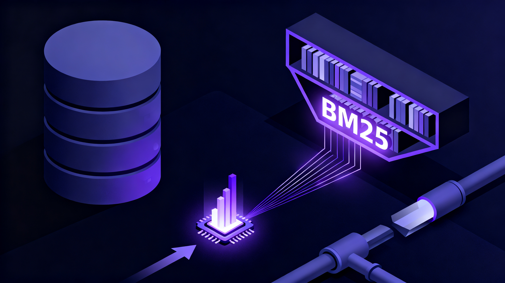

## 一句话总结

> ⭐ **SAG2 的核心贡献不是"又一个检索框架"，而是把检索层从"向量 + 预计算"退回"倒排索引 + 运行时判断"** —— ⭐ **建库 2.36 秒、零 embedding、零 GPU**，⭐ **MuSiQue R@5 80.68%**（超 HippoRAG 2 **15.55** 个点），⭐ **Agentic 模式 R@5 92.20%**。⭐ 我把它 ⭐ **完全本地化**了：⭐ **OpenJev-9B（6.36GB）跑在 oMLX**，⭐ **SAG CLI → 本地代理 → oMLX → OpenJev**，⭐ **2291 个文件全本地索引，索引库 51 MB**。⭐ 但有一件事必须说清楚：⭐ **"本地"只覆盖建库，检索仍然要跑决策模型**。



---

## 一、先把标题党部分剥掉

原始说法（袋鼠帝，2026-11-06）：

> RAG 这次真死了！SAG2 才是本地知识库的神，又快又准又便宜～

逐条对照论文和仓库：

| 说法 | 实测结论 |
|---|---|
| "RAG 真死了" | ⚠️ **夸张**。RAG 的短板是多跳，SAG2 解决的是多跳，不是取代向量库——企业里 90% 的单文档问答，混合检索仍然够用 |
| "本地知识库" | ⚠️ **有条件**。建库完全本地零成本，但**每次检索都要跑 JEV 决策模型**（本地跑要算力，用官方 API 要钱） |
| "又快" | ✅ **真**。建库 4.57 小时 → **2.36 秒**，约 **7000 倍** |
| "又准" | ✅ **真**。三个基准 8 项指标里 7 项第一（唯一例外是 MuSiQue R@1，SAG 一代 36.82 > SAG2 34.30） |
| "又便宜" | ⚠️ **部分**。建库 USD 0，但检索 **$0.434 / 100 题**、**$4.33 / 1000 题** |

---

## 二、真实血统：不是"RAG 死了"，是检索层重构了

### 知识库这十年的路线

```
2020  RAG（Facebook 论文）      切块 → embedding → 向量检索
2023  ChatGPT 之后爆发           FastGPT / Dify 把它产品化
2024  混合检索                   全文 + 向量 + 重排
2024  GraphRAG（微软）           大模型抽实体关系 → 知识图谱 → 多跳强，但贵且重
2025  LightRAG / HippoRAG 2     更轻的图谱路线
2026  LLM Wiki（卡帕西）         大模型把原文编译成 wiki 页面，再对 wiki 问答
2026  SAG2                       ← 把路反过来走
```

**前面每一步的共同点**：都在**入库时多花一点钱、多调一点模型**，换检索准确度。

SAG2 是**反着走的**：

| | 建库阶段 | 检索阶段 |
|---|---|---|
| 传统 RAG | embedding 模型 | 向量相似度 |
| GraphRAG | 大模型抽关系 | 图遍历 |
| LLM Wiki | 大模型写 wiki | 对 wiki 问答 |
| **SAG2** | **什么都不做，只建倒排索引** | **BM25 粗筛 + JEV 运行时判断** |

> **"用了几十年的 BM25 倒排索引"** —— Elasticsearch 默认打分就是它。

### 血统

```
DeepSeek-V4-Pro  (teacher)
   └─ 蒸馏 →  Qwen3.5-9B  ("Max Effect mode"，~250K 数学/STEM 样本)
        └─ Heretic v2.0.0.dev0 消审查 →  UNCENSORED-heretic
```

架构 `Qwen3_5ForConditionalGeneration`（含 vision_config，多模态）。语言 en / zh / ko / ja / es / ru，许可证 **Apache-2.0**。

### 消审查的代价：几乎为零

Heretic 用 ARA（Arbitrary-Rank Ablation），只动第 9–24 层：

| 参数 | 值 |
|---|---|
| start_layer_index | 9 |
| end_layer_index | 24 |
| preserve_good_behavior_weight | 0.8264 |
| overcorrect_relative_weight | 0.9645 |
| neighbor_count | 12 |

| | 拒答率 | KL 散度 |
|---|---|---|
| 原版 Jackrong/9B | 100/100 | 0 |
| UNCENSORED-heretic | **3/100** | **0.0422** |

**KL 只有 0.042** —— 消审查几乎没误伤能力。

---

## 三、建库 7000 倍提速：数字是真的

SAG-Benchmark 仓库 `Indexing and Cost` 表原文：

| | 论文记录 |
|---|---|
| 段落数 | 11,656 / 11,656 |
| **索引构建** | **2.36 秒** |
| SQLite 文件 | 25.87 MiB |
| **离线模型调用** | **0 / USD 0** |
| 模型成本 / 100 题 | USD 0.433769 |
| 模型成本 / 1000 题 | USD 4.326379 |

对比 SAG 一代：**4.57 小时 + 2826 万 tokens** → **2.36 秒 + 零 token**。

测试条件：**Apple M4 Pro / 64 GiB / 8 进程**，三次连续重建取中位数。

**这是真的 7000 倍。**

而且还有 EnterpriseRAG-Bench：**51 万份**模拟企业文档（邮件、工单、会议记录），建库 8 分 32 秒，文档 Recall@10 **81.10%**。

---

## 四、基准：8 项指标 7 项第一

论文主表（MuSiQue / 2Wiki / HotpotQA）：

| 方法 | MuSiQue R@5 | MuSiQue R@10 | 2Wiki R@10 | HotpotQA R@10 |
|---|---|---|---|---|
| BM25 | 47.47 | 54.41 | 71.50 | — |
| BGE-Large-EN-v1.5 | 56.32 | 64.08 | 73.75 | — |
| NV-Embed-v2 | 68.84 | 77.27 | 80.75 | — |
| **HippoRAG 2** | 65.13 | 73.76 | **93.40** | — |
| SAG（一代） | 80.36 | 83.37 | 93.57 | — |
| **SAG2** | **80.68** | **86.62** | **97.43** | **99.00** |

袋鼠帝说的"比 HippoRAG 2 高 15.55 个点" —— 80.68 − 65.13 = **15.55** ✓

### 真正的亮点：token 效率

| 模型 | 准确率 | 平均推理 token | 每正确答案 token | 每 1M token 正确答案 |
|---|---|---|---|---|
| **SAG2** | 90.53% | **2,858** | **676** | **316.8** |
| Qwen3.5-9B | 89.60% | 4,425 | 3,214 | 202.5 |

> 比母模型 **少 36.1% 的 token**，准确率还 **+0.93** 分。

**它不是"更准"，是用更少的思考量拿到同样的准确率** —— 这才是它能塞进 5.6GB 还不失真的原因。

### 论文里最狠的数字，文章没提

固定流水线只是开胃菜。论文还有 **Agentic SAG2** —— 让 LLM 自己决定何时搜、搜几轮、何时停：

| 方法 | MuSiQue R@5 | R@10 |
|---|---|---|
| SAG2（固定两跳） | 80.68 | 86.62 |
| **Agentic SAG2** | **92.20** | **95.39** |

配置：`gpt-6.1-sol` + high reasoning，每题最多 3 次工具调用。

**这个模式才真的接近"RAG 死了"** —— 但它要一个大模型来驱动。

---

## 五、⚠️ 关键：JEV 不是可替换的配件

这是原文没说透、但决定成败的一点。

SAG2 的检索流程：

```
① BM25 返回最多 100 个候选
② JEV（noul 判据）给每个候选打分：这段是不是必要证据？
③ 从高分段落抽关键词（纯统计，免费）
④ 用新关键词再搜，去重，再打分
⑤ 默认两轮扩展
```

论文自己的消融表（MuSiQue）：

| 方案 | R@5 | R@10 |
|---|---|---|
| BM25（纯词频） | 47.47 | 54.41 |
| BM25 + JEV（H=0，不扩展） | 60.78 | 67.93 |
| **BM25 + Qwen single scoring** | **60.17** | **66.88** |
| **BM25 + Jina single scoring** | 63.04 | 67.43 |
| **SAG2 + Jev baseline** | **80.59** | **86.61** |
| SAG2 + Qwen（两次扩展） | 55.55 | 71.61 |
| SAG2 + Qwen 0.6B（两次扩展） | 62.54 | 74.18 |
| SAG2 + Jina（两次扩展） | 65.61 | 72.13 |

**看清规律**：

- **单轮重排**时 JEV 只比 Qwen 高 0.6 个点（60.78 vs 60.17）→ **JEV 的优势不主要在单轮打分**
- **两轮扩展**时 JEV 做到 80.59，换通用模型只有 55.55 → **JEV 的价值在"多轮迭代 + 上下文累积 + 关键词扩展"**

换成通用模型，**比纯 BM25 只高 8 个点，还比不扩展的 BM25+JEV 低 5 个点**。

> **结论：JEV 不是"排序器里的一个可替换零件"，它是 SAG2 的核心。换成通用 reranker，方案直接垮掉。**

---

## 六、我的全本地化部署

### 架构

```
SAG CLI (Rust)  ──POST /v1/systemone──►  sag-jev-proxy (8766)  ──►  oMLX (8348)
                                                                            │
                                                                    OpenJev-9B-MLX-NVFP4
                                                                    (6.36GB, NVFP4 4bit)
```

**全部本地，零外网，零付费 API。**

### 为什么能对上：协议是同构的

我把 SAG2 的 `JevClient` 源码拉下来看了（`sag2/scripts/sag2.py:756`）。它 POST 到 `{endpoint}/systemone`：

```json
{"model":..., "state":"<compact_json>",
 "questions":{"candidate_<id>":{"type":"noul","instructions":{...},"criteria":{...}}}}
```

而 oMLX 的 `SystemOneRequest`：

```python
model: str
state: Any
questions: dict[str, SystemOneQuestion]   # type / instructions / criteria
```

**完全同构。** 所以 SAG2 那边只要：

```dotenv
JEV_BASE_URL=http://127.0.0.1:8766/v1
```

`JevClient` 会自己补 `/systemone`，直接就能跑 —— **不需要写协议转换层**。

### 意外发现：oMLX 内置 OpenJev 支持

我是在 oMLX 的源码里翻到的：

- `models/openjev.py` + `api/decisions.py` + `api/systemone_models.py`
- `POST /v1/systemone` 端点，实现的就是 OpenAI System One API
- `model_discovery.decision_kind()` 的识别条件：
  `model_type == "qwen3_5"` 且（存在 `helper/shim.py` **或** 目录名含 "openjev"）

**模型来源**：社区转换版 `nativ-community/JEV-9B-MLX-NVFP4`（NVFP4 4bit，6.52 GB）。
基座是 `autotrust/JEV-9B`（Apache-2.0，HF 上 69 万下载）。

### 实测：decision head 真的能输出校准概率

```json
{"answers": {"q1": {"type": "noul", "noul": 0.5401}}, "usage": {"input_tokens": 95, "output_tokens": 0}}
```

**是概率，不是文本。** 控制测试（SK 海力士 underfill 场景）：

| 候选 | noul | 判定 |
|---|---|---|
| 直接命中（Namics 供货原句） | **0.9653** | 相关 |
| 间接（有线索无答案） | 0.1313 | 无关 |
| 同主题但不含答案（HBM4 发布） | 0.0065 | 无关 |
| 完全无关（珊瑚礁） | 0.0065 | 无关 |

用 SAG2 的**原生判据原文**（`CRITERION` 常量）测，3 候选一批 2.40 秒：

```
candidate_c1（Namics 供货）= 0.7221
candidate_c2（HBM4 发布）     = 0.0065
candidate_c3（珊瑚礁）       = 0.0065
```

---

## 七、⚠️ 一个致命协议坑：oMLX keepalive 前导空白

这个坑差点让整个方案报废，值得完整记录。

**症状**：SAG CLI 第一次调用就报

```
error decoding response body for url (http://127.0.0.1:8348/v1/systemone)
```

但 oMLX 侧日志显示**请求其实成功了**：

```
SystemOne: model=OpenJev-9B-MLX-NVFP4, 50 questions, 18488 tokens in 65.180s
```

**根因**（`/Applications/oMLX.app/Contents/Resources/omlx/server.py`）：

```python
_JSON_KEEPALIVE_GRACE_S = 2.0        # line 3204

async def _with_json_keepalive(...):
    """Send keepalive spaces while waiting for a coroutine or task.
    ...
    JSON parsers ignore leading whitespace, so the final response parses normally."""
    yield " "                        # line 3232
```

oMLX 对**超过 2 秒**的非流式请求走 keepalive 分支，先 `yield " "` 再吐 JSON —— 响应体最前面带一个空格。

**关键点**：注释里说 "JSON parsers ignore leading whitespace"，这在 **Python** 成立（`json.loads` 容忍前导空白），但 **Rust 的 `serde_json` 不容忍**。而 SAG CLI 是 Rust 写的。

**实测对比**：

```
oMLX 直连   前缀=b' '  长度=1320   ← serde_json 直接报错
经代理      前缀=b'{'  长度=1319   ← 正常
```

**解法**：写了个 60 行的薄代理剥掉前导空白再转发：

```python
# ~/.openclaw/agents/main/scripts/sag-jev-proxy.py
out = raw.lstrip()
self.send_response(status)
self.send_header("Content-Type", "application/json")
self.send_header("Content-Length", str(len(out)))
self.end_headers()
self.wfile.write(out)
```

**教训**：跨语言客户端对接时，"JSON 解析器会忽略前导空白"这种假设不是协议保证。Python 和 Rust 在这一点上行为不同。

---

## 八、存储：索引很小，而且可以放外置盘

### 索引体积

| 目录 | 文件数 | 索引贡献 |
|---|---|---|
| `~/.openclaw/workspace` | 1558 | — |
| `~/Documents/Projects/samvortex.github.io` | 147 | — |
| `~/Documents/Obsidian Vault` | 586 | — |
| **合计** | **2291** | **sag.sqlite = 51.1 MB** |

**关键认知**：SAG **不复制原文**。它只建倒排索引，原文留在原地（"Your files stay in their original locations"）。所以存储需求 ≈ 索引大小，跟你的内容体量基本无关。

我的 workspace 本身 1.3 GB，Obsidian vault 28 MB —— 索引只占 51 MB。

### 迁到外置盘

Rust 源码里有 `SAG_DATA_DIR` 环境变量：

> For development and testing, `SAG_DATA_DIR` selects an isolated data directory. CLI and desktop must use the same value to share it.

```bash
sag service stop
cp -R ~/Library/Application\ Support/com.sag.desktop/. /Volumes/Storage/SAG-Wiki/
export SAG_DATA_DIR=/Volumes/Storage/SAG-Wiki
sag service restart
```

`sag status` 确认：

```json
{"pid": 39440, "data_directory": "/Volumes/Storage/SAG-Wiki"}
```

**小坑**：`sag service` 没有 `start` 子命令，只有 `status` / `stop` / `restart`。

---

## 九、实测性能：慢在 JEV，不在 BM25

| 环节 | 耗时 |
|---|---|
| 索引 1558 个文件 | 秒级 |
| 单条 noul 判定 | 0.45–0.68 s |
| 50 候选批量（18K tokens） | 65–78 s |
| **完整语义检索（3 结果）** | **约 1–2 分钟** |

**这个速度会让人以为坏了。** 但慢的地方很明确：BM25 粗筛是毫秒级的，时间全花在 JEV 对几十个候选逐个打分上 —— 而且一次检索要跑**多轮**扩展，每轮都重新打分。

**实际检索质量**（问「注意力经济学 通知过滤器 判定」）：

```
[1/3] filepath: ./docs/attention-economy.md
       heading: 注意力经济学：主动通知判据 / 三问过滤（发送前必过）
       lines: 16-16
[2/3] filepath: ./AGENTS.md
       heading: AGENTS.md - Your Workspace / 🔕 注意力经济学（主动通知判据）
[3/3] filepath: ./AGENTS.md
       heading: ... / 🚦 子 agent 投递闸门（2026-11-03 引入）
```

返回原文段落 + 行号范围，**中文命中准确**，跨文件聚合也对。

---

## 十、另一个 1.6G 的决策模型：能用，但语义不同

顺手试了 `mlx-community/Jev-Style-0.8B-Decision-v3-mlx-8bit`（0.82 GB）。

**它不是 autotrust 的 JEV**，是独立项目 `chaoliangUNSW/Jev-Style-0.8B-Decision-v3`（Apache-2.0，作者 Chaoliang Yan，模型卡明说"independently maintained, with no TypeSafe affiliation"）。base 是 `Qwen/Qwen3.5-0.8B`。

### 关键差异：noul 的问法不同

Jev-Style 的 `noul` 问的是"**这个陈述为真吗**"，不是 SAG2 的"这段是不是必要证据"。

我第一版测试用错问法，四个候选全在 0.96–0.97，看起来毫无判别力。换陈述式问法后：

| 候选 | Jev-Style 0.8B | OpenJev 9B |
|---|---|---|
| 直接命中 | **0.9748** | 0.9653 |
| 无关（HBM4） | **0.0487** | 0.0065 |
| **有线索无答案** | **0.5522** | **0.1313** |
| 延迟 | **44–60 ms** | 0.45–0.68 s |

**两端判别力相当**，而且快 10 倍。但**中间地带判不出来** —— 0.5522 卡在 0.5 附近。

而 SAG2 的多跳扩展轮恰恰要靠这个中间地带区分"这是答案"还是"这只是背景"。

> **所以：0.8B 适合第一轮粗筛，9B 适合扩展轮。** 要实现这个分层，得改 SAG2 代码或写个按轮次路由的代理 —— 不是马上能做的。

另外 `jev-style serve` 也提供 `POST /v1/systemone`，协议跟 SAG2 一致，端口默认 8765。

---

## 十一、踩坑清单（省你时间）

| 坑 | 现象 | 解法 |
|---|---|---|
| **oMLX keepalive 前导空白** | Rust 客户端 `error decoding response body` | 走代理剥空白，指向 8766 |
| **skill 名字冲突** | `sag` 已被 bundled 的 ElevenLabs TTS 占用 | 改名 `sag-wiki` |
| **skill 权限** | `drwx------` 的目录不被识别 | 目录 755，SKILL.md 644 |
| **oMLX 注册两次** | 同一模型一份 `engine=decision` 一份 `engine=batched` | 删 HF cache 副本再 `POST /admin/api/reload` |
| **model_type 不匹配** | 社区转换版是 `jev_text`，oMLX 要 `qwen3_5` | 改 config.json，备份留 `.orig` |
| **huggingface_hub 卡死** | 进程存活但 0 KB/s，停在 1.6 GB | `HF_HUB_DISABLE_XET=1` + 官方源 |
| **nohup 代理静默死** | 日志空、端口不监听 | `python3 -u script.py &` + 日志写文件 |
| **`sag service start` 不存在** | 只有 status/stop/restart | 用 `restart` |

---

## 十二、怎么判断你要不要它

**适合**：
- 本地文件为主（笔记、代码、文档），**文件一直在变** —— SAG 的增量更新是杀手级优势，改完文件自动重建索引
- 问题**需要跨文件串联**（"这个决策当时为什么这么定"要跨 memory / commit / 博客）
- 不想装向量库、不想付 embedding 成本
- 本机有 Apple Silicon，能跑 9B 决策模型

**不适合**：
- **单点查找为主** —— 你已经有 `grep` 和 `memory_search`，SAG 解决的是它们解决不了的**多跳**
- 大量**纯语义相似**检索（"找所有提到 X 的段落"）—— BM25 是词频匹配，语义泛化不如向量
- **中文为主且文件量大** —— 论文基准全英文，中文效果只有我这次的小样本验证，值得更大规模实测
- 需要**零延迟** —— 一次检索 1–2 分钟，对交互式场景偏慢

**我的判断**：**SAG2 值得装，但它不是"RAG 死了"，是给 RAG 补上了多跳这一块。** 而如果你已经在用 grep + memory_search + Obsidian，它补的是那些工具够不着的"跨文件串联"。

配合今天实测的 OpenJev-9B，**这套东西在 32GB 的 M4 Pro 上完全跑得动，索引 51 MB，检索零外网**。

---

### 相关链接

- 论文：arXiv [2610.22588](https://arxiv.org/abs/2610.22588)《SAG2: Embedding-Free Multi-Hop Retrieval with BM25 and JEV》
- 主仓库：[Zleap-AI/SAG](https://github.com/Zleap-AI/SAG)（MIT，2775 stars）
- 桌面端：[Zleap-AI/SAG-Wiki](https://github.com/Zleap-AI/SAG-Wiki)（MIT，Rust + Tauri）
- 复现代码：[Zleap-AI/SAG-Benchmark](https://github.com/Zleap-AI/SAG-Benchmark)（含 `verify_paper_results.py` 离线验证脚本）
- JEV 模型：[autotrust/JEV-9B](https://huggingface.co/autotrust/JEV-9B)（Apache-2.0）
- 决策模型项目：[heretic-project.org](https://heretic-project.org)
