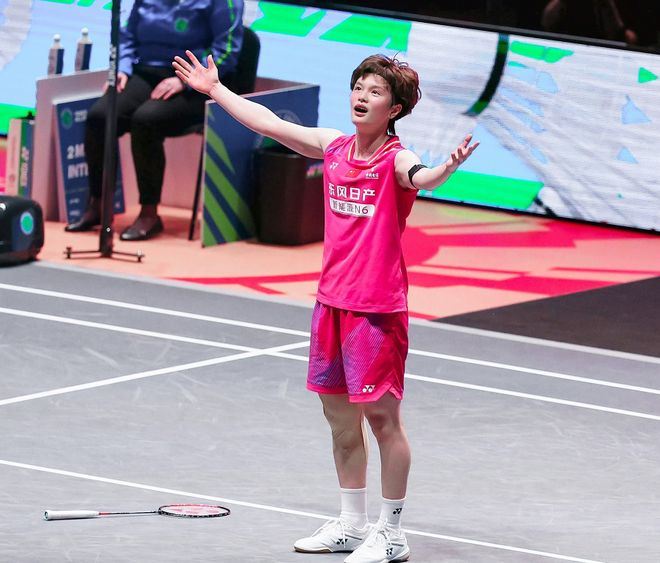

2026年日本羽毛球大师赛，在经历多日的激战之后，五大单项的决赛对阵已经全部出炉，国羽成功包揽混双冠亚军，除此之外，只有王祉怡一个人闯入到了女单决赛，最后一个比赛日的收官战，王祉怡迎战东道主山口茜，本场比赛两名选手打得非常激烈，不过关键时刻山口茜的发挥更胜一筹，最终以2-0击败王祉怡，问鼎女单冠军。

在现役的世界羽坛，韩国天才少女安洗莹已经成为了独一档的存在，而王祉怡和山口茜则是仅次于安洗莹的顶尖女单，本赛季王祉怡拿到了含金量十足的全英公开赛冠军，并且送给了安洗莹赛季唯一的一次失利，而山口茜则已经拿到了泰国公开赛、澳大利亚公开赛和中国公开赛三个冠军奖杯。

作为一对知根知底的老对手，王祉怡和山口茜在过往的世界大赛上，一共有过多达20次的正面交锋，战绩平分秋色都是10胜10负，不过最近的2次碰面，都是山口茜以2-0的大比分获得了胜利，这一次王祉怡能否在日本魔鬼客场复仇加冕，也就成为了这一场中日对决最大的看点。

王祉怡：2-0瑞秋·陈（加拿大）、2-0米娅（丹麦）、2-1奥原希望（日本）、2-0宫崎友花（日本）；

山口茜：2-0明地阳菜（日本）、2-1革通（泰国）、2-0郡司莉子（日本）、陈雨菲（中国）退赛。

在这一场冠军争夺战开打之后，两名选手进入状态都非常快，直接进入拉锯战，紧咬比分打到4平之后，王祉怡率先发力，通过压制山口茜的反手底线，连续创造出了网前突击的机会，很快建立起了7-4的优势，不过在日本一姐突然提速之后，王祉怡陷入被动，眼睁睁看着对手轰出一波流，以11-8反超比分，进入技术间歇。

重新回到赛场之后，山口茜在主场球迷的助威声中越战越勇，将领先的优势扩大到了14-9，尽管王祉怡没有放弃，一度将比分迫近到了13-15，但接下来失误频出，让山口茜笑纳大礼，以21-14取得开门红。

不能再输的王祉怡，第二局比赛加强了自己接发球后的突击直线，节奏的变化也打了山口茜一个措手不及，早早就确立起了9-4的领先，不过在形势一片大好的情况下，山口茜主动提速的打法，改变了比赛的走势，回敬一波得分小高潮后，不仅抹平了分差，还带着11-10的微弱领先，结束了前半局的争夺。

再次回到比赛场地之后，王祉怡利用自己最擅长的拉吊衔接突击打法，迅速追平了比分，并且一直和山口茜激战至20平，决胜时刻，打法更有侵略性的山口茜，靠着积极主动的劈杀，掌握住了主动权，以22-20锁定胜局。

随着这一场中日对决的落幕，王祉怡遭遇到了面对山口茜的交手三连败，日本一姐凭借主场之利，连续击败了国羽双保险陈雨菲和王祉怡，捧起了本届日本羽毛球大师赛的女单冠军。

特别声明：以上内容(如有图片或视频亦包括在内)为自媒体平台“网易号”用户上传并发布，本平台仅提供信息存储服务。

Notice: The content above (including the pictures and videos if any) is uploaded and posted by a user of NetEase Hao, which is a social media platform and only provides information storage services.

小兰看体育 2026-11-15 15:55:12

杨晨大神 2026-11-14 17:13:23

鹿鲨Sakana 2026-11-15 01:05:48

心也简单 2026-11-15 18:28:39

刘姚尧的文字城堡 2026-11-15 07:46:39

情如伊人b 2026-11-15 15:24:54

钉钉陌上花开 2026-11-15 10:57:31

迎男而上 2026-11-15 17:22:39

正在输入幸福 2026-11-14 02:48:31

迎男而上 2026-11-12 00:50:18

好奇韩大爷 2026-11-13 22:06:11

心也简单 2026-11-12 11:38:28

幽默小火山 2026-11-14 10:47:03

迎男而上 2026-11-15 17:25:26

心也简单 2026-11-12 01:59:43

两面包夹芋头 2026-11-15 03:55:19

迎男而上 2026-11-12 00:46:22

冷萧華 2026-11-11 09:09:02

重庆城市TV 2026-11-15 16:22:18

迎男而上 2026-11-12 00:43:50

心也简单 2026-11-15 18:31:30

三十六贱笑 2026-11-13 13:41:20

迎男而上 2026-11-15 17:24:02

迎男而上 2026-11-15 17:28:10

羽球小月亮 2026-11-14 21:35:24

小兔子的快乐 2026-11-14 01:54:32

心也简单 2026-11-15 18:32:53

孤城落日 2026-11-15 14:07:32

浣溪爱球 2026-11-14 14:19:57

天天瑜伽课 2026-11-15 13:44:30

咪咕体育 2026-11-14 12:20:58

趣笑小行星 2026-11-12 14:25:56

小辉体育 2026-11-15 18:04:56

扬子晚报 2026-11-11 07:52:23

匠心体育 2026-11-14 13:08:23

杨哥乒乓 2026-11-15 18:06:06

麦芽看世界 2026-11-14 00:58:55

麦芽看世界 2026-11-13 00:49:38

糖炒小栗子 2026-11-15 03:23:40

北青网-北京青年报 2026-11-12 21:26:04

## 配图

图：羽毛球（网易体育 · 2026-11-15）

## 来源

- [网易体育 · 原文](https://www.163.com/dy/article/LBPNASIN0549753N.html)
