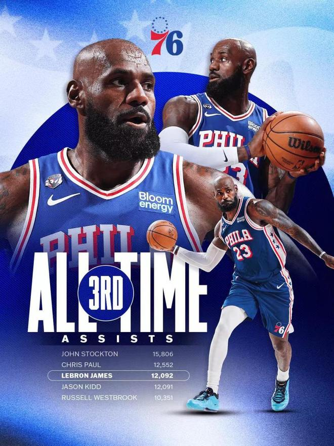

北京时间11月16日，NBA常规赛76人主场对阵步行者，恩比德轮休缺席，詹姆斯迎来复出。76人在一度落后9分情况下，詹姆斯、布朗与马克西三巨头给力表现，率队持续反扑末节开局扩大15分优势。詹姆斯率队挡住步行者的顽强追分，最终76人131-124双杀步行者收获2连胜，步行者结束2连胜。詹姆斯生涯助攻数12092次超越基德，升至NBA历史第三位迎来里程碑。

76人：詹姆斯15分6板11助、布朗31分、马克西27分4板6助、韦德12分7板3助2帽、西蒙斯12分、沃克11分7板、埃奇库姆11分4板6助、波普9分5板。

步行者：西亚卡姆31分2板2助、乌布雷16分4板2助、昆顿·杰克逊15分6板8助、麦康奈尔12分5板5助、内史密斯12分5板4助、赫夫11分2助、祖巴茨8分5板2助。

詹姆斯贡献15+6+11的全能数据，生涯助攻数提升到12092次助攻，超越基德升至NBA历史助攻榜第三。

NBA历史助攻榜前三：

1. 斯托克顿 15806次

2. 保罗 12552次

3. 詹姆斯 12092次

恩比德轮休缺席，詹姆斯休战一场后复出，76人还缺少巴洛与博纳，步行者缺少哈利伯顿、谢泼德。

76人前13场10胜3负，步行者前13场5胜8负，本赛季首次交锋76人客场114-109险胜步行者。本场首节前4分钟，双方交替领先缠斗至76人10-9领先，双方之后继续缠斗至76人15-14。詹姆斯攻传结合维持22-19领先优势，南斯连续得分引领步行者一波9-0攻势反超，76人持续反扑追分，首节比赛结束76人29-35落后步行者。

次节比赛，双方第二节均是单节不足30分，76人率先追到37-37，步行者一波8-0攻势取得领先。76人随后持续被压制以42-51落后，布朗接连得分追分，詹姆斯不断送出助攻，76人成功打出一波16-6攻势反超比分，76人单节29-22净胜7分，上半场比赛结束76人成功以58-57反超步行者。

中场休息回来，双方第三节进攻火力升级均是单节轰下30+得分展开对攻，76人在前4分钟维持73-71领先优势。詹姆斯连续得分率队逐步扩大82-73领先优势，步行者反扑追到仅差4分，马克西也站出来连续得分扩大两位数领先优势。76人单节39-30净胜9分，前三节比赛结束76人扩大97-87领先步行者。

进入第四节比赛，双方连续两节单节得分30+对攻，76人连得5分扩大15分优势，并在之后维持107-93领先优势。西亚卡姆引领步行者持续反扑缩小差距，詹姆斯助攻数超越基德升至NBA历史助攻榜第三位。76人挡住步行者的顽强追分，最终76人131-124险胜步行者。

76人：布朗、詹姆斯、沃克、埃奇库姆、马克西

步行者：乌布雷、西亚卡姆、内史密斯、祖巴茨、杰克逊

特别声明：以上内容(如有图片或视频亦包括在内)为自媒体平台“网易号”用户上传并发布，本平台仅提供信息存储服务。

Notice: The content above (including the pictures and videos if any) is uploaded and posted by a user of NetEase Hao, which is a social media platform and only provides information storage services.

钉钉陌上花开 2026-11-16 04:31:43

老梁体育漫谈 2026-11-16 04:33:43

鱼崖大话篮球 2026-11-16 05:21:26

小路看球 2026-11-16 05:00:08

远梦归晓r 2026-11-16 05:02:06

篮视角 2026-11-15 01:49:47

元气满分吖 2026-11-16 06:26:48

好火子 2026-11-16 05:39:48

有书 2026-11-16 06:15:37

罗吹终结者 2026-11-15 13:46:37

有书 2026-11-16 06:23:37

为了更好 2026-11-15 14:23:44

正经球迷 2026-11-13 13:03:09

罗吹终结者 2026-11-14 16:39:51

仅仅解说 2026-11-14 00:34:11

艾辰体娱 2026-11-14 13:45:37

甜度百分百21 2026-11-16 05:18:32

泄气得爱 2026-11-15 18:01:25

云雨生烟l 2026-11-14 01:46:31

灵感匣子 2026-11-16 01:28:30

篮球过人技巧 2026-11-14 17:40:04

奇聞空间 2026-11-14 11:14:16

董老师看竞技 2026-11-16 05:51:11

尺素a 2026-11-16 03:38:46

看球图一乐 2026-11-15 11:39:11

泄气得爱 2026-11-16 03:10:36

听风喃 2026-11-15 16:42:10

无人倾听无人倾听 2026-11-16 04:19:24

老杨体评 2026-11-14 14:34:44

随遇而安之心 2026-11-15 18:19:30

黑曼巴谈球 2026-11-15 09:23:40

此去经年y 2026-11-15 01:54:00

创造精彩剧情 2026-11-15 18:37:20

梦屿千寻u 2026-11-15 03:45:36

咪咕体育 2026-11-14 12:19:19

正经球迷 2026-11-15 10:07:43

好火子 2026-11-16 05:38:47

咪咕体育 2026-11-14 12:20:49

一袭纸鸢w 2026-11-14 04:19:43

正经球迷 2026-11-15 20:35:00

## 配图

图：篮球（网易体育 · 2026-11-16）

## 来源

- [网易体育 · 原文](https://www.163.com/dy/article/LBRAJB000529RKNN.html)
