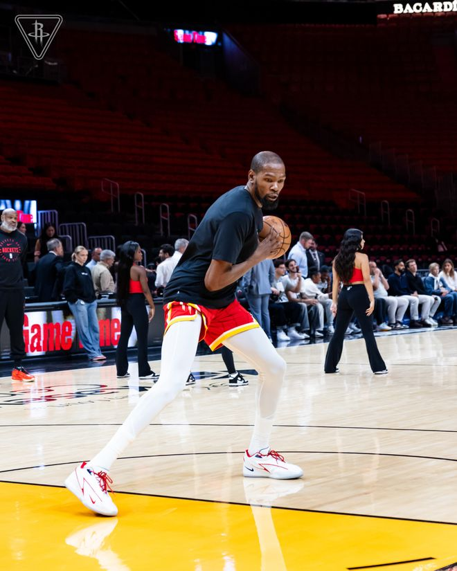

北京时间11月17日，NBA常规赛继续进行，休斯敦火箭队（11胜4负）连胜被终结。字母哥得到20分、13个篮板和6次助攻，米切尔送出两双，他们带领球队8人得分上双，迈阿密热火队（8胜6负）逐渐确立优势，他们在主场以128-110大胜火箭队。热火队拿到5连胜，火箭队结束4连胜。

热火队的字母哥得到20分、13个篮板和6次助攻，汤普森得到17分，维金斯得到17分和5个篮板，米切尔得到16分和10次助攻，波蒂斯得到16分和6个篮板，康维尔得到14分，加德纳得到14分和3次助攻，冯特奇奥得到10分和6个篮板。火箭队的申京得到23分和7个篮板，杜兰特得到22分和3次助攻，史密斯得到12分和10个篮板，克劳福德得到11分和10个篮板，范弗利特得到8分、5个篮板和6次助攻。

火箭队的范弗利特复出回到首发，阿门-汤普森因为左膝酸痛缺席。热火队在主场迅速找到手感，汤普森和加德纳轮流命中三分，热火队以12-2领先。史密斯和杜兰特各拿3分，火箭队连追8分迫近。热火队外线保持准星，汤普森和康维尔各中三分，他们合取9分，双方差距拉开到11分。之后两队各打成几次进攻，波蒂斯底角投中三分，首节结束时热火队以29-15领先。

谢泼德底角命中三分，他率队连得7分开始第二节，火箭队只落后7分。维金斯找到准星，连中两记三分，热火队以35-22领先。接下来的比赛双方交替得分，杜兰特中投得分，半场前3分30秒时火箭队以35-48落后。热火队外线保持准星，维金斯和汤普森轮流投中三分，热火队领先19分。杜兰特回应三分，字母哥进攻发力独取4分，场上分差拉开到20分。杜兰特罚球命中，申京突破打3分，半场结束时热火队以62-46领先。

热火队的康维尔上半场得到12分，汤普森得到11分，字母哥得到6分和9个篮板；火箭队的杜兰特得到15分，申京得到12分和5个篮板，史密斯得到9分和8个篮板。

第三节开始后申京连拿6分，范弗利特也命中三分，火箭队很快把差距缩小到9分。汤普森三分回应，火箭队延续反扑攻势，博格达诺维奇和申京轮流投中三分，本节进行了4分30秒时他们以63-73落后。热火队外线不甘示弱，加德纳和汤普森各进三分，他们引领一轮12-2的攻击波，这帮助热火队把优势拉回到19分。伊森连投带罚追回5分，加德纳再进三分，字母哥上篮得手，热火队连得7分又扩大优势。杜兰特进攻发力独取7分，波蒂斯回应三分你，米切尔扣篮得手，三节结束时热火队以101-81领先20分。

伊森突破扣篮揭开第四节大幕，维金斯和米切尔联手5分，热火队领先22分。火箭队追回4分，米切尔三分回应，维金斯、波蒂斯也轮流得分，第四节还有7分35秒时热火队以113-88领先。大比分落后的火箭队尽遣替补，他们一度把差距缩小到17分，但冯特奇奥和波蒂斯率队连拿9分，热火队把优势拉开到26分。最后时段双方用替补打完，热火队以128-110获胜。

火箭队首发阵容：范弗利特、杜兰特、伊森、史密斯、申京

热火队首发阵容：米切尔、加德纳、汤普森、阿德托昆博、阿德巴约

特别声明：以上内容(如有图片或视频亦包括在内)为自媒体平台“网易号”用户上传并发布，本平台仅提供信息存储服务。

Notice: The content above (including the pictures and videos if any) is uploaded and posted by a user of NetEase Hao, which is a social media platform and only provides information storage services.

鱼崖大话篮球 2026-11-17 18:04:01

锅子篮球 2026-11-17 14:51:43

鱼崖大话篮球 2026-11-17 14:58:23

体育闲话说 2026-11-17 18:29:49

乐享人生风雨 2026-11-15 00:22:16

球毛鬼胎 2026-11-17 18:41:43

落雪听梅a 2026-11-16 15:24:29

一纸情书s 2026-11-17 04:14:48

董老师看竞技 2026-11-15 14:28:13

梦仙境aa 2026-11-16 20:31:36

球毛鬼胎 2026-11-17 18:49:30

董老师看竞技 2026-11-17 17:23:51

篮球扫地僧 2026-11-17 18:41:12

酒话醉人 2026-11-15 11:43:25

创造精彩剧情 2026-11-17 02:32:21

老汆古装影视解说 2026-11-17 00:54:11

董老师看竞技 2026-11-17 13:10:25

酒话醉人 2026-11-16 04:13:08

痞子时代 2026-11-17 01:39:05

翻车选手小李 2026-11-15 03:18:47

大眼睛看看 2026-11-15 20:27:49

李广专业体育评论 2026-11-17 11:09:39

简单清风 2026-11-17 00:31:44

精彩一网打尽 2026-11-17 18:29:03

凉城若梦h 2026-11-17 05:57:32

黑曼巴谈球 2026-11-17 18:37:45

小区显眼包小周 2026-11-17 00:31:15

番茄肚腩 2026-11-17 13:03:41

十三哥侃大山 2026-11-17 00:30:15

精彩一网打尽 2026-11-17 18:30:21

体坛速报局 2026-11-17 09:21:39

紧跟时代脉搏 2026-11-15 20:29:46

ChinaRain刘晓健 2026-11-14 21:27:40

看球图一乐 2026-11-15 11:39:11

马三看世界 2026-11-17 07:33:14

体坛速报局 2026-11-17 12:38:21

咪咕体育 2026-11-16 21:33:36

咪咕体育 2026-11-16 21:36:19

咪咕体育 2026-11-16 21:36:04

紧跟时代脉搏 2026-11-16 02:39:39

## 配图

图：篮球（网易体育 · 2026-11-17）

## 来源

- [网易体育 · 原文](https://www.163.com/dy/article/LBU7GVVQ0529AL9S.html)
