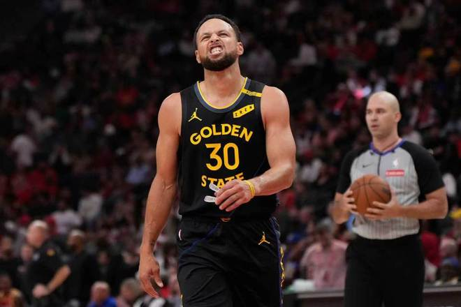

北京时间11月12日，NBA常规赛火箭主场对阵勇士，库里仅出场5分35秒因为右侧腹部酸痛提前退赛，火箭首节领先勇士15分优势，伦德博格率领勇士持续反扑前三节追到差6分，斯马特二级恶意犯规被驱逐。末节火箭攻防压制勇士逐步扩大两位数领先优势，最终火箭115-108战胜勇士收获2连胜，勇士结束8连胜。

火箭：杜兰特20分4篮板5助攻，申京19分13篮板9助攻，史密斯14分8篮板3盖帽，阿门19分7篮板4助攻2盖帽，范弗利特4记三分18分6助攻，谢泼德13分。

勇士：库里仅3分伤退，波杰姆斯基22分6篮板4助攻，伦德博格25分10篮板，梅尔顿11分4篮板4助攻，追梦格林7分5篮板7助攻。

杜兰特生涯运动战进球超越奥尼尔，升至NBA历史第七迎来里程碑，现役第二仅输詹姆斯。

两队前11场均是8胜3负，本场火箭缺少亚当斯与卡佩拉，勇士缺少巴特勒、穆迪、佩顿、波尔津吉斯。首节开局双方维持5-5，火箭内外开花一波7-0攻势取得领先，追梦上篮得分，火箭连得5分扩大17-7领先优势。火箭之后继续压制勇士维持21-11领先优势，库里因为右侧腹部酸痛提前退赛，伦德博格三分开火率队追到差7分。火箭一波7-0攻势扩大30-16领先，火箭继续压制勇士扩大优势，首节结束火箭35-20领先勇士。首节杜兰特11分与申京9分，库里仅3分伤退。

次节比赛，勇士进攻火力提升本场首次单节得分30+，伦德博格持续得分，引领勇士一波14-4攻势追到差5分。火箭连得5分扩大10分优势，勇士内外开花一波15-5攻势追到49-49，火箭回敬一波7-2攻势重新取得领先。火箭单节21-31输掉10分，上半场结束火箭被追到56-51领先勇士。前两节比赛，勇士三分26中9，伦德博格18+8与波杰姆斯基9分；火箭三分16中6，杜兰特15分与申京15+7+4。

中场休息回来，双方第三节均是单节不足30分，阿门得分率领火箭扩大62-53领先优势。勇士一波12-5攻势追到差2分，阿门连续得分扩大75-67领先优势，理查德三分命中。杜兰特也得分率队扩大10分优势，勇士继续反扑追分，斯马特与贝西发生冲突，斯马特挥拳二级恶意犯规被驱逐。阿门单节7中7轰下15分，火箭单节29-28净胜1分，三节结束火箭85-79领先勇士。前三节比赛，勇士三分36中13，伦德博格25+10与波杰姆斯基16+5+4；火箭三分26中7，杜兰特18+4+4与申京17+9+6，引领4人得分上双。

进入第四节比赛，勇士率先一波6-3攻势追到差3分，谢泼德连中三分引领8-0攻势扩大11分优势。勇士回敬一波6-0攻势追分，火箭借助团队攻势打出一波15-2攻势，还剩3分31秒火箭扩大111-93领先18分优势打停勇士。勇士撤下主力提前认输，火箭之后也是换上替补阵容，比赛提前进入垃圾时间，最终火箭大胜终结勇士8连胜。

火箭：杜兰特、史密斯、申京、阿门、范弗利特

勇士：库里、波杰姆斯基、霍福德、伦德博格、追梦格林

特别声明：以上内容(如有图片或视频亦包括在内)为自媒体平台“网易号”用户上传并发布，本平台仅提供信息存储服务。

Notice: The content above (including the pictures and videos if any) is uploaded and posted by a user of NetEase Hao, which is a social media platform and only provides information storage services.

知趣神秘人 2026-11-12 12:58:47

阿友田侃故事 2026-11-12 13:39:11

各地精彩不容错过 2026-11-12 05:24:59

鱼崖大话篮球 2026-11-12 17:51:40

锅子篮球 2026-11-12 14:53:36

主宰稳场 2026-11-12 00:14:57

司峰阿道 2026-11-10 15:35:35

紧跟时代脉搏 2026-11-11 03:49:20

大卫的篮球故事 2026-11-12 18:08:08

田先生篮球 2026-11-12 14:52:30

董老师看竞技 2026-11-10 14:13:29

小轲搞笑解说 2026-11-11 00:57:42

落雪听梅a 2026-11-11 01:17:54

董老师看竞技 2026-11-10 15:54:00

潘有辉骑行11周年 2026-11-11 00:56:51

篮球扫地僧 2026-11-12 19:09:05

体坛周报 2026-11-10 00:30:11

董老师看竞技 2026-11-10 15:53:48

聚焦事件 2026-11-12 04:19:00

福娃谈体育 2026-11-10 20:28:12

一纸情书s 2026-11-11 06:04:17

梦仙境aa 2026-11-11 19:08:52

郭夷包工头 2026-11-12 13:50:44

篮球过人技巧 2026-11-11 16:34:11

阿薎美食 2026-11-11 15:35:46

董老师看竞技 2026-11-10 13:52:34

凉了时光人 2026-11-12 01:38:24

李广专业体育评论 2026-11-12 13:31:09

人间闲散客 2026-11-12 02:44:12

心灵的触动a 2026-11-12 00:31:32

人间闲散客 2026-11-11 00:47:22

主宰稳场 2026-11-11 00:11:47

酒话醉人 2026-11-11 04:28:03

郭夷包工头 2026-11-11 09:45:24

伊雪绫纱e 2026-11-12 01:46:30

环球体坛啄木鸟 2026-11-11 11:43:14

福娃谈体育 2026-11-10 22:13:41

大卫的篮球故事 2026-11-12 18:35:44

小桥流水q 2026-11-11 09:23:19

无人倾听无人倾听 2026-11-12 04:40:16

## 配图

图：篮球（网易体育 · 2026-11-12）

## 来源

- [网易体育 · 原文](https://www.163.com/dy/article/LBHMS0IB0529RKNN.html)
