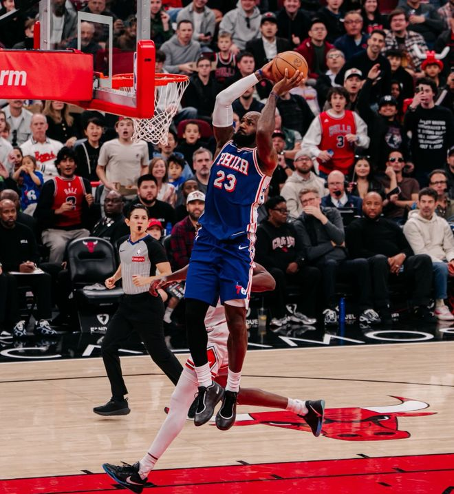

勒布朗詹姆斯上一场比赛重返故地表现不佳，再加上大帝恩比德梦游，导致费城76人不敌克利夫兰骑士，停下了连胜的脚步，这一个比赛日，76人远征芝加哥联合中心，客场挑战公牛，本场比赛詹姆斯和恩比德重新找回了状态，尤其是詹皇攻防两端完爆公牛新秀威尔逊，最终率领76人以127-121客场凯旋。

芝加哥公牛今夏在选秀大会上，得到了天赋满满的四号秀威尔逊，后者在自己的处子赛季就展现出了堪比加内特的全面性，前八场比赛场均能够贡献19.5分6.5板2.4助1.9断1.1帽的全面个人数据，无奈球队整体实力不济，仅仅取得了1胜7负的战绩，在东部积分榜上倒数。

在这一场和费城76人的对决开打之前，公牛已经遭遇到了六连败，而且在赛季首回合和76人的对决中，公牛也以19分的劣势，在费城吞下了失利的苦果，如今回到自己的主场，能否爆冷掀翻东部第一完成复仇，也就成为了球迷最为关心的话题。

比赛开打之后，詹皇和大帝展现出了和上一场面对骑士完全不同的竞技状态，加盟费城后更多扮演组织者角色的勒布朗詹姆斯，前两节直接开启了进攻模式，11中6砍下了全队最高的16分，恩比德也交出了12分6板的数据，再加上早早得分上双的杰伦布朗和马克西，76人如愿带着68-61的比分，回到了中场更衣室。

再次回到赛场之后，阅读比赛能力顶尖的詹姆斯，并没有选择顶着公牛的防守强攻，开始更多吸引夹击后，给队友创造得分的空间，不过只要出现机会，詹皇也不会手软，末节中路强突隔扣史密斯造犯规的一幕，更是让球迷感慨老夫聊发少年狂，四节战罢，詹姆斯也凭借16投8中的发挥，贡献了22分、5个篮板和5次助攻。

除了在进攻端的稳定发挥之外，詹姆斯防守表现也可圈可点，公牛首发的新秀威尔逊，虽然全场比赛砍下了18分，但是在詹皇的重点照顾下，得分效率不高，只有18次出手命中7球的发挥，再加上其他队友不给力，公牛只能接受主场输球的结局。

作为如今费城第一得分点的马克西，此役得分组织一肩挑，打出了27+4+7的全能表现，而杰伦布朗则砍下了全队最高的29分，恩比德中规中矩交出了18分、10个篮板、5次助攻和5次抢断，埃奇库姆在场上也是兢兢业业，攻防两端都做出了巨大的贡献，为球队攻克芝加哥，立下了汗马功劳。

76人：布朗29分7板4助、马克西27分4板7助、詹姆斯22分5板5助、恩比德18分10板5助2断、埃奇库姆13分6板3助3断、沃克9分11板、波普6分6板3助2帽、西蒙斯3分4板2助、迪恩·韦德1板1助

公牛：吉迪19分7板15助、布泽利斯19分5板2助、威尔逊18分5板2断、史密斯17分8板2助4帽、奥科罗12分2板1助、埃桑格10分7板1助、霍金斯9分1助、威廉姆斯7分3板3助、特雷·琼斯6分1板1助、克拉克斯顿4分4板4助2帽

特别声明：以上内容(如有图片或视频亦包括在内)为自媒体平台“网易号”用户上传并发布，本平台仅提供信息存储服务。

Notice: The content above (including the pictures and videos if any) is uploaded and posted by a user of NetEase Hao, which is a social media platform and only provides information storage services.

马健 2026-11-08 09:12:12

农城浪子 2026-11-08 21:11:55

正经球迷 2026-11-07 15:05:06

拥抱抵不过时光 2026-11-08 03:46:35

体坛速报局 2026-11-07 11:38:51

披挂风尘 2026-11-08 05:29:22

此去经年q 2026-11-07 13:01:10

千山暮雪h 2026-11-06 08:20:42

正经球迷 2026-11-06 09:32:46

紧跟时代脉搏 2026-11-07 04:04:32

爱顺的球 2026-11-07 16:27:08

看球图一乐 2026-11-07 13:26:10

看球图一乐 2026-11-07 11:33:51

董老师看竞技 2026-11-07 10:13:26

最佳菜鸟 2026-11-06 12:50:19

看球图一乐 2026-11-07 12:04:52

情如伊人b 2026-11-07 14:39:55

听风喃 2026-11-07 00:17:55

主宰稳场 2026-11-05 00:16:54

左脚爆射得分 2026-11-06 11:44:12

司峰阿道 2026-11-07 12:31:01

翻车选手小李 2026-11-07 01:48:09

听风喃 2026-11-09 00:18:55

oo烛光透影 2026-11-07 03:12:56

DoubleZero 2026-11-08 10:44:42

一点儿雨心 2026-11-07 11:11:20

人间闲散客 2026-11-07 02:25:30

听风喃 2026-11-08 00:21:19

董老师看竞技 2026-11-07 13:46:19

锁上的光v 2026-11-06 07:15:23

慕名而来只为你 2026-11-08 02:47:32

落雪听梅a 2026-11-08 01:21:52

随遇而安之心 2026-11-09 03:47:31

隐龙天下o 2026-11-09 05:19:15

孤城落日 2026-11-07 16:07:13

微雨花间h 2026-11-07 09:32:45

脑洞编剧小剧场 2026-11-09 02:32:45

随遇而安之心 2026-11-09 03:50:26

趣小亮 2026-11-05 11:35:19

酒话醉人 2026-11-08 05:08:08

## 配图

图：篮球（网易体育 · 2026-11-09）

## 来源

- [网易体育 · 原文](https://www.163.com/dy/article/LB9A22BD0549753N.html)
