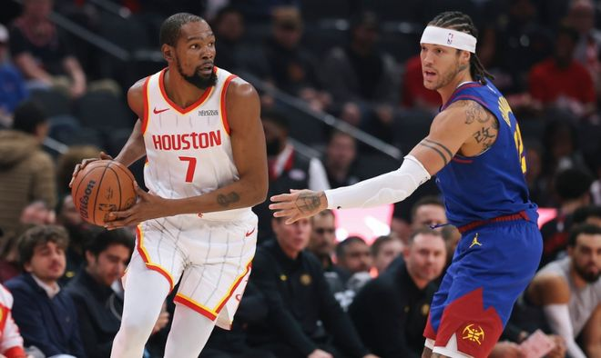

北京时间11月10日，NBA常规赛火箭主场对阵掘金，杜兰特全能表现引领火箭逐步扩大19分领先优势。掘金顽强反扑在下半场开局追平比分，火箭随后重新扩大两位数领先优势，最终火箭110-100战胜掘金结束2连败，掘金结束2连胜。

火箭：杜兰特23分12板8助、申京20分12板8助、小史密斯14分7板3助、伊森12分5板2助2断、范弗里特12分1板2助、阿门8分9板3助。

掘金：穆雷38分2板2助2帽、约基奇25分16板9助2帽、约翰逊8分2板1助2断、德罗赞7分4板2助。

火箭前10场7胜3负，掘金前8场5胜3负。本场火箭缺少亚当斯与卡佩拉，掘金缺少斯特劳瑟。首节开局火箭7-4领先，约基奇攻传结合引领一波9-4攻势反超2分，申京与范弗利特各中一记三分。穆雷三分命中，杜兰特攻传结合率队扩大24-18领先优势，掘金连追4分，火箭一波8-2攻势拉开比分，其中伊森压哨三分命中，首节结束火箭32-24领先掘金。首节火箭23中13，其中三分11中6，杜兰特7中5得到11+5+3+3失误；掘金24中9，其中三分10中2，约基奇7中3得到6+2+4与穆雷7分。

次节比赛，双方进攻火力均是出现下滑，尤其是掘金被限制单节不足20分。火箭率先一波11-0攻势碾压，火箭已经扩大43-24领先19分优势，掘金略有反扑追分。火箭多点开花维持51-33领先优势，掘金连追5分，火箭继续巩固领先优势，火箭单节22-16净胜6分，上半场结束火箭54-40领先掘金。前两节比赛，掘金三分18中4，约基奇12+6+4与穆雷15分；火箭三分19中7，杜兰特13+6+5与伊森10分。

中场休息回来，双方连续两节均是单节不足30分，火箭率先扩大58-42领先优势。约基奇与穆雷双核给力表现，引领掘金一波18-2攻势追到60-60，杜兰特率火箭打出一波11-2攻势重新取得领先。掘金持续紧咬比分拉锯战缠斗，火箭单节23-28被追回5分，三节结束火箭77-68领先掘金。前三节比赛，掘金三分26中7，约基奇19+14+7与穆雷23分；火箭三分27中8，杜兰特21+8+8引领4人得分上双。

进入第四节比赛，火箭前5分钟维持91-83领先优势，掘金连追4分，范弗利特三分开火引领火箭连得5分。火箭继续内外开花得分，史密斯三分命中扩大103-92领先优势，掘金连追4分，范弗利特三分命中。约基奇与申京各得2分，杜兰特被犯规罚球扩大领先优势，掘金之后无力扭转局势，最终火箭战胜掘金结束2连败，掘金结束2连胜。

火箭：杜兰特、史密斯、申京、阿门、范弗利特

掘金：卡约、戈登、约基奇、布劳恩、穆雷

特别声明：以上内容(如有图片或视频亦包括在内)为自媒体平台“网易号”用户上传并发布，本平台仅提供信息存储服务。

Notice: The content above (including the pictures and videos if any) is uploaded and posted by a user of NetEase Hao, which is a social media platform and only provides information storage services.

法老不说教 2026-11-10 18:01:03

锅子篮球 2026-11-10 13:56:26

看尽人间百态 2026-11-10 18:59:18

董老师看竞技 2026-11-10 14:13:29

董老师看竞技 2026-11-08 12:06:43

听风喃 2026-11-09 00:26:00

董老师看竞技 2026-11-10 13:52:34

薛艳艳爱生活 2026-11-10 11:35:55

网文作者夏少斌 2026-11-08 18:24:55

董老师看竞技 2026-11-08 14:25:49

将死蝴蝶标本吻l 2026-11-08 01:10:17

创造精彩剧情 2026-11-09 03:26:19

宏傲易 2026-11-09 02:13:38

看球图一乐 2026-11-09 17:18:21

董老师看竞技 2026-11-10 15:53:54

体坛速报局 2026-11-09 11:14:53

马三看世界 2026-11-10 12:28:40

紧跟时代脉搏 2026-11-10 03:28:26

人间闲散客 2026-11-10 01:24:57

大话火箭队 2026-11-10 15:40:43

咪咕体育 2026-11-09 17:49:12

而长终 2026-11-10 14:06:54

咪咕体育 2026-11-09 17:49:07

咪咕体育 2026-11-09 17:47:50

萌萌乐翔事 2026-11-09 04:46:39

大话火箭队 2026-11-10 16:01:03

咪咕体育 2026-11-09 17:49:05

篮球大视野 2026-11-10 15:31:07

领略非凡 2026-11-07 20:21:40

各地精彩不容错过 2026-11-09 05:03:18

篮球盛世 2026-11-09 09:40:00

喜老登 2026-11-10 01:51:14

耀眼的星火 2026-11-10 02:14:21

乐享人生风雨 2026-11-10 00:53:09

凉了时光人 2026-11-09 11:05:12

无人倾听无人倾听 2026-11-10 04:52:12

正经球迷 2026-11-10 16:30:31

篮球扫地僧 2026-11-10 18:27:31

铭记人类辉煌 2026-11-09 02:25:23

董老师看竞技 2026-11-10 15:54:00

## 配图

图：篮球（网易体育 · 2026-11-10）

## 来源

- [网易体育 · 原文](https://www.163.com/dy/article/LBCDOLNJ0529RKNN.html)
