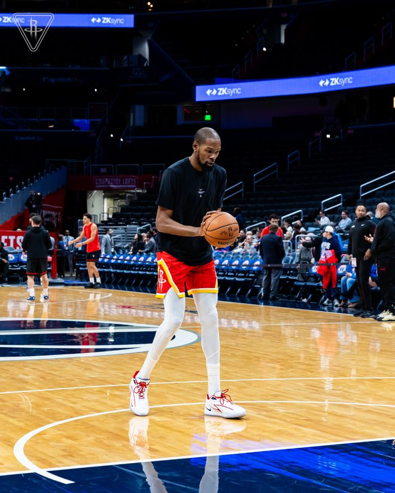

北京时间11月16日，NBA常规赛继续进行，休斯敦火箭队（11胜3负）继续连胜。汤普森得到26分、7个篮板和7次助攻，杜兰特和伊森各得到25分，他们率队前三节确立大比分优势，火箭队在客场以147-119轻取华盛顿奇才队（4胜10负）。火箭队拿到4连胜，奇才队遭遇7连败。

火箭队的汤普森得到26分、7个篮板和7次助攻，杜兰特得到25分、4个篮板和5次助攻，伊森得到25分和7个篮板，申京得到19分、8个篮板和8次助攻，博格达诺维奇得到12分和4次助攻，谢泼德得到11分和6次助攻，史密斯得到9分、6个篮板和5次助攻。奇才队的萨尔得到25分和9个篮板，迪班萨得到16分和7个篮板，戴维斯得到14分、8个篮板和5次助攻，乔治得到11分和4次助攻，莱利得到14分，卡林顿得到11分，吹杨5投0中，一分未得只有8次助攻。

火箭队的范弗利特缺席，亚当斯复出。开场后双方争夺激烈，领先权几次易主，米德尔顿三分命中，杜兰特中投回应，首节还有4分钟时两队以21平握手言和。卡林顿突破得手打破平局，谢泼德和伊森各中三分，火箭队连拿8分反超领先。奇才队不甘示弱，米德尔顿和库里巴利各中三分扳平，谢泼德又中三分，申京突破扣篮，首节结束时火箭队以36-31领先5分。

史密斯三分命中，他率队连得7分开始第二节，火箭队领先两位数。奇才队暂停后萨尔三分还击，汤普森外线找到准星，连中2个三分球，杜兰特也进攻发力，连投带罚拿下6分，半场前6分25秒时火箭队以57-40领先17分。乔治扣篮阻止差距拉大，两队之后各得几分，伊森底角投中三分率队又拿6分，火箭队在半场前2分25秒时以71-50领先21分。迪班萨和萨尔联手追回4分，伊森扣篮还以颜色，半场结束时火箭队以73-54领先。

火箭队的汤普森上半场得到19分、5个篮板和4次助攻，杜兰特得到16分，伊森得到10分和4个篮板；奇才队的萨尔得到15分和4个篮板，乔治得到9分，戴维斯7投1中只得到2分，吹杨0分5助攻。

第三节开始后不久汤普森连投带罚拿下4分，他率队连得8分，火箭队以88-58领先30分。戴维斯追回4分，杜兰特和申京联手5分继续扩大优势。曼恩和卡林顿分别投中三分缩小差距，谢泼德回应三分，伊森连投带罚得到4分，火箭队牢牢保持大比分领先。戴维斯和库里巴利追回4分，伊森连进两球，博格达诺维奇三分中的，火箭队以119-83领先。迪班萨连进两球，奇才队追回5分结束第三节，他们以88-119落后。

大比分领先的火箭队在第四节开始后尽遣替补，奇才队把迪班萨、萨尔两位高顺位选秀留在场上锻炼，迪班萨三分命中，萨尔两罚一中，第四节还有5分45秒时奇才队以102-132落后。之后的比赛没有悬念，火箭队以147-119获胜。

火箭队首发阵容：汤普森、杜兰特、史密斯、申京、亚当斯

奇才队首发阵容：杨、乔治、迪班萨、戴维斯、萨尔

特别声明：以上内容(如有图片或视频亦包括在内)为自媒体平台“网易号”用户上传并发布，本平台仅提供信息存储服务。

Notice: The content above (including the pictures and videos if any) is uploaded and posted by a user of NetEase Hao, which is a social media platform and only provides information storage services.

体育新角度 2026-11-16 16:52:36

宗介说体育 2026-11-16 14:22:40

落雪听梅a 2026-11-16 15:24:29

体育闲话说 2026-11-16 18:52:17

麦子的篮球故事 2026-11-16 18:51:20

看球图一乐 2026-11-14 16:05:02

乐享人生风雨 2026-11-15 00:22:16

董老师看竞技 2026-11-14 16:18:27

董老师看竞技 2026-11-16 17:43:22

翻车选手小李 2026-11-15 03:18:47

紧跟时代脉搏 2026-11-15 20:29:46

看球图一乐 2026-11-15 11:39:11

大话火箭队 2026-11-16 17:00:56

大话火箭队 2026-11-16 16:50:48

紧跟时代脉搏 2026-11-16 02:39:39

答案聊体育1 2026-11-16 18:22:37

一纸情书s 2026-11-16 03:44:21

大眼睛看看 2026-11-14 01:20:32

环球体坛啄木鸟 2026-11-16 17:16:05

咪咕体育 2026-11-14 12:19:19

梧桐听雨l 2026-11-16 02:24:40

春若秋水 2026-11-15 12:34:47

语妍视频剪辑 2026-11-14 20:07:11

锅子篮球 2026-11-16 18:09:04

仙液琼浆c 2026-11-14 02:00:34

一纸情书s 2026-11-16 03:42:58

烟斜雾横j 2026-11-16 05:11:53

董老师看竞技 2026-11-16 10:32:45

董老师看竞技 2026-11-16 17:23:24

舌尖探店官 2026-11-16 06:18:35

董老师看竞技 2026-11-14 15:54:55

大话火箭队 2026-11-14 18:18:24

一纸情书s 2026-11-16 17:03:04

看球图一乐 2026-11-14 12:42:31

篮球实战宝典 2026-11-16 17:55:39

一纸情书s 2026-11-16 17:25:49

一纸情书s 2026-11-16 17:24:34

体育新角度 2026-11-16 16:28:42

落雪听梅a 2026-11-16 15:23:00

诚跃纺织品2 2026-11-14 03:24:43

## 配图

图：篮球（网易体育 · 2026-11-16）

## 来源

- [网易体育 · 原文](https://www.163.com/dy/article/LBRHJ4890529AL9S.html)
