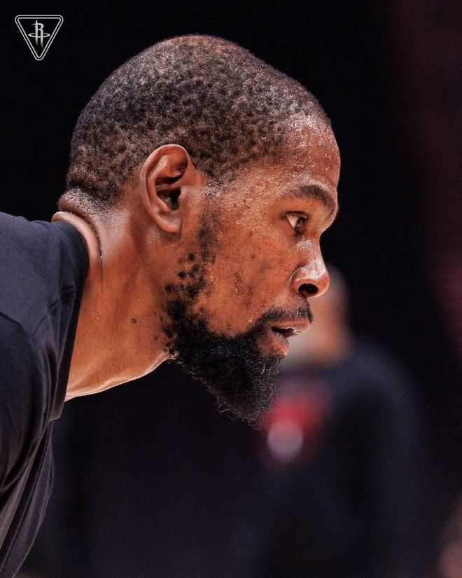

北京时间11月3日，NBA常规赛继续进行，休斯敦火箭队（7胜1负）拿到连胜。申京得到26分、7个篮板和10次助攻，史密斯得到14分和10个篮板，他们带领球队顶住对手冲击保持领先，火箭队在主场以109-93战胜波士顿凯尔特人队（5胜2负）。凯尔特人队结束5连胜。

火箭队的申京得到26分、7个篮板和10次助攻，史密斯得到14分和10个篮板，汤普森得到14分，伊森得到13分，杜兰特得到12分。凯尔特人队的塔图姆得到19分、6个篮板和9次助攻，奎塔得到16分和6个篮板，加扎得到14分，斯切尔曼得到11分和5个篮板。

凯尔特人队的乔治休战。火箭队在主场开局不错，杜兰特命中两球率队以9-4领先。塔图姆跳投还击，两队之后对攻几个回合，伊森替补出场表现不俗，连中两记三分球，首节还有2分55秒时火箭队以25-15领先10分。凯尔特人队暂停后塔图姆连拿4分，他率队回敬9-0的反击波，双方差距只剩下1分。申京篮下打进，加扎三分命中追平，斯马特两罚全中，塔图姆回应两罚，首节结束时双方以29平握手言和。

史密斯和申京轮流得分开启第二节，火箭队再次领跑。康利三分回应，火箭队保持进攻状态，史密斯再中三分，申京、汤普森也轮流得分，半场前5分钟时他们以42-35领先。罗宾逊空接扣篮，伊森再次开火又拿5分，特什维也上篮得手，火箭队领先11分。奎塔内线发力追回6分，杜兰特、汤普森和申京轮流得分保持领先。塔图姆弧顶投中三分，半场结束时凯尔特人队以50-57落后。

火箭队的申京上半场得到12分、4个篮板和4次助攻，汤普森得到12分，伊森得到11分；凯尔特人队的塔图姆得到11分、4个篮板和4次助攻，加扎得到9分。

第三节开始后不久斯切尔曼投中三分，他率队连追7分，凯尔特人队追至62-63。火箭队暂停后范弗利特跳投还击，史密斯也命中三分，这帮助球队稳住局面。塔图姆保持攻击性连拿4分把差距缩小到2分，申京突破得手好，史密斯三分中的，火箭队在第三节还有4分50秒时以75-68领先。双方之后各得几分，杜兰特右侧底线跳投命中，三节结束时火箭队以82-73领先9分。

怀特跳投命中开始第四节，斯马特迅速回应两记三分，谢泼德也锦上添花，一波13-3的小高潮让火箭队在第四节还有6分50秒时以97-79领先。怀特还击三分，谢泼德保持手感又中三分，申京也跳投命中，火箭队继续保持18分领先。凯尔特人队非常顽强，塔图姆率队连追5分，可惜之后塔图姆错失三分追分机会，汤普森切入扣篮得手，第四节还有2分25秒时火箭队以104-89领先。最后时刻凯尔特人队无力回天，他们以93-109落败。

凯尔特人队首发阵容：怀特、塔图姆、斯切尔曼、冈萨雷斯、奎塔

火箭队首发阵容：范弗利特、汤普森、杜兰特、史密斯、申京

特别声明：以上内容(如有图片或视频亦包括在内)为自媒体平台“网易号”用户上传并发布，本平台仅提供信息存储服务。

Notice: The content above (including the pictures and videos if any) is uploaded and posted by a user of NetEase Hao, which is a social media platform and only provides information storage services.

开着车去流浪 2026-11-03 17:59:35

为了更好 2026-11-02 03:25:15

一个体育黑 2026-11-03 18:01:05

下班疯玩小吴 2026-11-03 00:17:19

马健 2026-11-01 05:27:24

语妍视频剪辑 2026-11-01 12:54:17

嘴角上翘 2026-11-01 11:44:17

熊哥爱篮球 2026-11-03 19:12:56

大话火箭队 2026-11-03 17:56:12

为了更好 2026-11-02 03:31:39

显微镜下的人性 2026-11-01 06:51:25

随遇而安之心 2026-11-03 03:57:45

小叶子侃球FM 2026-11-03 02:14:06

创造精彩剧情 2026-11-01 11:49:22

吕谑极限手工 2026-11-03 17:17:51

看球图一乐 2026-11-03 13:14:57

单色黎明s 2026-11-03 02:06:20

尺素a 2026-10-31 04:51:54

紧跟时代脉搏 2026-11-02 02:35:07

篮球过人技巧 2026-11-03 17:48:54

印星娱事Star 2026-11-01 17:43:27

正经球迷 2026-11-03 19:17:46

飞驰论坛o 2026-11-02 02:47:02

咪咕体育 2026-11-02 13:52:38

你的雷达站 2026-11-01 18:10:28

阿嬍体育评论 2026-11-02 02:28:44

熊哥爱篮球 2026-11-03 18:45:22

夜里的海风 2026-11-01 13:02:13

熊哥爱篮球 2026-11-03 18:55:54

语妍视频剪辑 2026-11-03 15:51:49

宇宙观察 2026-11-02 03:31:15

语妍视频剪辑 2026-11-03 15:50:34

董老师看竞技 2026-11-01 14:30:04

后世的君子 2026-11-01 21:46:58

童言电影2025 2026-11-03 00:13:37

大话火箭队 2026-11-03 18:42:05

小郭聊球 2026-11-02 14:13:22

大眼睛看看 2026-11-03 02:28:22

语妍视频剪辑 2026-11-03 15:53:13

老汆古装影视解说 2026-11-02 01:29:30

## 配图

图：篮球（网易体育 · 2026-11-03）

## 来源

- [网易体育 · 原文](https://www.163.com/dy/article/LAQDE36G0529AL9S.html)
