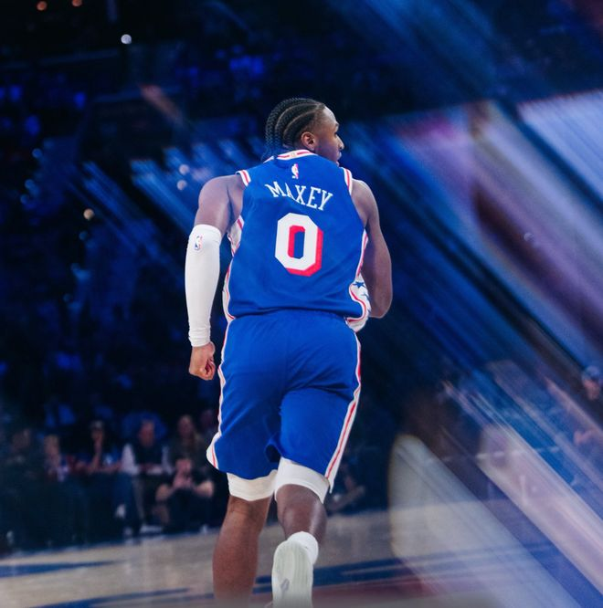

北京时间11月13日，NBA常规赛继续进行，费城76人队（10胜3负）重拾胜利。詹姆斯缺阵的情况下马克西得到27分，恩比德拿到20分，他们带领球队后三节发力逐渐确立优势，76人队在主场以123-112战胜多伦多猛龙队（5胜7负）。猛龙队遭遇3连败。

76人队的马克西得到27分和8次助攻，恩比德得到20分和4个篮板，布朗得到18分和6个篮板，西蒙斯得到17分，埃奇库姆得到15分、8个篮板和8次助攻，波普得到11分。猛龙队的巴雷特得到31分、14个篮板和5次助攻，奎克利得到26分、4个篮板和6次助攻，博伊斯得到14分和4次助攻，巴通得到13分，珀尔特尔得到9分和5个篮板。

76人队的勒布朗因伤缺席，韦德顶替首发。开场的4平后马克西三分中的帮助76人队领跑，可猛龙队很快还击，奎克利打4分成功，沃尔特三分命中，他们引领一轮12-0的攻击波，首节进行了5分钟时猛龙队以19-9领先。埃奇库姆连进两球，他和马克西联手7分止血，巴雷特手感来了连进2个三分球，连拿8分率队打出14-0的攻击波，猛龙队把优势拉开到17分。恩比德打3分阻止差距拉大，西蒙斯三分中的，76人队连追8分结束首节，他们以24-33落后9分。

西蒙斯的手感在第二节延续，又中三分率队打出11-1的反击波，本节进行了3分钟后76人队以35-34反超1分。巴雷特跳投还击，之后两队展开对攻，比分交替增加，领先权多次易主，布朗和沃克轮流得分，半场前34秒时76人队以60-57领先。巴雷特翼侧回敬三分，60平，半场结束时双方握手言和。

76人队的马克西上半场得到14分，布朗得到12分，埃奇库姆得到10分4个篮板和5次助攻；猛龙队的奎克利得到15分和4个篮板，巴雷特得到13分、4个篮板和4次助攻。

第三节开始后双方继续拉锯战，比分紧紧咬住，恩比德和马克西突然发力各拿4分，他们引领球队打出10-2的攻击波，76人队以76-71领先。巴雷特回应3分，恩比德连造犯规罚球命中守住领先，猛龙队又追5分扳为81平，85平后马克西独得4分，西蒙斯再中三分，他们带领球队打出11-2的攻击波结束第三节，76人队以96-87领先。

沃克独得5分开始第四节，76人队把优势拉开到13分。奎克利追回4分，布朗、埃奇库姆轮流得分还击保持领先。巴雷特突破得手，巴通三分命中，猛龙队努力将差距缩小到6分，西蒙斯又站出来回敬三分，恩比德也中投得手，第四节还有3分10秒时76人队以116-105领先。奎克利回应三分紧咬比分，波普命中三分，恩比德中投得手，76人队以123-108领先。猛龙队之后无力回天，他们以112-123落败。

猛龙队首发阵容：奎克利、沃尔特、巴雷特、博伊斯、珀尔特尔

76人队首发阵容：马克西、埃奇库姆、布朗、韦德、恩比德

特别声明：以上内容(如有图片或视频亦包括在内)为自媒体平台“网易号”用户上传并发布，本平台仅提供信息存储服务。

Notice: The content above (including the pictures and videos if any) is uploaded and posted by a user of NetEase Hao, which is a social media platform and only provides information storage services.

咪咕体育 2026-11-12 03:08:22

难寄期许w 2026-11-13 04:37:38

正经球迷 2026-11-13 13:03:09

23号球魁 2026-11-12 19:01:41

上班摸鱼一级选手 2026-11-12 02:46:18

第X个想法 2026-11-12 11:42:44

篮球扫地僧 2026-11-13 16:03:53

咪咕体育 2026-11-12 03:08:24

战甲观测者 2026-11-13 13:48:39

初心不负y 2026-11-13 11:37:38

体育闲话说 2026-11-13 15:41:39

马健 2026-11-13 03:31:33

语妍视频剪辑 2026-11-13 12:06:17

泄气得爱 2026-11-12 03:59:31

篮球圈里的那些事 2026-11-13 18:24:28

老汆古装影视解说 2026-11-12 00:17:39

南风入弦y 2026-11-13 11:34:06

主宰稳场 2026-11-11 00:07:41

寝室显眼包大队长 2026-11-12 02:44:16

荒野老五 2026-11-12 00:58:51

小徐妹 2026-11-13 11:47:06

看球图一乐 2026-11-11 17:02:41

篮球过人技巧 2026-11-11 18:32:53

看球图一乐 2026-11-12 17:14:45

禾三千体育 2026-11-13 18:19:12

罗吹终结者 2026-11-10 21:47:39

搞笑协会鸭 2026-11-09 13:56:55

篮球过人技巧 2026-11-11 15:07:57

尺素a 2026-11-12 04:19:23

一纸情书s 2026-11-11 06:04:17

久愛不變s 2026-11-13 05:51:44

心在跳动n 2026-11-12 03:26:32

23号球魁 2026-11-10 23:53:42

罗吹终结者 2026-11-12 11:10:45

篮球过人技巧 2026-11-11 14:13:02

看球图一乐 2026-11-13 16:52:55

暮雨咋歇着 2026-11-11 00:59:58

麦子的篮球故事 2026-11-13 14:20:08

观测者改变星光h 2026-11-12 02:09:04

你是我的小甜甜 2026-11-13 00:50:16

## 配图

图：篮球（网易体育 · 2026-11-13）

## 来源

- [网易体育 · 原文](https://www.163.com/dy/article/LBJU65GL0529AL9S.html)
