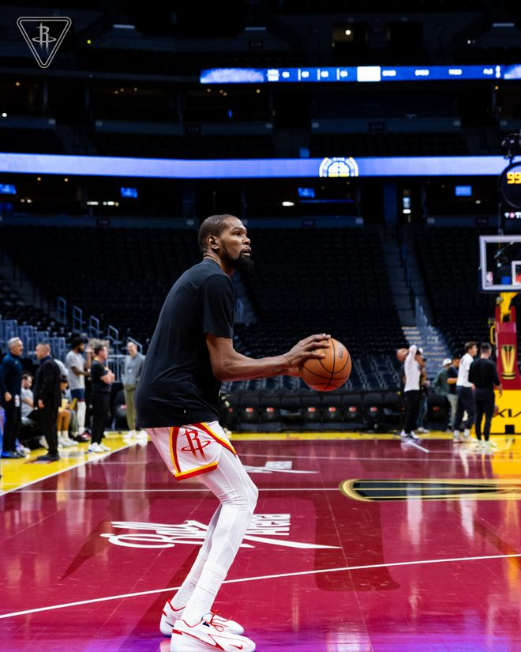

北京时间11月21日，NBA杯继续进行，休斯顿火箭队（12胜5负）无缘连胜。虽然申京复出送出三双，但约基奇得到26分、7个篮板和11次助攻，他带领球队7人得分上双，丹佛掘金队（9胜5负）第四节打出攻势拉开比分确立胜局，他们在主场以133-124战胜火箭队。掘金队拿到2连胜。

掘金队的约基奇得到26分、7个篮板和11次助攻，布劳恩得到19分和5个篮板，约翰逊得到19分和6次助攻，戈登得到18分，德罗赞得到15分，穆雷得到14分和7次助攻，巴格利得到10分和6个篮板。火箭队的申京得到28分、11个篮板和10次助攻，范弗利特得到25分和9次助攻，汤普森得到22分和6个篮板，史密斯得到21分和4个篮板，杜兰特得到16分、4个篮板和4次助攻。

火箭队的申京复出回到首发。开场后两队交替领跑，11平后穆雷和戈登联手5分，掘金队取得领先。火箭队外线找到准星，史密斯和申京各中三分，首节进行了4分40秒时他们以19-17反超。掘金队外线毫不示弱，布劳恩和戈登回应三分，他们重新领先3分。范弗利特三分中的追成26平，布拉泽尔和琼斯联手5分，斯马特还击三分，申京突破得手，火箭队连得7分结束首节，他们以33-31领先2分。

第二节开始后双方互有攻守，比分交替增加，申京补篮得手，史密斯罚球命中，火箭队以42-40领先。德罗赞进攻发力独取5分反超比分，汤普森、伊森杜兰特轮流得分，火箭队借助8-0的反击波再次反超。约翰逊和布劳恩联手7分帮助球队再次领先，范弗利特上篮咬住比分，布劳恩三分中的，申京连投带罚得到4分，双方战成60平。戈登扣篮打进压哨球，半场结束时掘金队以62-60领先2分。

掘金队的布劳恩上半场得到12分，约翰逊和戈登各得到9分；火箭队的申京得到16分、5个篮板和5次助攻，史密斯和汤普森各得到10分。

两队在第三节开始后展开对攻战，场上比分迅速增加，汤普森突然发力连得6分，本节还有5分35秒时火箭队以84-80领先。布劳恩三分还击，戈登打3分成功，掘金队迅速反超2分。范弗利特跳投追平，之后双方又是互换领先权，伊森三分命中，申京两次突破打进，他们联手打出7-0的攻击波结束第三节，火箭队以102-99反超3分。

史密斯两罚全中揭开第四节大幕，巴格利手感来了连取5分，掘金队追成106平。史密斯突破还击，德罗赞两罚全中，申京和汤普森联手3分，火箭队以111-108领先。德罗赞两罚追分，汤普森和范弗利特联手4分，火箭队领先5分。可这之后火箭队突然进攻短路，连续投篮打铁，约基奇、穆雷带领球队打出10-0的攻击波，首节还有3分钟时掘金队以120-115重新领跑。史密斯扣篮止血，穆雷底线跳投命中，掘金队稳住局势。

范弗利特造犯规，可他竟然两罚不中，约基奇造犯规两罚全中，申京扣篮得手，场上维持5分差距。穆雷出手三分，范弗利特被吹犯规，三罚全中，127-119。杜兰特急停跳投延续追分希望，约基奇二次进攻得手，第四节还有57.3秒时掘金队以129-121领先。申京勾手不中，戈登拿到篮板。约基奇失误，范弗利特抢投三分不中，约翰逊两罚全中，掘金队锁定胜局。范弗利特再次三分不中，戈登空接上篮，范弗利特三分命中，掘金队以133-124获胜。

火箭队首发阵容：范弗利特、汤普森、杜兰特、史密斯、申京

掘金队首发阵容：穆雷、布劳恩、约翰逊、戈登、约基奇

特别声明：以上内容(如有图片或视频亦包括在内)为自媒体平台“网易号”用户上传并发布，本平台仅提供信息存储服务。

Notice: The content above (including the pictures and videos if any) is uploaded and posted by a user of NetEase Hao, which is a social media platform and only provides information storage services.

鱼崖大话篮球 2026-11-21 16:30:42

格斗社 2026-11-21 15:59:25

花谢依然美 2026-11-21 17:16:35

咪咕体育 2026-11-21 16:21:56

倔强到自私 2026-11-21 16:49:29

篮球人物 2026-11-19 23:25:24

爱不爱都依你 2026-11-21 17:23:40

击你的心灵深处 2026-11-21 16:44:48

网文作者夏少斌 2026-11-21 17:27:29

篮球实战宝典 2026-11-21 15:31:30

泪之魂y 2026-11-20 01:55:18

篮球小布丁 2026-11-21 17:49:31

泪之魂y 2026-11-20 02:01:09

看球图一乐 2026-11-21 14:12:06

董老师看竞技 2026-11-21 17:29:40

众生的世界观 2026-11-21 03:34:41

一纸情书s 2026-11-21 05:36:37

时光瘦了j 2026-11-19 04:07:14

嘞是唐孃孃 2026-11-20 05:53:43

铭记人类辉煌 2026-11-21 03:03:48

张二要自律 2026-11-20 06:13:26

落雪听梅a 2026-11-20 01:24:41

沙雕道具制造局 2026-11-21 02:32:36

许侶很机智 2026-11-20 02:53:36

老嗮说体育 2026-11-20 00:35:29

柔弼 2026-11-20 00:45:27

舌尖小游记 2026-11-20 01:42:16

你是佛的弟子 2026-11-20 03:09:20

罐头告诉猫迷 2026-11-21 17:01:52

而长终 2026-11-21 17:56:09

揭秘那些精彩 2026-11-19 17:09:17

小宋努力生活 2026-11-21 17:40:54

咪咕体育 2026-11-21 16:21:48

咪咕体育 2026-11-21 16:21:53

七堇年a 2026-11-19 23:20:35

春若秋水 2026-11-19 12:41:15

一纸情书s 2026-11-19 05:25:49

全球风情大揭秘 2026-11-21 05:30:12

大眼睛看看 2026-11-20 02:49:55

为了更好 2026-11-21 04:13:42

## 配图

图：篮球（网易体育 · 2026-11-21）

## 来源

- [网易体育 · 原文](https://www.163.com/dy/article/LC8THDFJ0529AL9S.html)
