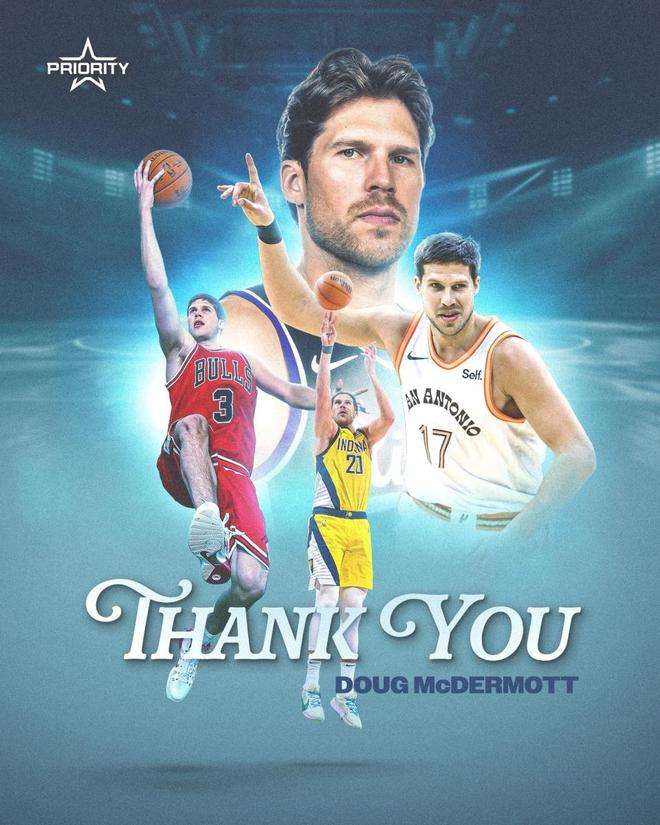

北京时间11月14日，道格・麦克德莫特于今日宣布退役，结束自己12年的NBA生涯。麦克德莫特是2014年首轮秀，职业生涯定位为三分射手，先后效力7支球队，累计命中1032记三分球。他一共出战726场常规赛，场均8.5分，三分命中率41%，大多以替补身份登场。

现年34岁的麦克德莫特在2014选秀大会上以11号签被掘金选中，但选秀当夜就被交易至芝加哥公牛。他在公牛度过前两个半赛季，之后开启联盟漂泊生涯，效力过俄克拉荷马雷霆、纽约尼克斯、达拉斯独行侠、印第安纳步行者以及圣安东尼奥马刺。2024至2026年，他在萨克拉门托国王打完最后两个赛季，期间出战71场比赛。

麦克德莫特早在大学时期就全美闻名。他在克瑞顿大学三次入选全美最佳阵容，球队主帅正是他的父亲格雷格・麦克德莫特；2010至2014年，他带领球队连续四年闯入NCAA疯狂三月。

2013–14赛季，他成为全美得分王，大四赛季拿下年度最佳大学球员。他的大学总得分一度位列NCAA一级联盟男篮历史第五（目前排在第七）。

2023年12月，克瑞顿大学为他举行了球衣退役仪式。

麦克德莫特所属经纪公司Priority Sports官宣了他退役的消息。经纪人巴泰尔斯坦发表声明如下——

“我们的道格写下了一段多么精彩的故事。高中时期并不被看好的他，后来在克瑞顿大学打出了大学篮球史上最辉煌的生涯之一。道格为蓝鸟队球迷留下了一个又一个难忘瞬间。在NBA的这12年里，道格是联盟最顶尖的射手之一，深受所有队友与教练的喜爱和尊重。所有这些，共同拼凑成了一段如此特别的职业生涯。恭喜你，道格！我们为你取得的所有成就感到无比自豪，更重要的是，为你所坚守的一切感到骄傲！”

特别声明：以上内容(如有图片或视频亦包括在内)为自媒体平台“网易号”用户上传并发布，本平台仅提供信息存储服务。

Notice: The content above (including the pictures and videos if any) is uploaded and posted by a user of NetEase Hao, which is a social media platform and only provides information storage services.

甜度百分百21 2026-11-14 05:17:28

曦言说 2026-11-12 13:48:13

元气满分吖 2026-11-14 04:10:09

烈火战鹰 2026-11-13 04:48:44

好火子 2026-11-14 06:39:22

看球图一乐 2026-11-12 11:13:28

简单清风 2026-11-13 03:13:52

云雨生烟l 2026-11-13 00:51:58

小熊回收站 2026-11-12 03:27:12

安之若素p 2026-11-13 02:19:48

只愿一生l 2026-11-12 06:09:21

赛场名场面 2026-11-14 04:53:23

简单清风 2026-11-13 03:39:13

语妍视频剪辑 2026-11-13 12:23:06

天注定 2026-11-14 00:31:14

猫熊说体育 2026-11-12 10:23:00

董老师看竞技 2026-11-12 16:12:56

一纸情书s 2026-11-12 05:48:10

小郭聊球 2026-11-11 12:24:51

钉钉陌上花开 2026-11-13 11:21:39

凉了时光人 2026-11-12 01:38:24

搞笑脑洞研究所 2026-11-12 02:44:18

罗说NBA 2026-11-14 06:39:04

只若初见h 2026-11-13 03:49:06

看球图一乐 2026-11-13 14:17:50

久愛不變s 2026-11-13 05:51:44

孑孑动漫 2026-11-12 11:21:11

神秘研究院 2026-11-12 11:06:09

你是我的小甜甜 2026-11-13 00:50:16

罗说NBA 2026-11-14 06:31:41

江西人旅拍记 2026-11-12 10:42:52

我是汪汪妹 2026-11-12 11:20:10

小猫动漫 2026-11-12 11:58:14

慢享生活集 2026-11-14 06:22:01

弄月公子 2026-11-14 05:35:06

小潌拍客在北漂 2026-11-14 04:01:55

弄月公子 2026-11-13 22:11:35

星视频 2026-11-13 10:39:41

环球时报 2026-11-13 08:33:44

钉钉陌上花开 2026-11-13 11:16:49

## 配图

图：篮球（网易体育 · 2026-11-14）

## 来源

- [网易体育 · 原文](https://www.163.com/dy/article/LBM5P2O80529BA9O.html)
