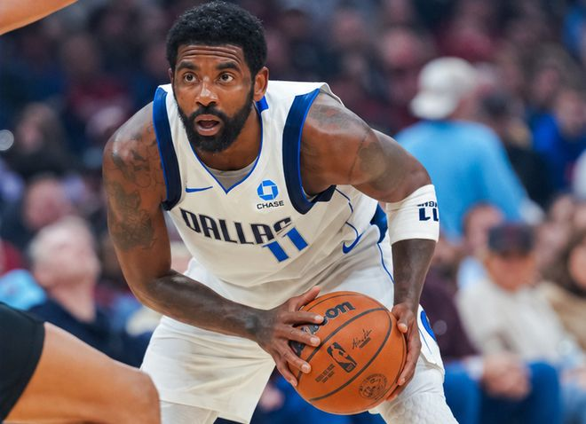

北京时间11月15日，NBA常规赛骑士主场对阵独行侠，骑士是背靠背第二场，骑士多位主力哈登与米切尔等因飞机延误选择轮休缺席。残阵骑士凭借团队攻势，逐步压制独行侠扩大20+领先优势，欧文单节20分率队反扑功亏一篑，最终骑士127-117战胜独行侠，独行侠遭遇2连败。

骑士：普罗克特24分11篮板10助攻，泰森18分，海佐尼亚22分，布莱恩特19分11篮板，托马斯20分，奥米尔13分。

独行侠：欧文7记三分34分6篮板5助攻3抢断，弗拉格18分8篮板6助攻，马丁15分，华盛顿10分，加福德10分，马绍尔12分。

欧文轰下全场最高分，且单节狂轰20分，难阻独行侠输给残阵骑士。

骑士前13场6胜7负，独行侠前12场7胜5负。本场独行侠缺少莱夫利、克里斯蒂，骑士缺少哈登、莫布利、阿伦、米切尔等多位主力。首节开局，残阵骑士内外开花取得10-4领先，独行侠连追3分，托马斯三分回敬。独行侠一波8-0攻势反超2分，双方交替领先缠斗至骑士20-17领先，双方之后继续缠斗至骑士30-33落后，托马斯三分命中，首节结束双方维持33-33。首节独行侠25中10，其中三分13中5，马丁4中4得到9分、欧文5中1与弗拉格5中2；骑士24中13，其中三分14中6，托马斯9分。

次节比赛，骑士连续两节单节得分30+，且限制独行侠进攻火力大幅下滑。骑士内外开花维持43-39领先优势，独行侠连得5分反超，骑士连得4分，加福德中投得分。骑士多点开花一波15-2攻势扩大14分优势，骑士持续得分不断扩大领先优势，骑士单节38-20净胜18分，上半场结束骑士71-53领先独行侠。前两节比赛，骑士三分23中8，泰森15分与布莱恩特14+6，引领4人得分上双；独行侠三分19中5，马丁11分、欧文7中1得到6分5助攻与弗拉格11中3得到8分。

中场休息回来，双方第三节均是轰下30+得分对攻，骑士率先多点开花扩大79-58领先优势，欧文持续得分展开对攻，引领独行侠追到差14分。普罗克特三分开火引领一波9-2攻势拉开21分优势，欧文与弗拉格引领一波14-2攻势追到差9分，骑士回敬一波8-3攻势追分。欧文单节12中7狂轰20分，骑士单节34-38被追回4分，三节结束骑士105-91领先独行侠。前三节比赛，骑士三分33中13，泰森、普罗克特与布莱恩特均18分，引领6人得分上双；独行侠三分31中10，欧文26+4+5引领4人得分上双。

骑士带着14分领先优势进入第四节比赛，普罗克特继续三分命中引领一波8-0攻势，骑士已经扩大113-91领先22分优势，独行侠一波9-3攻势追分。海佐尼亚两罚全中，阿尔达马三分命中，托马斯抛射命中，欧文三分回敬。海佐尼亚暴扣，欧文连续得分引领一波6-0攻势追到差12分，奥米尔暴扣。独行侠已经无力扭转局势，最终残阵骑士爆冷战胜独行侠，独行侠遭遇2连败。

骑士：泰森、海佐尼亚、布莱恩特、托马斯、普罗克特

独行侠：马丁、华盛顿、加福德、弗拉格、欧文

特别声明：以上内容(如有图片或视频亦包括在内)为自媒体平台“网易号”用户上传并发布，本平台仅提供信息存储服务。

Notice: The content above (including the pictures and videos if any) is uploaded and posted by a user of NetEase Hao, which is a social media platform and only provides information storage services.

篮球扫地僧 2026-11-15 19:02:35

颜小白的篮球梦 2026-11-15 19:17:48

网文作者夏少斌 2026-11-13 21:18:17

看球图一乐 2026-11-15 12:08:21

我是盲流 2026-11-15 17:35:35

体坛速报局 2026-11-15 09:58:00

咪咕体育 2026-11-14 12:19:19

禾三千体育 2026-11-15 17:02:48

梦仙境aa 2026-11-15 18:17:49

咪咕体育 2026-11-14 12:20:49

颜小白的篮球梦 2026-11-15 18:48:50

创造精彩剧情 2026-11-15 18:30:28

老杨体评 2026-11-14 14:30:23

大眼睛看看 2026-11-14 01:13:49

品茶悟浮沉 2026-11-11 01:28:57

看球图一乐 2026-11-15 11:39:11

烈火战鹰 2026-11-13 04:48:44

看球图一乐 2026-11-15 16:54:40

董老师看竞技 2026-11-12 21:20:22

阿兴爱生活 2026-11-15 14:33:36

墨史轩 2026-11-15 18:07:06

左脚爆射得分 2026-11-14 11:38:32

兵哥篮球故事 2026-11-15 19:36:48

此去经年y 2026-11-15 01:54:00

天注定 2026-11-15 07:21:07

兵哥篮球故事 2026-11-15 19:35:39

篮球星播客 2026-11-14 13:26:30

篮球实战宝典 2026-11-15 17:18:53

左脚爆射得分 2026-11-14 11:36:26

秃秃说动漫 2026-11-14 22:27:52

你是我的小甜甜 2026-11-15 00:52:08

马克餐饮日记 2026-11-15 00:31:13

铲屎官的受难日常 2026-11-14 01:25:52

扬子晚报 2026-11-11 07:52:23

秃秃说动漫 2026-11-13 23:14:14

抬起头看黑板 2026-11-11 12:54:49

北青网-北京青年报 2026-11-12 21:26:04

秃秃说动漫 2026-11-11 22:27:54

澎湃新闻 2026-11-15 10:26:02

秃秃说动漫 2026-11-11 22:26:36

## 配图

图：篮球（网易体育 · 2026-11-15）

## 来源

- [网易体育 · 原文](https://www.163.com/dy/article/LBP6Q7US0529RKNN.html)
