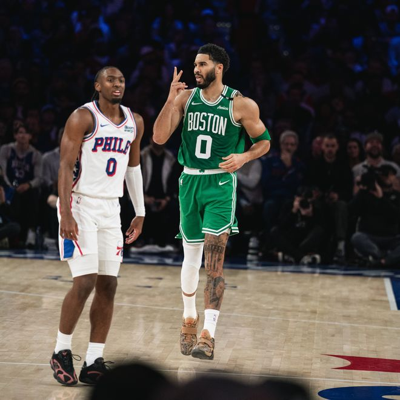

北京时间11月11日，NBA常规赛继续进行，费城76人队（9胜3负）遭遇败仗。重回费城的乔治得到36分，塔图姆得到21分，他们带领球队利用三四节攻势确立大比分领先，波士顿凯尔特人队（9胜2负）在客场以123-101战胜76人队。凯尔特人队拿到4连胜。

凯尔特人队的乔治得到36分和5个篮板，塔图姆得到21分、6个篮板和4次助攻，普理查德得到18分、6个篮板和5次助攻，豪瑟得到12分和5个篮板。76人队的马克西得到24分和4次助攻，西蒙斯得到17分，恩比德得到16分和6个篮板，布朗得到13分和5个篮板，勒布朗12投4中，得到11分、8个篮板和5次助攻。

布朗被交易后首次与老东家相遇。做客的凯尔特人队迅速找到手感，怀特三分命中，塔图姆连进两球，凯尔特人队以11-7领先。马克西打3分追分，沃尔什回应三分，塔图姆保持手感又拿5分，首节还有6分30秒时凯尔特人队以21-12领先9分。布朗突破扣篮，恩比德连造犯规四罚全中，76人队很快把差距缩小到3分。豪瑟站出来回敬三分，他率队打出7-1的攻击波，场上分差又变为9分。西蒙斯中投得手，首节结束时76人队以23-30落后。

第二节开始后不久普理查德突破得手，乔治弧顶投中三分，凯尔特人队以39-28领先。布朗两罚追分，乔治、普理查德轮流得分，豪瑟保持手感又进2个三分球，冈萨雷斯也锦上添花，半场前3分30秒时凯尔特人队以54-38领先16分。韦德和布朗追回4分，乔治打3分还击，两队拉锯几个回合，恩比德和埃奇库姆联手4分结束第二节，76人队以51-62落后11分。

凯尔特人队的乔治上半场得到17分和4个篮板，塔图姆得到13分和4个篮板；豪瑟得到9分；76人队的马克西得到12分，恩比德得到9分和5个篮板，布朗得到8分。

恩比德用三分球揭开第三节大幕，马克西两罚全中，76人队只落后6分。塔图姆回应三分，他率队连拿7分迅速拉开。布朗领到四犯后被继续留在场上，勒布朗翼侧命中三分，他带领球队连追7分，本节进行了3分35秒时76人队以63-69落后。凯尔特人队暂停后奎塔单打得分暂时稳住局势，勒布朗两次突破得手，乔治三分还击，韦德翼侧回敬三分，76人队又打出一轮7-0的反击波，本节还有4分钟时他们追成76平。79平后76人队突然哑火，普理查德、豪瑟和塔图姆各中三分，绿军再次拉开领跑。马克西三分止血，斯切尔曼回敬三分，三节结束时凯尔特人队以91-82领先。

凯尔特人队的外线火力在第四节延续，普理查德和乔治投进3个三分球，一轮9-0的攻击波让他们以100-82领先。76人队暂停后投篮依旧失准，乔治手感火热又拿5分，双方差距拉开到23分。布朗连追5分，乔治勇不可挡又中两记三分，第四节还有5分35秒时凯尔特人队以111-87领先。大比分差距让剩余比赛没有悬念，双方都换上替补，凯尔特人队以123-101获胜。

凯尔特人队首发阵容：怀特、塔图姆、乔治、沃尔什、奎塔

76人队首发阵容：马克西、埃奇库姆、布朗、勒布朗、恩比德

特别声明：以上内容(如有图片或视频亦包括在内)为自媒体平台“网易号”用户上传并发布，本平台仅提供信息存储服务。

Notice: The content above (including the pictures and videos if any) is uploaded and posted by a user of NetEase Hao, which is a social media platform and only provides information storage services.

篮球扫地僧 2026-11-11 18:25:08

一纸情书s 2026-11-11 06:04:17

后仰跳投绝杀 2026-11-11 19:33:43

李广专业体育评论 2026-11-11 11:58:27

网文作者夏少斌 2026-11-09 20:53:52

篮球过人技巧 2026-11-11 14:13:02

宗介说体育 2026-11-09 13:49:26

听风喃 2026-11-11 00:17:34

各地精彩不容错过 2026-11-11 05:35:01

凉了时光人 2026-11-11 01:37:59

董老师看竞技 2026-11-09 17:26:45

董老师看竞技 2026-11-09 09:51:12

看球图一乐 2026-11-11 12:42:59

董老师看竞技 2026-11-09 09:40:37

云初搞笑 2026-11-10 14:06:47

骄阳之夏明 2026-11-10 01:20:41

后仰跳投绝杀 2026-11-11 19:38:34

听风喃 2026-11-09 00:23:08

空白我们 2026-11-10 00:15:18

罗吹终结者 2026-11-10 21:47:39

全力说体育 2026-11-11 09:47:32

创造精彩剧情 2026-11-10 04:13:31

显微镜下的人性 2026-11-11 04:53:47

体坛周报 2026-11-11 16:48:45

体坛速报局 2026-11-09 08:07:55

人间闲散客 2026-11-10 01:25:43

浣溪爱球 2026-11-11 11:00:11

体坛速报局 2026-11-09 07:09:15

篮球过人技巧 2026-11-11 15:07:57

搞笑协会鸭 2026-11-09 13:56:55

神秘研究院 2026-11-10 11:15:39

凉生枕时e 2026-11-11 13:22:11

主宰稳场 2026-11-10 00:15:01

伊人若梦u 2026-11-11 14:49:54

月影沙丘d 2026-11-11 13:24:42

孤城落日 2026-11-10 16:21:32

董老师看竞技 2026-11-09 08:47:07

看球图一乐 2026-11-11 18:17:29

小叶子侃球FM 2026-11-11 00:04:38

23号球魁 2026-11-10 23:53:42

## 配图

图：篮球（网易体育 · 2026-11-11）

## 来源

- [网易体育 · 原文](https://www.163.com/dy/article/LBEQKSJ80529AL9S.html)
