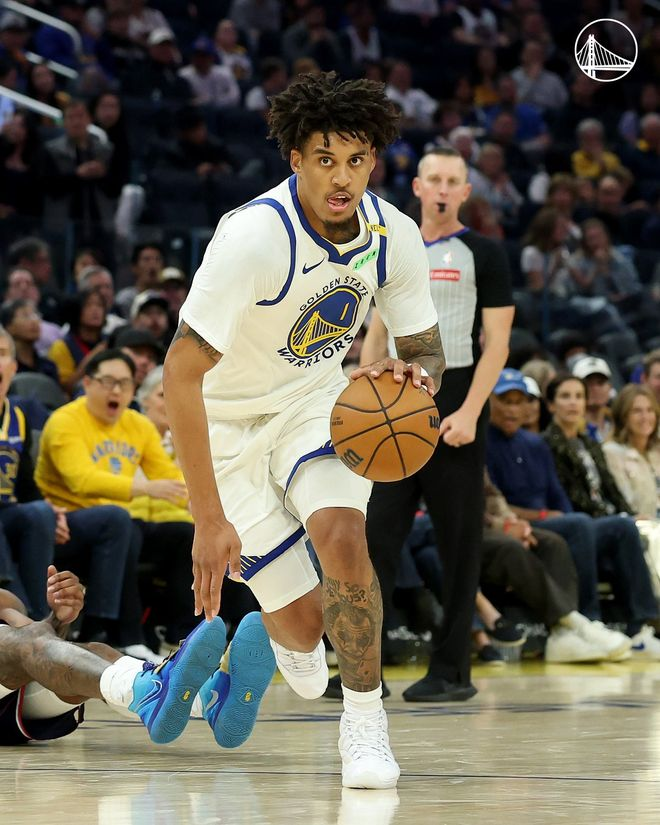

北京时间11月2日，NBA常规赛继续进行，金州勇士队（4胜3负）继续连胜。伦德伯格得到全场最高37分，梅尔顿得到21分和6个篮板，他们率队依靠第二节攻势确立领先，勇士队在主场以124-112战胜洛杉矶快船队（1胜5负）。勇士队拿到4连胜。

勇士队的伦德伯格得到37分、4个篮板和5次助攻，梅尔顿得到21分和6个篮板，波杰姆斯基得到17分、8个篮板和8次助攻，威廉姆斯得到17分。快船队的八村塁得到24分和7个篮板，桑德斯得到16分，加兰得到15分和7次助攻，邓恩得到12分，马丁内利得到10分。

勇士队的库里、格林一同轮休，梅尔顿、尼昂进入首发。开场后两队交替领跑，八村塁连得5分，琼斯三分命中，他们率队打出8-2的小高潮，快船队以14-9领先。佩顿还击三分，波杰姆斯基二次进攻得手，勇士队迅速追平。桑德斯替补出场迅速开火命中三分，加兰造犯规三罚全中，快船队再次拉开领跑。勇士队外线毫不逊色，霍福德、伦德伯格分别投中三分追成24平，桑德斯保持手感又进2个三分球，他连拿8分率队打出13-5的小高潮结束首节，快船队以37-29领先8分。桑德斯单节得到11分。

第二节开始后快船队进攻失准，连续投篮打铁，威廉姆斯连得5分率队连追7分迫近。八村塁突破还击，伦德伯格连进两球，本节进行了4分30秒时勇士队以40-39反超。八村塁扣篮得手，尼昂三分命中率队又拿5分扩大优势。邓恩两罚咬住比分，之后两队互有攻守，比分交替增加，伦德伯格半场前进攻开火，命中两记三分，一人连得10分带领球队以10-6的攻击波结束这一节，勇士队以63-57领先6分进入半场休息。

勇士队的伦德伯格上半场得到19分，威廉姆斯得到12分；快船队的八村塁得到16分和4个篮板，桑德斯得到11分，加兰得到8分和5次助攻。

波杰姆斯基用三分球开启第三节，八村塁连追5分缩小差距，勇士队不甘示弱，伦德伯格又中两球，梅尔顿也命中三分，他们联手打出9-0的小高潮，本节还有6分50秒时勇士队以77-63领先。八村塁又中三分，伦德伯格手感火热回敬两记三分，勇士队领先15分。大洛跳投阻止差距拉大，桑德斯回到场上连拿5分，快船队把比分追至77-85。波姐慕斯后撤步三分中的，他带领球队连得5分再次拉开，邓恩、加兰和琼斯联手8分结束这一节，快船队在三节结束时以85-92落后7分。

第四节开始后两队拉锯几个回合，勇士队进攻再次发力，伦德伯格和梅尔顿各中三分，一波8:0的小高潮后，他们以108-92领先16分。暂停后快船队的进攻仍无起色，连续投篮打铁，伦德伯格和波杰姆斯基各拿3分，勇士队领先22分。大部分落后的快船队尽遣替补，可他们没有放弃抵抗，马丁内利命中两个三分球，一人独取8分，快船队在第四节还有2分15秒时追至110-118。梅尔顿挺身而出，连中2个三分球锁定胜局，最终勇士队以124-112获胜。

快船队首发阵容：加兰、邓恩、八村塁、琼斯、杰克逊

勇士队首发阵容：波杰姆斯基、梅尔顿、尼昂、伦德伯格、巴塞

特别声明：以上内容(如有图片或视频亦包括在内)为自媒体平台“网易号”用户上传并发布，本平台仅提供信息存储服务。

Notice: The content above (including the pictures and videos if any) is uploaded and posted by a user of NetEase Hao, which is a social media platform and only provides information storage services.

锅子篮球 2026-11-02 15:34:23

全景体育V 2026-11-02 11:58:34

一将篮球 2026-11-02 13:57:33

董老师看竞技 2026-10-31 14:40:45

慕名而来只为你 2026-10-29 03:46:14

司峰阿道 2026-10-31 14:46:32

输在感情刀 2026-11-01 10:18:45

一网打尽全球焦点 2026-11-02 19:06:21

各地精彩不容错过 2026-11-01 07:00:35

正经球迷 2026-10-31 16:46:27

各地精彩不容错过 2026-11-02 03:36:13

主宰稳场 2026-10-31 21:11:28

酒话醉人 2026-11-01 10:42:12

北青网-北京青年报 2026-11-02 14:36:02

笑脸猫咪察 2026-11-02 11:41:24

体坛速报局 2026-10-31 13:35:42

看球图一乐 2026-11-01 14:45:04

潇湘烟雨水 2026-11-02 18:49:38

黑曼巴谈球 2026-11-01 02:24:46

北青网-北京青年报 2026-11-02 14:36:02

嘴角上翘 2026-10-31 13:23:42

夜里的海风 2026-10-31 15:30:00

华夏云海 2026-10-30 23:04:43

听风喃 2026-11-01 11:40:12

篮球盛世 2026-11-01 13:39:02

小赖评球 2026-11-01 01:51:22

咪咕体育 2026-11-02 13:52:38

青川入画 2026-11-02 04:23:00

黑曼巴谈球 2026-11-01 02:19:01

随遇而安之心 2026-11-02 03:58:05

看球图一乐 2026-10-31 13:43:56

董老师看竞技 2026-11-02 13:44:18

乌雅恺歌 2026-11-01 05:07:11

凉了时光人 2026-11-02 01:19:43

董老师看竞技 2026-10-31 14:26:21

篮球资讯达人 2026-11-02 15:09:47

大卫的篮球故事 2026-11-02 17:50:43

篮球过人技巧 2026-11-02 13:42:59

喜光懂天下 2026-11-01 02:07:27

体坛速报局 2026-11-02 11:28:39

## 配图

图：篮球（网易体育 · 2026-11-02）

## 来源

- [网易体育 · 原文](https://www.163.com/dy/article/LANKF9PK0529AL9S.html)
