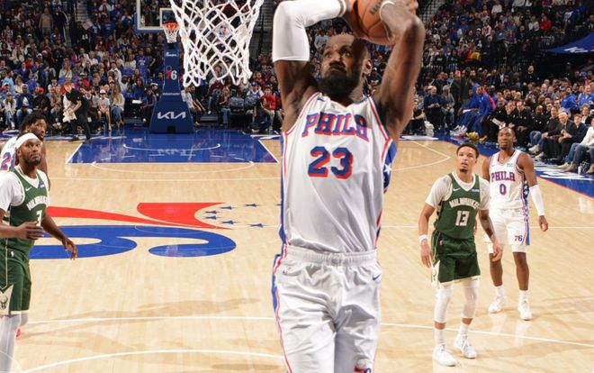

北京时间11月22日，76人主场132-129险胜雄鹿，拿下5连胜，同时也送给雄鹿13连败。詹姆斯得到21分6篮板6助攻3抢断，贡献4记暴扣，末节独得13分。恩比德得到26分17篮板9助攻，篮板赛季新高。76人半场仅领先1分，第三节一度领先13分，雄鹿缩小分差但还是不敌76人。希罗空砍生涯新高的50分，绝平三分超时无效。

雄鹿：希罗50分11篮板7助攻7三分，伯里斯26分8篮板4助攻，库兹马12分5篮板，小哈克斯9分，格林9分，罗林斯8分6篮板，韦尔6分8篮板3助攻，特纳5分6篮板5助攻3盖帽

76人：恩比德26分17篮板9助攻，詹姆斯21分6篮板6助攻3抢断，西蒙斯18分，马克西17分4篮板4助攻，埃奇库姆16分6助攻，巴洛12分4篮板，波普11分，沃克9分7篮板4助攻

詹姆斯本场送出4记暴扣，末节独得13分，恩比德贡献大号准三双，率领76人拿下胜利！

恩比德关键时刻踩线出界，裁判并未响哨，引起争议。当时雄鹿已经没有挑战机会了。

希罗绝平三分命中，可惜超时了！

首节，詹姆斯开场就送暴扣，埃奇库姆、马克西上篮得分，雄鹿一方，希罗三分命中，罗林斯补篮得分。詹姆斯再送扣篮，库兹马、希罗三分命中，雄鹿打出一波7-0。波普、西蒙斯三分命中，恩比德、罗林斯上篮得分，韦尔连续空接扣篮，沃克上篮得手，双方比分交替领先。希罗三罚三中，首节战罢，雄鹿30-29领先76人。

次节，韦尔补扣，巴洛连得4分。伯里斯也连中两球，雅库奇奥尼斯上篮得手，雄鹿领先6分。埃奇库姆扣篮2+1，伯里斯又连得5分，马克西、沃克上篮得分，恩比德打成2+1，76人反超雄鹿。库兹马连得6分，希罗三分再中，雄鹿打出一波14-7，领先7分。詹姆斯上篮得手，恩比德扣篮后，又上篮打成2+1，76人回敬一波8-0，半场结束，76人60-59领先雄鹿。

易边再战，希罗、罗林斯接连得分，小哈克斯三分命中，雄鹿反超5分。詹姆斯再送扣篮，恩比德连得4分，埃奇库姆和马克西也突破得手。波普、希罗互飙三分，恩比德连续罚球得分，西蒙斯连得8分，76人一波12-0攻势后，领先13分。希罗、格林也很快用三分还以颜色。特别是希罗开启得分模式，连续将球打进，三节战罢，希罗已经轰下35分，76人98-92领先雄鹿。

末节，巴洛连得8分，希罗也连进两球，伯里斯上篮得手，格林三分命中，雄鹿一波7-0。詹姆斯补篮得分，随后又打成2+1，格林三分再中，詹姆斯打板再中，恩比德中投命中，詹姆斯送出第4个扣篮。特纳三分命中，詹姆斯两罚两中后又抛投命中，76人领先10分。希罗两罚两中，已经得到43分，创个人生涯新高。恩比德中投命中，希罗三分命中。伯里斯扣篮，希罗把球打进，拿下50分。恩比德两罚全中，伯里斯三分命中，雄鹿只落后1分。恩比德两罚两中，留给雄鹿1.5秒。希罗三分命中但超时，最终76人险胜雄鹿，拿下胜利。

雄鹿：希罗、罗林斯、库兹马、小哈克斯、特纳

76人：马克西、埃奇库姆、波普、詹姆斯、恩比德

特别声明：以上内容(如有图片或视频亦包括在内)为自媒体平台“网易号”用户上传并发布，本平台仅提供信息存储服务。

Notice: The content above (including the pictures and videos if any) is uploaded and posted by a user of NetEase Hao, which is a social media platform and only provides information storage services.

李汪手工制作 2026-11-22 18:04:00

布斯基 2026-11-22 19:00:07

篮球扫地僧 2026-11-22 18:32:06

晚风知我意21 2026-11-22 19:20:10

糖炒小栗子 2026-11-22 15:26:53

显微镜下的人性 2026-11-20 06:46:38

隐龙天下o 2026-11-22 03:13:23

显微镜下的人性 2026-11-22 10:11:59

一溪风月w 2026-11-21 11:44:19

马健 2026-11-20 07:12:37

十三哥侃大山 2026-11-21 00:42:58

曹操篮球解说 2026-11-19 13:05:20

土豆糯米饭精选 2026-11-21 02:56:38

星耀球坛 2026-11-20 23:48:32

提子唠生活 2026-11-21 00:17:36

宋垀搞笑配音 2026-11-21 04:27:46

风里小记事 2026-11-20 01:22:20

北青网-北京青年报 2026-11-22 16:07:01

董老师看竞技 2026-11-22 09:20:48

张二要自律 2026-11-20 06:13:26

不似经年g 2026-11-20 03:20:05

于令 2026-11-21 06:08:51

各地精彩不容错过 2026-11-21 05:04:16

驴驴老baby 2026-11-20 06:43:15

猫咪妞妞 2026-11-20 07:18:34

董老师看竞技 2026-11-22 08:38:02

许侶很机智 2026-11-21 02:48:15

你笑的好甜美 2026-11-20 04:55:40

一路荒凉如歌aa 2026-11-21 02:05:42

凤凰网科技 2026-11-21 04:27:56

不如恋物j 2026-11-22 08:29:01

黑曼巴谈球 2026-11-20 04:05:07

语妍视频剪辑 2026-11-22 14:37:13

极酷体育 2026-11-19 22:46:57

快乐加载中21 2026-11-22 19:07:48

篮球过人技巧 2026-11-21 01:05:21

你是佛的弟子 2026-11-20 03:10:33

夜里的海风 2026-11-21 03:43:09

落雪听梅a 2026-11-22 01:06:19

将死蝴蝶标本吻l 2026-11-22 02:04:26

## 配图

图：篮球（网易体育 · 2026-11-22）

## 来源

- [网易体育 · 原文](https://www.163.com/dy/article/LCAHKEDC0529BA9O.html)
