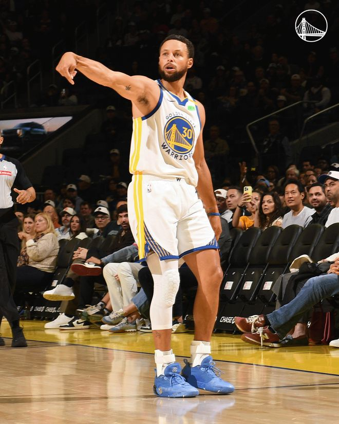

北京时间11月8日，NBA常规赛继续进行，金州勇士队（7胜3负）继续连胜。库里得到41分、6个篮板和6次助攻迎来里程碑时刻，他在加时赛关键时刻连得5分帮助球队确立胜局，勇士队在主场以126-119战胜奥兰多魔术队（2胜7负）。勇士队拿到7连胜，魔术队遭遇4连败。

勇士队的库里得到41分、6个篮板和6次助攻，他成为队史第8位抢到5000个篮板的球员，35岁后得分40+场次达到16场排名历史第一。伦德伯格得到23分和8个篮板，波杰姆斯基得到15分和7个篮板，尼昂得到11分，格林送出6个篮板和13次助攻。魔术队的瓦格纳得到30分、6个篮板和11次助攻，达席尔瓦得到19分和7个篮板，卡特得到19分和11个篮板，卡恩得到18分和12个篮板，布莱克得到18分、8个篮板和6次助攻。

勇士队在主场迅速找到进攻状态，库里独得5分，伦德伯格命中两球，他们带领球队以13-7领先。瓦格纳跳投暂时止血，勇士队外线手感延续，尼昂和梅尔顿各进三分，一轮10-0的攻击波让他们以23-9领先。卡恩三分中的阻止分差继续拉大，霍福德和伦德伯格联手3分，卡恩又追5分，波杰姆斯基翼侧投中三分，首节结束时勇士队以31-19领先。

第二节开始后不久魔术队外线开火，卡特连中2个三分球，一轮8-0的反击波让他们追至31-38。波杰姆斯基三分回应，威廉姆斯打3分成功，勇士队回敬10-3的攻击波，他们把优势拉开到14分。卡恩和瓦格纳追回5分，库里和波杰姆斯基一同发力联手拿下9分结束第二节，勇士队以57-41领先16分。

勇士队的库里上半场得到14分、4个篮板和4次助攻，波杰姆斯基得到12分；魔术队的卡恩得到14分和7个篮板，瓦格纳得到13分。

布莱克和卡特各拿3分开始第三节，魔术队只落后11分。库里三罚还击，魔术队外线找到准星，瓦格纳和达席尔瓦联手投进3个三分球，他们追至58-65。库里回应三分，魔术队把反扑攻势延续，卡特三分命中，达席尔瓦发力拿下7分，他们带领球队打出14-1的反击波，本节还有3分20秒时魔术队以72-69反超。理查德回应4分夺回领先，布莱克连得6分，威廉姆斯连投带罚拿下4分，三节结束时勇士队以77-78落后1分。

最后一节开始后瓦格纳和布莱克合取5分，魔术队以83-77领先。尼昂和波杰姆斯基回敬三分，勇士队追成85平。87平、89平、92平后伦德伯格单打得手，比塔泽上篮追平，96平后伦德伯格取分帮助勇士队再次领跑，卡特和布莱克联手4分，第四节还有2分30秒时魔术队以100-98领先。

库里突破打进，接着弧顶投中三分，第四节还有1分45秒时勇士队以103-100领先。魔术队毫不逊色，达席尔瓦回应三分，103平。格林进攻掩护犯规，达席尔瓦三分不中，库里弧顶再中三分，魔术队非常强硬，卡特回敬三分，106平。库里突破制造犯规，两罚全中，勇士队以108-106领先。魔术队暂停后瓦格纳突破抛投得分，108平。库里突破打进，第四节还有25.2秒时勇士队以110-108领先。卡特上篮被巴塞封盖，卡特再次上篮不中，卡恩补篮得手，110平，比赛进入加时赛。

加时赛开始后库里、格林都在场下休息，但勇士队开局不错连拿4分领跑。卡特两罚命中，伦德伯格三分回应，魔术队非常顽强，卡特和达席尔瓦各中三分，加时赛还有2分20秒时魔术队以118-117反超。库里突破打3分回敬，卡特两罚不中，库里突破得手，勇士队以122-118领先。卡特制造犯规两罚一中，119-122。伦德伯格单打得手，124-119。魔术队暂停后无力回天，勇士队获胜。

魔术队首发阵容：布莱克、理查德森、达席尔瓦、瓦格纳、卡特

勇士队首发阵容：库里、波杰姆斯基、桑托斯、伦德伯格、格林

特别声明：以上内容(如有图片或视频亦包括在内)为自媒体平台“网易号”用户上传并发布，本平台仅提供信息存储服务。

Notice: The content above (including the pictures and videos if any) is uploaded and posted by a user of NetEase Hao, which is a social media platform and only provides information storage services.

只关于篮球 2026-11-08 03:23:48

司峰阿道 2026-11-08 14:35:23

小叶子侃球FM 2026-11-07 19:05:39

猫眠花下t 2026-11-07 01:11:57

各地精彩不容错过 2026-11-08 05:52:08

宗介说体育 2026-11-06 14:13:45

董老师看竞技 2026-11-06 15:01:27

拥抱抵不过时光 2026-11-07 01:06:57

体坛速报局 2026-11-08 13:04:54

一纸情书s 2026-11-07 06:30:59

铭记人类辉煌 2026-11-08 03:02:17

看球图一乐 2026-11-08 14:05:31

小叶子侃球FM 2026-11-05 23:49:59

董老师看竞技 2026-11-08 14:14:26

极酷体育 2026-11-07 20:49:37

紧跟时代脉搏 2026-11-08 03:45:06

小叶子侃球FM 2026-11-07 19:05:39

一纸情书s 2026-11-07 06:35:17

紧跟时代脉搏 2026-11-06 04:08:40

看球图一乐 2026-11-08 13:26:33

董老师看竞技 2026-11-08 13:49:51

创造精彩剧情 2026-11-07 04:14:34

笑料收集站 2026-11-05 12:01:47

体育慢镜头 2026-11-06 18:13:40

紧跟时代脉搏 2026-11-07 04:05:58

篮球过人技巧 2026-11-06 13:09:59

董老师看竞技 2026-11-08 17:21:27

体育一点就通 2026-11-08 14:45:00

体坛速报局 2026-11-06 12:20:21

一纸情书s 2026-11-07 06:36:38

众生的世界观 2026-11-06 03:47:54

23号球魁 2026-11-07 19:10:03

热爱工作的王总 2026-11-07 01:46:39

23号球魁 2026-11-08 17:53:35

一纸情书s 2026-11-07 06:33:50

天生是美女 2026-11-08 18:31:45

落雪听梅a 2026-11-08 01:24:49

董老师看竞技 2026-11-08 16:34:10

钱说体育 2026-11-08 18:59:56

凉生枕时e 2026-11-08 11:01:30

## 配图

图：篮球（网易体育 · 2026-11-08）

## 来源

- [网易体育 · 原文](https://www.163.com/dy/article/LB789S470529AL9S.html)
