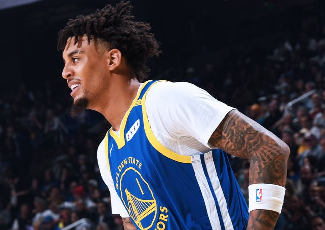

北京时间11月20日，NBA常规赛勇士客场对阵灰熊，双方均是背靠背第二场，灰熊仅出场5分24秒因伤退赛。灰熊压制勇士扩大18分优势，勇士反扑上半场结束追到差8分，灰熊下半场逐步扩大30+领先优势提前锁定胜局，最终灰熊126-98双杀勇士收获5连胜，勇士遭遇5连败。

勇士：伦德博格11分8篮板7助攻，贝西16分13篮板，波杰姆斯基15分，理查德15分。

灰熊：布泽尔6中6得到16分6篮板5助攻，韦尔斯22分7篮板，科沃德5记三分19分4篮板4助攻，斯潘塞9分11助攻，全队6人得分上双。

勇士前15场8胜7负，灰熊前15场11胜4负，本赛季首次交锋勇士108-111惜败灰熊。本场勇士缺少库里、巴特勒、穆迪与追梦等，灰熊缺少杰罗姆、伊迪与小皮蓬等。首节开局灰熊8-2领先，贝西得到2分，灰熊连得5分扩大13-4领先，灰熊之后维持19-11领先。理查德上篮得分，灰熊连中两记三分扩大12分优势，克赖尔三分追分。灰熊连得4分，勇士一波8-2攻势追分，首节结束灰熊31-24领先勇士。首节勇士三分4中1，贝西9分5篮板；灰熊三分8中4，科沃德10分与布泽尔3中3得到9分。

次节比赛，勇士冲击内线追到差4分，灰熊多点开花一波14-1攻势，灰熊已经扩大47-30领先优势。科沃德随后三分命中，进一步扩大52-34领先，勇士内外开花一波10-0攻势追到差8分。韦尔斯三分回敬，勇士追回3分，灰熊单节24-23净胜1分，上半场结束灰熊55-47领先勇士。前两节比赛，勇士三分16中3，贝西9+8与理查德9分；灰熊三分17中8，科沃德13分、布泽尔11分与韦尔斯10分。

中场休息回来，灰熊本场首次单节得分35+，勇士被限制连续三节不足30分。灰熊率先一波9-2攻势扩大15分优势，波杰姆斯基率队回敬一波8-3攻势追分，灰熊多点开花一波11-2攻势扩大19分优势。灰熊持续用团队攻势扩大90-70领先，勇士略有反扑追分，灰熊单节37-26净胜11分，三节结束灰熊扩大92-73领先勇士。前三节比赛，勇士三分23中4，波杰姆斯基13分引领4人得分上双；灰熊三分26中12，布泽尔16+4+4引领4人得分上双。

灰熊带着19分领先优势进入第四节比赛，灰熊在前4分半钟继续扩大104-79领先优势。由于双方之间比分差距太大，且残阵勇士实力孱弱，比赛已经提前失去胜负悬念。末节剩余时间彻底进入垃圾时间，灰熊继续牢牢掌控场上局势，最终灰熊轻松大胜勇士收获5连胜，勇士遭遇5连败。

勇士：伦德博格、桑托斯、贝西、波杰姆斯基、梅尔顿

灰熊：韦尔斯、布泽尔、亨德里克斯、科沃德、斯潘塞

特别声明：以上内容(如有图片或视频亦包括在内)为自媒体平台“网易号”用户上传并发布，本平台仅提供信息存储服务。

Notice: The content above (including the pictures and videos if any) is uploaded and posted by a user of NetEase Hao, which is a social media platform and only provides information storage services.

观察者海风 2026-11-20 18:45:53

鱼崖大话篮球 2026-11-20 11:50:02

咪咕体育 2026-11-19 06:59:00

甜份超标的我 2026-11-20 18:59:15

篮球大视野 2026-11-20 16:13:42

往日爱恨d 2026-11-20 06:23:27

阿薎美食 2026-11-18 15:44:15

初心不负y 2026-11-18 03:26:26

弄月公子 2026-11-20 18:45:42

篮球盛世 2026-11-20 18:40:02

乐享人生风雨 2026-11-20 00:48:00

全球风情大揭秘 2026-11-17 08:28:04

咪咕体育 2026-11-19 06:58:51

咪咕体育 2026-11-19 06:58:53

董老师看竞技 2026-11-19 13:57:40

梦仙境aa 2026-11-18 21:17:54

尺素a 2026-11-18 03:44:52

各地精彩不容错过 2026-11-19 04:56:18

咪咕体育 2026-11-19 06:58:48

老楚说球 2026-11-20 03:28:40

大眼睛看看 2026-11-20 02:52:36

篮球过人技巧 2026-11-18 17:29:12

竞技追梦人 2026-11-19 11:50:29

咪咕体育 2026-11-19 06:57:23

人间闲散客 2026-11-18 03:27:02

元气满分吖 2026-11-20 15:00:53

全球风情大揭秘 2026-11-16 23:11:09

体育闲话说 2026-11-20 17:18:38

老付聊体育 2026-11-19 06:36:28

oo烛光透影 2026-11-19 03:03:07

小轲搞笑解说 2026-11-19 00:39:54

福娃谈体育 2026-11-19 16:53:37

老威头 2026-11-19 19:59:20

看球图一乐 2026-11-20 11:45:20

老范谈史 2026-11-20 16:10:12

宗介说体育 2026-11-20 15:14:38

铭记人类辉煌 2026-11-19 03:23:09

开着车去流浪 2026-11-20 16:15:21

麦子的篮球故事 2026-11-20 16:10:43

嘴角上翘 2026-11-19 03:48:35

## 配图

图：篮球（网易体育 · 2026-11-20）

## 来源

- [网易体育 · 原文](https://www.163.com/dy/article/LC64B8ME0529RKNN.html)
