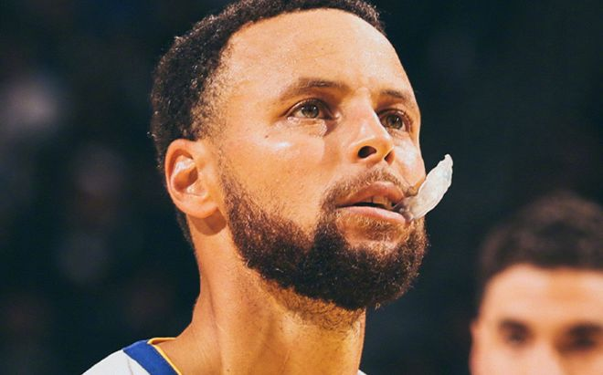

北京时间11月6日，NBA常规赛勇士主场对阵热火，热火是背靠背第二场，勇士在最多落后10分情况下，上半场追到53-53。下半场库里给力表现激活勇士团队攻势，勇士在末节逐步扩大20+领先优势，最终勇士120-100逆转战胜热火豪取6连胜。

勇士：库里6记三分29分4助攻，伦德博格17分8篮板6助攻，理查德10分，追梦2分5篮板11助攻，尼昂13分。

热火：字母哥20分14篮板4助攻，阿德巴约18分10篮板，克莱11分，米切尔4记三分22分8助攻，拉松13分，康韦尔13分。

库里NBA生涯常规赛总得分超越名宿大O奥斯卡·罗伯特森，升至NBA历史第17位，也是升至控卫历史得分榜第二，仅次于今夏退役的威少。

库里解锁NBA生涯常规赛5000篮板里程碑。

库里成为NBA历史首位达成至少26000分+5000篮板+6000助攻+4000三分的球员。

勇士前8场5胜3负，热火前8场3胜5负。本场勇士缺少巴特勒、穆迪、波尔津吉斯与桑托斯，首节开局勇士遭热火内外开花压制2-9落后。理查德抛射追分，字母哥暴扣与米切尔三分扩大10分优势打停勇士，库里与伦德博格各中一记三分。米切尔与理查德对攻一记三分，阿德巴约内线连得5分，伦德博格上篮追分，波杰姆斯基、拉松与尼昂各中一记三分。双方接连冲击内线得分，霍福德三分命中，首节结束勇士26-29落后热火。首节勇士三分13中6，库里5中1得到3分；热火三分10中4，字母哥5中4得到9+4+2。

次节比赛，康韦尔三分命中，尼昂与波蒂斯冲突各吃一T，勇士一波7-1攻势追平比分。康韦尔与波杰姆斯基对攻一记三分，字母哥与梅尔顿各得2分，康韦尔三分与阿德巴约2+1扩大6分优势。勇士冲击内线追分，克莱与霍福德对攻三分，字母哥中投得分，库里与伦德博格携手打出8-0攻势反超2分。字母哥两罚全中，勇士单节27-24净胜3分，上半场结束勇士追到53-53持平热火。前两节比赛，热火三分23中8，字母哥16+9+2与阿德巴约12分；勇士三分25中9，理查德10分、伦德博格9分与库里10中2仅得到7分。

中场休息回来，勇士率先连得5分，克莱三罚全中、字母哥2+1与维金斯中投得分，热火一波8-0攻势反超3分。勇士连得6分，克莱三分回敬，库里连得8分与助攻霍福德三分命中，梅尔顿与伦德博格接连得分，勇士已经14-1攻势取得13分优势。拉松三分命中，勇士连续冲击内线扩大14分优势，拉松再中三分，勇士再度多点开花压制。勇士单节38-23净胜15分，三节结束勇士91-76领先热火。前三节比赛，热火三分35中11，字母哥19+15+4引领5人得分上双；勇士三分37中13，库里21分引领3人得分上双。

进入第四节比赛，米切尔连得7分，佩顿与库里接连上篮得分，库里还命中三分维持15分优势。拉松两罚全中，字母哥送出干扰球，库里再中三分扩大18分优势打停热火。米切尔与阿德巴约里突外投得分，热火一波10-4攻势打停勇士，贝西暴扣与尼昂两次上篮扩大18分优势。字母哥两罚一中，伦德博格暴扣与尼昂三分命中扩大20+领先优势，比赛已经提前失去胜负悬念，热火无力扭转局势，最终勇士逆转战胜热火豪取6连胜。

勇士：库里、波杰姆斯基、理查德、伦德博格、追梦

热火：维金斯、字母哥、阿德巴约、克莱、米切尔

特别声明：以上内容(如有图片或视频亦包括在内)为自媒体平台“网易号”用户上传并发布，本平台仅提供信息存储服务。

Notice: The content above (including the pictures and videos if any) is uploaded and posted by a user of NetEase Hao, which is a social media platform and only provides information storage services.

鱼崖大话篮球 2026-11-06 15:22:42

宗介说体育 2026-11-06 14:13:45

鱼崖大话篮球 2026-11-06 13:44:20

夜白侃球 2026-11-06 16:15:10

阿鱼吃什么 2026-11-04 10:55:22

空谷幽幽蓝 2026-11-06 18:20:19

你是佛的弟子 2026-11-05 03:18:33

篮球热嗖 2026-11-06 19:13:18

一路荒凉如歌aa 2026-11-05 02:03:13

正经球迷 2026-11-04 19:23:44

铭记人类辉煌 2026-11-04 03:31:18

阿嬍体育评论 2026-11-04 03:09:37

董老师看竞技 2026-11-06 14:28:39

梦仙境aa 2026-11-05 17:27:31

简单清风 2026-11-04 15:38:16

笑脸猫咪察 2026-11-02 11:41:24

紧跟时代脉搏 2026-11-06 04:08:40

篮球盛世 2026-11-05 11:11:57

十三哥侃大山 2026-11-05 00:17:47

主宰稳场 2026-11-04 00:18:22

你是佛的弟子 2026-11-05 03:19:56

司峰阿道 2026-11-06 15:30:23

笑料收集站 2026-11-05 12:01:47

魔法污 2026-11-05 11:59:22

董老师看竞技 2026-11-04 15:08:02

紧跟时代脉搏 2026-11-04 04:13:07

体育慢镜头 2026-11-06 18:13:40

一个体育黑 2026-11-06 18:45:45

懂球帝 2026-11-06 16:32:41

简单清风 2026-11-05 14:29:42

主宰稳场 2026-11-06 00:14:39

篮球过人技巧 2026-11-06 13:09:59

极酷体育 2026-11-05 16:26:55

篮球过人技巧 2026-11-06 13:34:00

简单清风 2026-11-05 01:55:39

激情与荣耀并存 2026-11-05 03:33:53

创造精彩剧情 2026-11-06 04:20:38

体坛速报局 2026-11-06 12:20:21

懂球帝 2026-11-06 16:32:40

小叶子侃球FM 2026-11-05 23:49:59

## 配图

图：篮球（网易体育 · 2026-11-06）

## 来源

- [网易体育 · 原文](https://www.163.com/dy/article/LB2A1R420529RKNN.html)
