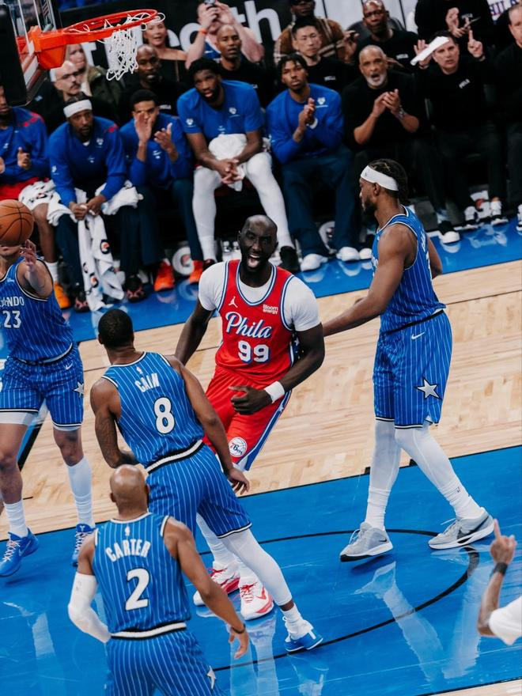

11月19日，NBA常规赛继续进行，费城76人队赴客场挑战奥兰多魔术队。本场比赛76人队后来居上，在最多落后16分的情况下，最终121-116逆转击败了魔术队，取得4连胜的同时终结了对手的4连胜。

76人队（13-3）：詹姆斯22分6助攻，恩比德26分6篮板7助攻，埃奇库姆24分8篮板6助攻，西蒙斯18分，波普8分8篮板，

魔术队（6-8）：小瓦格纳27分8篮板11助攻，萨格斯18分8篮板，布莱克15分6助攻，卡特15分8篮板，贝恩15分，达席尔瓦12分。

首节比赛中段魔术队多点开花，打出了一波15-2的进攻高潮，5分35秒贝恩三分命中，魔术队24-9领先76人队15分。76人队在后半段逐渐找到手感，但魔术队方面同样保持了很高的命中率。首节比赛战罢，76人队27-40落后对手。

第二节詹姆斯连拿4分，76人队打出9-0的追分攻势，7分04秒追到45-51。魔术队方面连得5分，再次将分差拉开到两位数。最后2分钟76人队再次打出追分高潮，半场比赛结束时，76人队64-69落后5分。

第三节开局魔术队连得6分，双方差距再次来到两位数。76人队方面多点开花，回敬了一波9-2的攻势，波普的三分命中，让76人追到73-77。此后两队你来我往，76人队多次追到只有1分分差。三节比赛过后，76人92-97落后5分。

末节埃奇库姆包办了76人队的前10分，带队在关键时刻追上比分。5分09秒沃克三分命中，76人队107-106实现反超。此后双方在场上陷入拉锯战，最后14秒西蒙斯三分命中，76人队119-113终结比赛悬念。最终全场比赛战罢，76人队121-116赢下胜利。

特别声明：以上内容(如有图片或视频亦包括在内)为自媒体平台“网易号”用户上传并发布，本平台仅提供信息存储服务。

Notice: The content above (including the pictures and videos if any) is uploaded and posted by a user of NetEase Hao, which is a social media platform and only provides information storage services.

鱼崖大话篮球 2026-11-19 17:18:55

弄月公子 2026-11-19 15:29:14

老汆古装影视解说 2026-11-18 00:33:59

翻车选手小李 2026-11-19 00:03:21

梦仙境aa 2026-11-18 19:32:05

老侃侃球 2026-11-19 10:38:32

体育新角度 2026-11-19 15:03:43

一抹宁静 2026-11-17 03:35:55

体坛周报 2026-11-19 17:08:12

23号球魁 2026-11-17 17:12:21

董老师看竞技 2026-11-19 14:32:02

星中乐事 2026-11-18 02:37:23

老付聊体育 2026-11-18 11:53:51

嘴角上翘 2026-11-19 16:22:57

篮球盛世 2026-11-16 11:08:22

诗意鸢尾 2026-11-18 04:47:26

两重心事p 2026-11-19 03:46:56

颜小白的篮球梦 2026-11-19 18:18:34

梦仙境aa 2026-11-18 20:12:51

夜里的海风 2026-11-19 11:21:40

曹操篮球解说 2026-11-19 13:05:20

诗意鸢尾 2026-11-18 03:57:24

董老师看竞技 2026-11-19 14:32:03

董老师看竞技 2026-11-19 11:52:25

阿鲲作曲 2026-11-19 00:45:26

篮球人物故事会 2026-11-17 18:01:24

极酷体育 2026-11-16 22:47:03

荒野老五 2026-11-18 20:58:57

曹操篮球解说 2026-11-19 12:29:31

曼曼爱剪辑 2026-11-18 00:59:23

曦言说 2026-11-19 16:22:09

慕名而来只为你 2026-11-18 01:58:22

常青Dx 2026-11-18 03:08:52

篮球人物故事会 2026-11-17 17:28:16

吟雪情枫y 2026-11-19 03:25:47

此去经年q 2026-11-19 12:15:31

梦仙境aa 2026-11-19 11:56:17

老汆古装影视解说 2026-11-19 01:13:57

罗吹终结者 2026-11-19 14:49:43

创造精彩剧情 2026-11-18 02:50:02

## 配图

图：篮球（网易体育 · 2026-11-19）

## 来源

- [网易体育 · 原文](https://www.163.com/dy/article/LC3F11HH0529TPTB.html)
