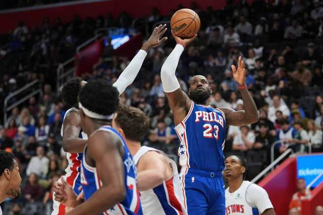

北京时间11月5日，NBA常规赛76人客场对阵活塞，展开东部前二的榜首之争，布朗、恩比德与詹姆斯前两节给力表现，引领76人上半场56-42领先活塞。下半场76人在末节开局扩大18分优势，活塞顽强反扑追到个位数差距功亏一篑，最终76人112-106复仇活塞豪取5连胜巩固东部第一，活塞结束3连胜。

76人：詹姆斯13分10篮板8助攻，布朗30分7篮板，恩比德26分15篮板，马克西19分7助攻，埃奇库姆11分。

活塞：坎宁安26分7篮板11助攻，罗宾逊7记三分27分，奥萨尔11分17篮板，科林斯16分。

詹姆斯NBA生涯达成命中16000球里程碑，创造NBA历史第一纪录。

詹姆斯NBA生涯已经给至少205名球员送出助攻，创造NBA历史第一纪录。

詹姆斯本赛季已经得到至少100+50+50数据，追平76人队史最快纪录。

76人前8场7胜1负东部第一，活塞前7场6胜1负东部第二，本赛季首次交锋76人主场93-106输给活塞。本场活塞缺少杜伦与乔，76人缺少巴洛与胡克波尔蒂。首节开局76人2-6落后，76人连得5分反超，双方缠斗至76人9-8领先，活塞一波9-2攻势反超6分。76人多点开花一波10-0攻势反超，赫尔特三分追分，76人一波8-1攻势拉开比分，其中布朗超远压哨三分命中，首节结束76人29-21领先活塞。首节布朗10分与恩比德8+5，坎宁安8中2仅得到4+3+3+1+1帽。

次节比赛，詹姆斯突破上篮扩大10分优势，科林斯勾手得分，布朗补篮得分，活塞连追4分。詹姆斯连送助攻76人扩大40-27领先打停活塞，布朗随后接连命中三分，76人逐步扩大48-31领先优势。活塞冲击内线一波9-0攻势追分，76人得到3分，恩比德肘击史密斯吃T，坎宁安罚中一球。布朗与恩比德携手造犯规合计6罚5中，76人单节27-21净胜6分，上半场结束76人扩大56-42领先活塞。前两节比赛，76人三分10中4，布朗23分、詹姆斯8+7+6与恩比德13+8；活塞三分17中4，罗宾逊11分与坎宁安9+5+4。

中场休息回来，坎宁安三分命中，恩比德勾手得分，埃奇库姆中投得分维持60-47领先。活塞一波7-2攻势追到差8分，马克西三分开火逐步找到进攻状态，76人一波8-2攻势扩大70-56领先。活塞连追5分，詹姆斯也站出来得分维持77-65领先，罗宾逊再中三分，马克西三分命中引领8-0攻势扩大16分优势。76人继续压制活塞，76人单节35-33再赢2分，三节结束76人91-75领先活塞。前三节比赛，76人三分17中8，詹姆斯13+9+7、布朗28分与恩比德18+11；活塞三分25中9，罗宾逊6记三分20分与坎宁安20+4+6。

进入第四节比赛，布朗与马克西接连得分，76人扩大95-77领先18分优势，活塞一波9-0攻势追到差9分。恩比德中投得分，里德暴扣，76人再得4分扩大13分优势，詹金斯三分命中追分。马克西三分回敬，活塞连追4分，恩比德中投得分，罗宾逊三分命中。坎宁安两罚全中，詹姆斯中投打铁，坎宁安上篮追到差4分。双方随后接连打铁，恩比德被犯规两罚全中，罗宾逊造埃奇库姆三分犯规三罚两中，马克西被犯规两罚全中。科林斯暴扣，马克西继续被犯规两罚全中，双方各请求一次暂停，最终76人险胜活塞豪取5连胜坐稳东部第一。

76人：布朗、詹姆斯、恩比德、马克西、埃奇库姆

活塞：里德、科林斯、奥萨尔、罗宾逊、坎宁安

特别声明：以上内容(如有图片或视频亦包括在内)为自媒体平台“网易号”用户上传并发布，本平台仅提供信息存储服务。

Notice: The content above (including the pictures and videos if any) is uploaded and posted by a user of NetEase Hao, which is a social media platform and only provides information storage services.

鱼崖大话篮球 2026-11-05 17:56:03

法老不说教 2026-11-05 18:18:25

小路看球 2026-11-05 17:23:15

一个体育黑 2026-11-05 17:55:04

孤单是寂寞的毒 2026-11-05 04:45:15

奇聞空间 2026-11-03 11:31:12

隐龙天下o 2026-11-04 11:34:58

寒士之言本尊 2026-11-05 19:25:03

董老师看竞技 2026-11-03 10:53:29

桑葚爱动画 2026-11-05 19:00:41

无人倾听无人倾听 2026-11-03 13:31:33

董老师看竞技 2026-11-05 10:51:35

董老师看竞技 2026-11-03 14:31:33

你是佛的弟子 2026-11-05 03:15:51

正经球迷 2026-11-05 17:46:20

紧跟时代脉搏 2026-11-03 02:58:29

酒话醉人 2026-11-04 04:38:18

体育新角度 2026-11-05 19:22:32

体坛速报局 2026-11-03 11:54:25

语妍视频剪辑 2026-11-04 12:16:25

青山入怀u 2026-11-04 01:13:15

各地精彩不容错过 2026-11-05 05:56:30

正经球迷 2026-11-04 13:06:06

本质珺 2026-11-03 13:05:26

体坛八点半的那些事儿 2026-11-05 19:03:27

董老师看竞技 2026-11-03 09:53:28

董老师看竞技 2026-11-05 10:53:24

做只好猹 2026-11-04 11:58:37

语妍视频剪辑 2026-11-05 15:21:53

体坛速报局 2026-11-03 11:25:25

一路荒凉如歌aa 2026-11-05 02:04:34

董老师看竞技 2026-11-05 14:24:49

湘村大余 2026-11-05 19:15:46

体坛速报局 2026-11-03 10:39:27

简单清风 2026-11-05 16:45:44

曹操篮球解说 2026-11-04 10:25:31

薛艳艳爱生活 2026-11-03 11:52:31

篮球过人技巧 2026-11-04 18:47:03

揭秘那些精彩 2026-11-04 04:01:08

趣小亮 2026-11-05 11:35:19

## 配图

图：篮球（网易体育 · 2026-11-05）

## 来源

- [网易体育 · 原文](https://www.163.com/dy/article/LAVEL0RU0529RKNN.html)
