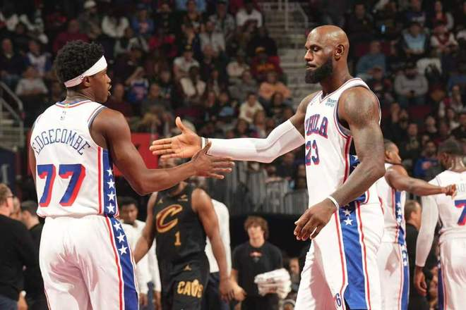

北京时间11月7日，NBA杯76人客场对阵骑士，76人在落后16分情况下，持续反扑在第三节中段追到仅差2分。骑士多点开花碾压76人逐步扩大25+领先优势，最终76人95-119输给骑士结束5连胜丢掉联盟第一，骑士结束2连败。

76人：詹姆斯8分7篮板3助攻6失误创加盟最低分纪录，也是时隔11个月再次单场得分未上双。恩比德9中0得到6分7篮板2盖帽赛季最差表现，布朗20分5篮板5助攻，埃奇库姆19分4抢断，马克西17分4助攻。

骑士：米切尔23分7篮板8助攻，莫布利22分6篮板4助攻，哈登17分6篮板3助攻，沃特森13分9篮板，全队7人得分上双。

米切尔贡献准三双全能表现，引领骑士用团队攻势复仇战胜76人。

76人前9场8胜1负联盟第一，骑士前8场4胜4负，本赛季首次交锋76人114-106战胜骑士完成29分大逆转。本场76人缺少博纳与巴洛，骑士缺少阿伦、泰森。首节前4分半钟76人持续打铁，被骑士多点开花压制2-15落后，詹姆斯上篮得分。骑士连得4分，76人连追5分，托马斯与西蒙斯对攻一记三分。骑士连得5分扩大15分优势，76人冲击内线有所反扑追分，首节结束76人22-33落后骑士。首节76人仅20中6，其中三分9中2，恩比德7中0仅得到2分；骑士20中13，其中三分12中5，米切尔10分与哈登4+3+3。

次节比赛，76人进攻回暖本场首次单节得分30+，埃奇库姆三分命中，骑士多点开花得分扩大16分优势。76人连得6分，海佐尼亚上篮得分，76人一波7-1攻势追到差6分，骑士连得4分维持10分优势。76人冲击内线一波8-1攻势追到差3分，骑士再得5分，布朗与哈登对攻一记三分，76人单节32-29追回3分，上半场结束76人54-62落后骑士。前两节比赛，76人三分19中7，布朗11+3+4与埃奇库姆17分、恩比德7中0得到4分与詹姆斯4中1仅得到2+3+3+4失误；骑士三分21中7，莫布利15分、米切尔与海佐尼亚均10分、哈登9+4+3。

中场休息回来，双方第三节均是单节不足30分，马克西攻传结合率领76人追到61-64仅差3分。76人继续反扑詹姆斯上篮追到65-67仅差2分，骑士连得6分扩大优势，76人随后被拉开70-79落后。马克西中投得分，骑士连得4分扩大11分优势，骑士之后继续压制76人拉开比分，76人单节20-29输掉9分，三节结束76人74-91落后骑士。前三节比赛，76人三分32中9，埃奇库姆19分、马克西17分与布朗14分，恩比德9中0得到6分与詹姆斯7中2得到4分；骑士三分30中10，米切尔20+6+8引领6人得分上双。

进入第四节比赛，骑士率先连得5分扩大22分领先优势，布朗中投打破得分荒，骑士立即请求暂停。詹姆斯上篮追到差18分，沃特森上篮与莫布利三分扩大21分优势，布朗连得4分，海佐尼亚上篮与哈登两罚全中。76人连续造犯规6罚5中，哈登三分命中，米切尔两罚一中扩大22分优势，双方均是撤下主力球员。比赛提前进入垃圾时间，骑士继续掌控局势，最终76人输给骑士结束5连胜丢掉联盟第一，骑士结束2连败。

76人：布朗、詹姆斯、恩比德、马克西、埃奇库姆

骑士：梅里尔、莫布利、沃特森、米切尔、哈登

特别声明：以上内容(如有图片或视频亦包括在内)为自媒体平台“网易号”用户上传并发布，本平台仅提供信息存储服务。

Notice: The content above (including the pictures and videos if any) is uploaded and posted by a user of NetEase Hao, which is a social media platform and only provides information storage services.

正经球迷 2026-11-07 15:05:06

你是佛的弟子 2026-11-05 03:15:51

小桥流水q 2026-11-07 18:54:34

体坛速报局 2026-11-07 11:38:51

黑曼巴谈球 2026-11-05 20:49:17

慕名而来只为你 2026-11-07 03:26:46

此去经年q 2026-11-07 13:01:10

千山暮雪h 2026-11-06 08:20:42

隐龙天下o 2026-11-04 11:34:58

马健 2026-11-05 23:56:40

九哥动漫 2026-11-06 03:17:38

隨風 2026-11-06 04:38:51

董老师看竞技 2026-11-05 10:51:35

各地精彩不容错过 2026-11-05 05:56:30

正经球迷 2026-11-05 17:46:20

正经球迷 2026-11-06 09:32:46

看球图一乐 2026-11-07 12:04:52

董老师看竞技 2026-11-07 10:13:26

紧跟时代脉搏 2026-11-07 04:04:32

繁花散尽m 2026-11-06 11:22:20

罗吹终结者 2026-11-07 18:06:34

语妍视频剪辑 2026-11-05 11:44:09

情如伊人b 2026-11-07 14:39:55

小熊回收站 2026-11-07 04:04:32

语妍视频剪辑 2026-11-05 15:21:53

看球图一乐 2026-11-07 11:33:51

体育慢镜头 2026-11-05 21:34:29

最佳菜鸟 2026-11-06 12:50:19

司峰阿道 2026-11-07 12:31:01

小叶子侃球FM 2026-11-05 23:49:58

仰茉莉 2026-11-06 03:35:28

网文作者夏少斌 2026-11-07 18:19:18

忘川无我n 2026-11-06 09:44:19

体坛速报局 2026-11-05 11:47:29

看球图一乐 2026-11-07 13:26:10

董老师看竞技 2026-11-05 11:02:19

左脚爆射得分 2026-11-06 11:44:12

泪之魂y 2026-11-05 01:52:08

揭秘那些精彩 2026-11-06 03:57:25

董老师看竞技 2026-11-05 10:53:24

## 配图

图：篮球（网易体育 · 2026-11-07）

## 来源

- [网易体育 · 原文](https://www.163.com/dy/article/LB4K72S10529RKNN.html)
