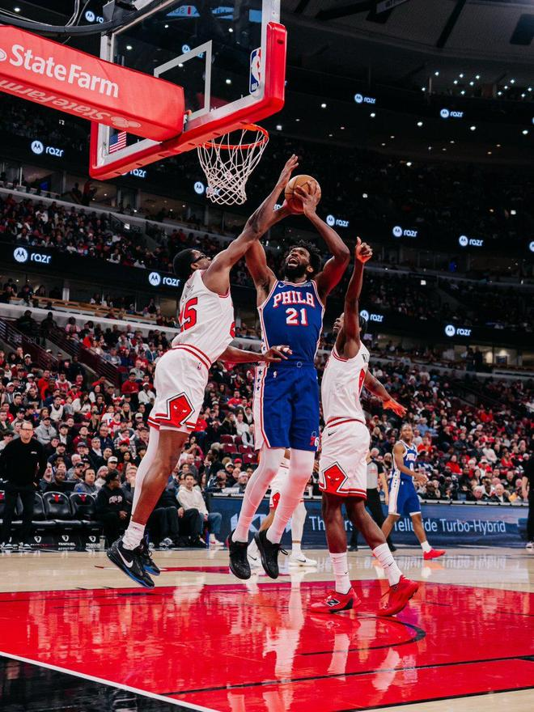

11月9日，NBA常规赛费城76人队客场挑战芝加哥公牛队。本场比赛双方一路僵持到最后时刻才分出胜负，76人队顶住了公牛队的反扑，127-121赢下了比赛的胜利，送给了公牛队一波7连败，继续坐稳了东部第一的位置。

76人（9-2）：布朗29分7篮板4助攻，詹姆斯22分4篮板5助攻，恩比德18分10篮板，马克西27分7助攻，埃奇库姆13分6篮板。

公牛（1-8）：吉迪19分7篮板15助攻，布泽利斯19分5篮板，威尔逊18分5篮板，史密斯17分8篮板，奥科罗12分。

首节比赛公牛队打出了6-0的开局，中段史密斯一人连拿5分，公牛队一度23-16取得7分优势。76人队多点开花，连拿7分过后双方在4分35秒战至23-23。此后双方交替领先，首节结束76人队34-32领先公牛2分。

第二节詹姆斯在短短2分半钟时间内独得11分，带领76人队打出了15-4的一波攻势，5分53秒76人队51-44领先公牛队7分。此后76人队再接再厉，马克西的两次罚球命中，一度将分差拉开到10分。半场比赛过后，76人68-61领先公牛。

第三节公牛打出了7-0的开局，布泽利斯的三分命中，让双方68-68回到同一水平线上。布朗、马克西和恩比德联手打出一波9-2，76人队稳住阵脚。最后2分22秒沃克的三分命中，一度将分差拉开到12分。但公牛队在最后2分钟顽强追到6分差距，三节结束76人99-93领先。

末节公牛队连追7分之后，在5分05秒追到110-113。奥科罗的2+1一度让公牛在最后3分钟追到116-118。关键时刻马克西三分命中，123-116分差再次被76人拉开到7分。最后14秒布朗两罚两中，76人队领先6分终结比赛悬念。

特别声明：以上内容(如有图片或视频亦包括在内)为自媒体平台“网易号”用户上传并发布，本平台仅提供信息存储服务。

Notice: The content above (including the pictures and videos if any) is uploaded and posted by a user of NetEase Hao, which is a social media platform and only provides information storage services.

真正能保护你的 2026-11-09 18:57:51

老贃是个手艺人 2026-11-09 14:01:45

削桐作琴 2026-11-09 17:47:39

正经球迷 2026-11-07 15:05:06

董老师看竞技 2026-11-09 09:40:37

马健 2026-11-08 09:12:12

宗介说体育 2026-11-09 13:49:26

体坛速报局 2026-11-07 11:38:51

紧跟时代脉搏 2026-11-07 04:04:32

拥抱抵不过时光 2026-11-08 03:46:35

董老师看竞技 2026-11-09 08:47:07

听风喃 2026-11-09 00:23:08

寒士之言本尊 2026-11-09 17:45:24

董老师看竞技 2026-11-09 09:51:12

你是佛的弟子 2026-11-09 12:09:00

董老师看竞技 2026-11-09 17:26:45

搞笑协会鸭 2026-11-09 13:56:55

体坛速报局 2026-11-09 08:07:55

奇聞空间 2026-11-09 12:42:34

董老师看竞技 2026-11-07 10:13:26

体坛速报局 2026-11-09 07:09:15

披挂风尘 2026-11-08 05:29:22

篮球过人技巧 2026-11-09 18:09:17

翻车选手小李 2026-11-07 01:48:09

司峰阿道 2026-11-07 12:31:01

人间闲散客 2026-11-07 02:25:30

DoubleZero 2026-11-08 10:44:42

一路荒凉如歌a 2026-11-09 01:42:20

听风喃 2026-11-09 00:18:55

趣小亮 2026-11-05 11:35:19

脑洞编剧小剧场 2026-11-09 02:32:45

董老师看竞技 2026-11-07 13:46:19

随遇而安之心 2026-11-09 03:50:26

酒话醉人 2026-11-08 05:08:08

大树123 2026-11-09 19:08:45

随遇而安之心 2026-11-09 03:47:31

尺素a 2026-11-08 04:56:29

人间闲散客 2026-11-08 01:11:03

落雪听梅a 2026-11-08 01:23:21

此去经年q 2026-11-07 13:01:10

## 配图

图：篮球（网易体育 · 2026-11-09）

## 来源

- [网易体育 · 原文](https://www.163.com/dy/article/LB9A2E730529TPTB.html)
