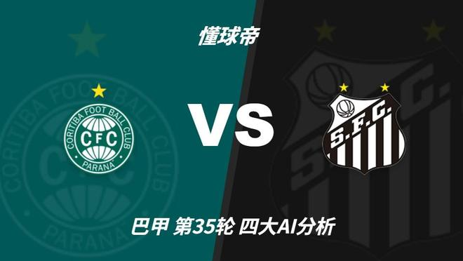

北京时间11月19日6点30分，巴甲第35轮，库里蒂巴主场迎战桑托斯。

主队34轮积42分排名第13，客队积47分排名第9。库里蒂巴需要抢分远离降级区，桑托斯则要追赶解放者杯资格区。主队近期进球效率偏低，客队迎来内马尔回归，比赛关键在于桑托斯能否兑现前场优势。

千问：内马尔回归提升创造力，桑托斯有望反客为主

库里蒂巴近五轮只进3球，中前场衔接不畅是主要问题。若苏埃负责组织，布雷诺-洛佩斯和佩德罗-罗沙必须及时接应，否则主队容易陷入外围传导。门将佩德罗-莫里斯科缺席，佩德罗-兰热尔将顶替出场。

桑托斯迎回内马尔，阿图尔也有望首发，库蒂尼奥、埃弗顿和加布里埃尔-巴博萨提供多种进攻选择。内马尔回撤能吸引防守，为两侧队友创造前插空间。尽管球队连续三轮未胜，前场配置仍占优。千问看好客队凭个人能力打破僵局。

参考比分：1-2、0-1

豆包：库里蒂巴主场不会轻易让出主动权

库里蒂巴积42分，仍需拿分巩固保级位置。球队本季17个联赛主场6胜5平6负，虽谈不上强势，但仍有主场抢分基础，回到库托佩雷拉球场有望提升对抗强度。雅西伤情好转，可以改善后防稳定性。桑托斯迎回内马尔和阿图尔，但两人仍需找回比赛节奏，不能期待他们立刻解决所有问题。

若苏埃可以连接中场与双前锋，利用客队边后卫前插后的空间反击。桑托斯后防人员也有调整，新搭档需要磨合。豆包认为主队有能力将比赛拖入胶着，平局机会不低，主队若能率先限制内马尔接球，比赛就有望进入自己熟悉的节奏。

参考比分：1-1、0-0

Kimi：桑托斯前场选择更多，但防守转换仍有风险

桑托斯前场特点互补：内马尔在肋部持球，库蒂尼奥寻找直塞线路，埃弗顿从边路内切，加布里埃尔-巴博萨牵制中卫。阿图尔若能向前输送，客队便有机会持续威胁禁区。

但客队也要防范反击。若苏埃能在两线间送球，布雷诺-洛佩斯和佩德罗-罗沙便可冲击禁区。桑托斯本季17个联赛客场打进27球、丢28球，进攻有产量，防守却不够稳。两侧压上时，后腰必须保护中卫身前。Kimi认为客队技术优势更明显，但难有大比分，倾向小胜。

参考比分：0-1、1-2

DeepSeek：中场控制决定比赛，双方都有机会取得进球

比赛关键在中场攻防转换。蒂亚戈-桑托斯、塞巴斯蒂安-戈麦斯和尼古拉斯-丰塞卡需要限制前腰区域，避免内马尔、库蒂尼奥轻松转身。主队若能在中场形成对抗，便可削弱客队技术优势。

阿图尔回归增加出球选择，但加布里埃尔-邦滕波缺席影响轮换。客队若过度依赖内马尔，容易被针对性围堵。主队抢分动力强，桑托斯防守也不稳定。客队需要控制边后卫的前插幅度，避免进攻投入过多后被对手直接打身后。DeepSeek认为双方都有破门机会，平局值得重视。

参考比分：1-1、1-2

综合分析：桑托斯进攻配置占优，库里蒂巴主场仍有抵抗力

四家意见分歧：千问、Kimi支持客胜，豆包、DeepSeek看平。库里蒂巴进球效率偏低；桑托斯迎回内马尔和阿图尔，创造力提升，但连续三轮不胜且后防仍需磨合，客胜并不稳妥。

若桑托斯先得分，主队压上会给客队反击空间；若库里蒂巴领先，桑托斯则要依靠个人能力破密集防守。综合阵容与创造力，客队略占上风，仍需防平。

比赛观点：客胜，防范平局

参考比分：1-2、0-1，次选1-1

11月17日四大AI分析结果：豆包和DeepSeek5中3并列第一

特别声明：以上内容(如有图片或视频亦包括在内)为自媒体平台“网易号”用户上传并发布，本平台仅提供信息存储服务。

Notice: The content above (including the pictures and videos if any) is uploaded and posted by a user of NetEase Hao, which is a social media platform and only provides information storage services.

懂球帝 2026-11-18 14:38:19

懂球帝 2026-11-18 17:07:16

懂球帝 2026-11-18 16:26:07

搞怪笑工厂 2026-11-18 09:20:37

爱搞笑的皮皮 2026-11-17 13:46:06

足球印象CC 2026-11-18 15:03:21

利利爱搞笑 2026-11-18 13:52:33

我们的足球记忆 2026-11-17 20:26:56

懂球帝 2026-11-18 14:38:19

一个香蕉说球 2026-11-17 23:17:55

足球印象CC 2026-11-17 20:01:45

路上的风景我想你 2026-11-18 04:48:07

幽默狂欢营 2026-11-18 09:22:54

精彩背后的故事 2026-11-17 03:00:33

懂球帝 2026-11-18 17:28:50

奇葩笑话大舞台 2026-11-17 14:08:41

奥力给趣笑堂 2026-11-18 10:49:39

福酱的小时光 2026-11-18 17:31:11

千山暮雪h 2026-11-18 03:57:15

体坛周报 2026-11-17 04:21:41

小刘说趣奇 2026-11-17 14:26:46

浣溪爱球 2026-11-17 12:02:31

足球故事GOAL 2026-11-17 20:06:59

左脚爆射得分 2026-11-17 17:55:46

精彩一网打尽 2026-11-16 15:29:28

心开动漫鑫鑫 2026-11-17 01:26:26

足球推文C 2026-11-18 19:34:11

王飬吃吃喝喝 2026-11-17 02:54:31

神秘研究院 2026-11-16 11:10:41

篮球过人技巧 2026-11-16 20:12:01

篮球过人技巧 2026-11-15 20:07:20

米奇兔 2026-11-18 14:37:35

一抹宁静 2026-11-18 02:37:51

狍子歪解体坛 2026-11-16 04:10:19

海浪星体育 2026-11-17 11:55:54

米奇兔 2026-11-16 14:57:34

人间闲散客 2026-11-17 02:35:43

篮球过人技巧 2026-11-15 21:09:14

精彩一网打尽 2026-11-18 08:55:33

精彩背后 2026-11-18 09:06:57

## 配图

图：篮球（网易体育 · 2026-11-18）

## 来源

- [网易体育 · 原文](https://www.163.com/dy/article/LC1R7SKI0549BAP0.html)
