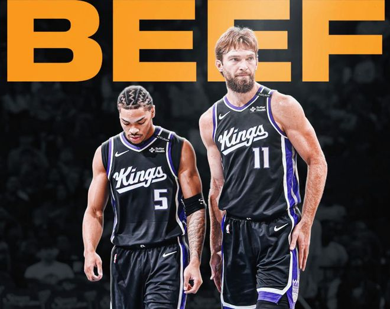

北京时间11月2日，萨克拉门托国王是新赛季开局表现最差的球队之一，开赛遭遇六连败。球队处境艰难，随着交易截止日临近，国王大概率会成为市场上值得重点关注、可能有动作的队伍。

国王给予新秀后卫阿卡夫大量球权，他目前是队内得分王。与此同时，扎克・拉文、多曼塔斯・萨博尼斯等老将，整个赛季都可能卷入交易流言。

据Heavy网站NBA消息源肖恩・德维尼报道，有消息认为萨博尼斯本赛季有可能被送走。

德维尼提到，想要补强内线高度的球队，会对这位前全明星球员有意。他补充说，如果萨博尼斯本赛季没能交易出去，国王可能会等到明年夏天再动手，届时他的合同将进入最后一年。

这名消息人士还透露，萨博尼斯不太愿意和阿卡夫这种大量持球的后卫搭档，而国王也没有和萨博尼斯续约的打算。

“国王这边，本赛季手握两份年薪接近5000万的合同：扎克・拉文的合同即将到期，多曼塔斯・萨博尼斯还剩一年。球队现在把球权交给效率低下、盲目出手的小达赖厄斯・阿卡夫，这只会进一步压低两名老将本就有限的交易价值。”德维尼写道。

“萨博尼斯还有机会出手，毕竟各队一直都需要内线。如果本赛季走不了，那他明年夏天大概率会被交易。国王无意留下他，他本人也不想和阿卡夫这种球权黑洞搭档。如果能用他换回一个首轮签，那算是大收获，但难度很高。”

国王新秀阿卡夫生涯前三战就打破了一项尘封50年的纪录：三场比赛合计出手73次。此前这项纪录由凯文・杜兰特保持，杜兰特新秀赛季前三战出手64次。大量出手也转化成了得分产出，他场均砍下26.3分，排在本赛季联盟场均得分前十。

特别声明：以上内容(如有图片或视频亦包括在内)为自媒体平台“网易号”用户上传并发布，本平台仅提供信息存储服务。

Notice: The content above (including the pictures and videos if any) is uploaded and posted by a user of NetEase Hao, which is a social media platform and only provides information storage services.

马健 2026-11-01 05:27:24

小叶子侃球FM 2026-10-30 16:25:36

篮球盛世 2026-11-01 17:08:39

为了更好 2026-11-02 03:25:15

篮球大图 2026-11-01 10:59:12

语妍视频剪辑 2026-11-01 12:54:17

星河漫山野 2026-11-02 05:50:12

创造精彩剧情 2026-11-01 11:49:22

玫瑰进化出獠牙h 2026-10-31 12:13:24

尺素a 2026-10-31 04:51:54

娱姐碎碎念 2026-11-01 17:43:27

篮球过人技巧 2026-10-31 16:18:35

显微镜下的人性 2026-11-01 06:51:25

老威头 2026-10-31 18:14:09

半岛荼靡u 2026-10-31 04:38:27

紧跟时代脉搏 2026-11-02 02:35:07

嘴角上翘 2026-11-01 11:44:17

暮雨咋歇着 2026-10-31 00:55:19

各地精彩不容错过 2026-11-02 03:34:51

精彩一网打尽 2026-11-02 02:46:02

酒话醉人 2026-11-02 03:32:37

飞驰论坛o 2026-11-02 02:47:02

咪咕体育 2026-10-31 04:31:54

醉卧浮生 2026-11-01 10:36:49

咪咕体育 2026-10-31 04:30:37

阿嬍体育评论 2026-10-31 03:36:24

田先生篮球 2026-11-01 13:38:05

董老师看竞技 2026-11-01 14:30:04

大西体育 2026-11-01 13:39:58

吕谑极限手工 2026-11-01 13:26:57

老汆古装影视解说 2026-10-31 03:44:12

罗吹终结者 2026-10-30 19:20:55

小叶子侃球FM 2026-11-01 18:25:07

雪里温柔z 2026-11-01 06:20:02

破晓资讯 2026-11-01 15:38:24

正经球迷 2026-10-30 14:00:55

精彩一网打尽 2026-11-01 06:49:50

老汆古装影视解说 2026-10-31 03:59:03

精彩一网打尽 2026-11-02 02:44:46

旧城旧巷a 2026-11-02 02:57:17

## 配图

图：篮球（网易体育 · 2026-11-02）

## 来源

- [网易体育 · 原文](https://www.163.com/dy/article/LAN6C2EI0529BA9O.html)
