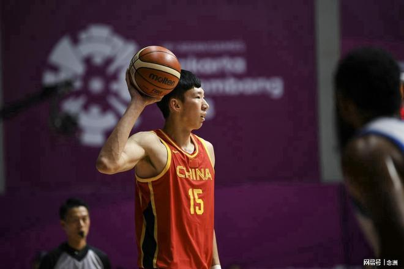

中国男篮备战世预赛，周琦重返国家队集训名单，而据周琦的儿子透露，之前父亲想参加亚运会，但是国家队不要他。

名古屋亚运会中国男篮名单公布后以及中国男篮兵败亚运会后，多位媒体人透露，周琦本人愿意出战亚运会，但最终名单公布时他却落选了。

媒体人诚sir老爸爆料称，郭士强的理由是“周琦没参加夏天集训”，可他选了刚做完手术的余嘉豪，余嘉豪休赛期同样在养伤，俩人情况本质没区别。季孟年认为，周琦这一代运动员对于代表祖国参加大型综合运动会还是有特殊情感的，没能入选他自己也感觉有些遗憾。

如今，中国男篮公布世预赛名单，周琦重返国家队。周琦妻子更新社媒，晒出和儿子的对话视频，并配文写道：“发个库存，在小孩哥的心里种下正确的种子。”

周琦儿子在短视频中确认此事：“我很想让爸爸去日本打败日本队，但他们不让爸爸去。我说你以后还是别去（国家队）了，他说不行。”

特别声明：以上内容(如有图片或视频亦包括在内)为自媒体平台“网易号”用户上传并发布，本平台仅提供信息存储服务。

Notice: The content above (including the pictures and videos if any) is uploaded and posted by a user of NetEase Hao, which is a social media platform and only provides information storage services.

宗介说体育 2026-11-04 14:28:24

宗介说体育 2026-11-05 15:03:15

万灵缝合厂 2026-11-05 02:49:51

国足未赢够 2026-11-05 12:29:02

国足未赢够 2026-11-04 14:57:22

国足未赢够 2026-11-04 15:08:22

叹为观止易 2026-11-06 04:37:59

烟雨洛神生 2026-11-06 00:59:03

科技前沿菌 2026-11-04 04:03:34

男足的小球童 2026-11-05 17:10:30

体育慢镜头 2026-11-04 21:01:49

海星动画 2026-11-05 11:50:18

被忽略的美好 2026-11-06 03:31:04

一路荒凉如歌a 2026-11-06 02:37:46

我们的主场 2026-11-04 00:01:53

逗比演员说体育 2026-11-06 00:31:49

安养社Health 2026-11-06 05:21:27

新华社 2026-11-05 09:58:24

耘禾农技社 2026-11-05 03:24:57

逗比演员说体育 2026-11-06 00:40:57

灼凉 2026-11-06 02:17:06

林小湜体育频道 2026-11-06 03:30:35

山野探险家c 2026-11-06 05:18:45

叫醒耳朵b 2026-11-05 02:51:34

带你领略世界风采 2026-11-05 15:32:30

何夕夕与书 2026-11-05 02:31:28

国足未赢够 2026-11-04 14:57:40

丁铗惊悚影视解说 2026-11-06 00:19:27

国足未赢够 2026-11-04 14:57:34

空白我们 2026-11-04 00:20:16

宗介说体育 2026-11-05 14:44:30

心如止水o 2026-11-06 03:07:35

国足未赢够 2026-11-04 14:55:37

国足未赢够 2026-11-05 12:49:19

逗比演员说体育 2026-11-06 00:33:43

晓隯就是我 2026-11-06 01:26:54

逗比演员说体育 2026-11-06 00:38:38

达达爱剪辑 2026-11-06 05:21:43

夏末的晨溪 2026-11-06 04:57:32

你在彼方 2026-11-06 05:11:09

## 配图

图：篮球（网易体育 · 2026-11-06）

## 来源

- [网易体育 · 原文](https://www.163.com/dy/article/LB1J8MQ50553AOVQ.html)
