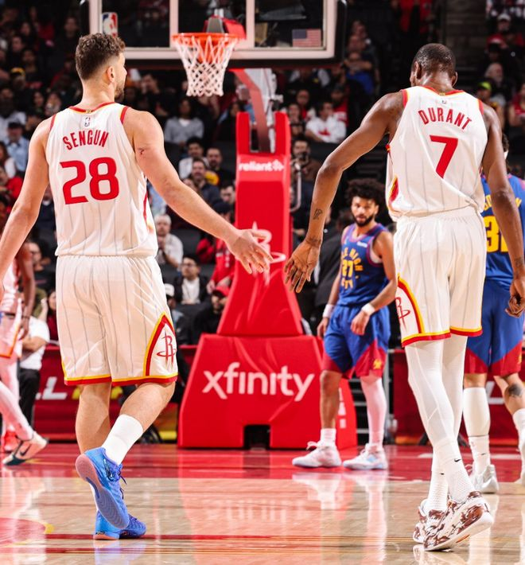

火箭大胜掘金结束连败，这场比赛后火箭8胜3负排在西区第六的位置。此役火箭队在主场顶住了掘金的反扑并在第三节稳固了局势，末节一直牢牢掌控大局，申京与杜兰特的表现很关键。

本赛季进入末节杜兰特就不灵，申京是唯一的依仗，此役申京末节打了11分钟，6中4，罚球3中1，拿到9分3篮板5助攻，是他的进攻与串联帮助火箭拿下胜利。

全场比赛申京35分钟，17中9，三分3中1，拿到20分12篮板8助攻1抢断1盖帽，上一场对阵太阳16中5已经回暖。

这场比赛申京是唯一可以出战的中锋，亚当斯比目鱼肌拉伤、卡佩拉脚踝扭伤、希布韦生病。乌度卡在赛前谈到这三位中锋的伤势，希布韦大概率只缺席1-2场比赛，但亚当斯与卡佩拉需要在一周后重新评估，具体归期未定。

申京实际上是带伤出战，此役他就因为背伤缺席了两场比赛，可因为球队的内线捉襟见肘他只能带伤出战。目前，他场均34.7分钟，拿到21.3分9篮板7.8助攻1.1抢断1.1盖帽，命中率51.4%，三分命中率47.4%，他依旧是球队第一战力，可有伤的他又能坚持多久？

休媒Will呼吁火箭队需要补强一位替补中锋，亚当斯依旧无法登场，申京的状态无法保证，如果申京也缺席，火箭队等于没有真的中锋可用。（卡佩拉、希布韦能力不足）

火箭还剩两个主场（勇士、爵士），随后在11月16日后会开启一波四连客之旅，如果四连客开启后亚当斯、卡佩拉二人中的一人还无法复出，那么申京的压力会更大。

特别声明：以上内容(如有图片或视频亦包括在内)为自媒体平台“网易号”用户上传并发布，本平台仅提供信息存储服务。

Notice: The content above (including the pictures and videos if any) is uploaded and posted by a user of NetEase Hao, which is a social media platform and only provides information storage services.

细胞漫游者 2026-11-11 03:05:03

山野探险家c 2026-11-11 03:12:51

晚晚秋意渐 2026-11-11 04:35:03

用冷眼洞悉世界 2026-11-11 05:51:57

小管聊一聊 2026-11-11 03:42:16

十夏九漓 2026-11-11 04:29:19

精彩一网打尽 2026-11-11 03:26:03

聚焦热点大爆炸 2026-11-11 05:52:49

阅尽天下精彩 2026-11-11 05:54:39

吕彍极限手工 2026-11-11 03:12:05

走过海棠 2026-11-11 03:16:16

网文作者夏少斌 2026-11-08 18:24:55

董老师看竞技 2026-11-08 12:06:43

铭记人类辉煌 2026-11-10 03:09:17

正经球迷 2026-11-10 16:30:31

你是佛的弟子 2026-11-11 03:02:24

小郭聊球 2026-11-08 22:35:00

篮球过人技巧 2026-11-10 20:16:17

看球图一乐 2026-11-09 17:18:21

正经球迷 2026-11-08 23:13:25

紧跟时代脉搏 2026-11-11 03:42:34

创造精彩剧情 2026-11-11 04:37:24

耀眼的星火 2026-11-10 02:14:21

紧跟时代脉搏 2026-11-10 03:29:50

阿嬍体育评论 2026-11-11 04:18:47

各地精彩不容错过 2026-11-09 05:03:18

凉了时光人 2026-11-09 11:05:12

孤单是寂寞的毒 2026-11-11 04:04:12

咪咕体育 2026-11-09 17:49:12

听风喃 2026-11-09 00:26:00

篮球盛世 2026-11-09 17:05:24

热点风采 2026-11-11 04:18:29

搞笑脑洞研究所 2026-11-10 02:29:07

泪之魂y 2026-11-11 01:56:54

咪咕体育 2026-11-09 17:49:07

咪咕体育 2026-11-09 17:47:50

好火子 2026-11-11 06:04:49

萌萌乐翔事 2026-11-09 04:46:39

领略非凡 2026-11-11 02:38:39

喜老登 2026-11-10 01:51:14

## 配图

图：篮球（网易体育 · 2026-11-11）

## 来源

- [网易体育 · 原文](https://www.163.com/dy/article/LBEF004F05299VFU.html)
