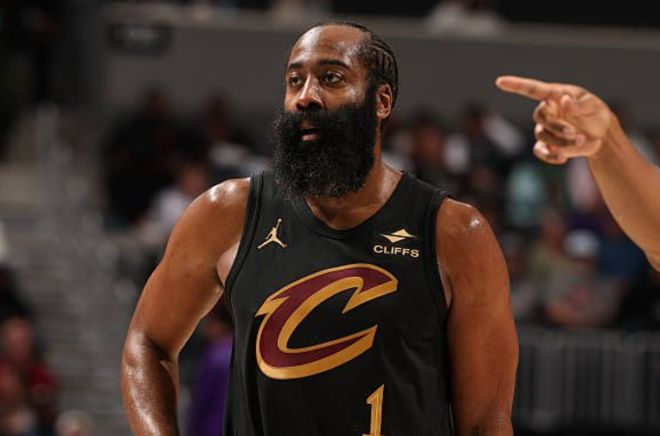

北京时间11月13日，据骑士名记瓦尔登报道，哈登训练营报到时身材走样，现在也还没调到最佳。他打算借着赛季前期的比赛，以赛代练找回身体状态，至少他本人坦然承认这点。昨日采访中，他说，夏天没怎么打野球，到了这个年纪，他清楚自己要等体能恢复到位，速度才能回来。

“我知道适应比赛强度、节奏，所有一切都需要时间，”哈登说，“我不再年轻，没法立刻进入状态，赛季开始前我就清楚这点。现在，我感觉很不错，训练也一直在跟上。这也是我能在联盟立足这么久的原因。”

哈登表示外界的批评不会困扰他，他现在只想“把状态调到最好，熟悉队友”。

哈登今年37岁，这是他的第18个赛季。大多数球员到这个年纪，都会慢上一拍，数据栏里那一项的数字再也不会那么亮眼。

对尼克斯一战，哈登打得游刃有余，交出了久违的经典表现，拿下赛季新高32分，骑士115-107击败尼克斯，这场胜利球队非常需要。

哈登出战33分钟，14投9中，投进5记三分，罚球11中9。全场仅有2次失误，甚至拿出了一定的防守贡献——哪怕在上个十年他还是联盟顶级得分手时，防守也一直饱受诟病。他拿到2次抢断，佩顿・沃特森那次本场最佳追身大帽，哈登也有功劳。

比赛还剩33秒，骑士领先5分，尼克斯发起快攻反击。球提前传给麦克布莱德，哈登挡在他和篮筐之间。这场冲刺，麦克布莱德有能力、也理应完成超车，他确实做到了。但哈登一直跟防，选对了防守路线、持续移动脚步，让沃特森刚好到位，完成这次追身封盖。

“不可能做到完美，”哈登说，“今晚好了一些。我们会复盘哪些奏效、哪些不行，把好的地方延续下去。”

这是哈登在骑士的第一个完整赛季，但他和队内老将们已经熟悉。上赛季交易截止日，球队用加兰换来了他，骑士方面一直认为，哈登的到来，帮助球队打进了东决，对阵的正是尼克斯。

想要再次走到那一步，骑士需要哈登更多这样的夜晚。

“我们不需要他每晚都打出这种表现，”骑士主帅阿特金森说，“他自己也明白。他要做的是持续做出正确选择；他是球商极高的球员，懂得反复做出正确判断。所以不用像当年火箭时期的哈登那样，每晚疯狂得分。我们有足够多的进攻武器。”

最近几天，随队记者注意到一个刺眼的数据：骑士轮换里所有球员，本赛季在哈登在场时的数据，都不如他不在场的时候。克利夫兰本地媒体在周三赛前刊发长文，详细列出哈登的各项数据困境，这里摘录几条——

哈登不在场时，骑士每百回合进攻效率要高出15分。开赛至今，他的投篮命中率、禁区终结命中率都创下生涯新低。在所有禁区出手至少25次的球员里，他的禁区命中率大概率是联盟最差的，仅有36%。他的助攻率为25.7%，低于上赛季他在场时34.7%的助攻占比。

情况一目了然。更难看的不只是年龄，还有他的合同：三年9700万美元。骑士是一支为冲冠砸下重金的球队，这份合同，是期待他成为争冠路上的关键一环。

开赛11场，他并没有打出匹配身价的表现，直到昨日的麦迪逊广场花园。

“他找回自己了。”砍下23分的米切尔说道。

特别声明：以上内容(如有图片或视频亦包括在内)为自媒体平台“网易号”用户上传并发布，本平台仅提供信息存储服务。

Notice: The content above (including the pictures and videos if any) is uploaded and posted by a user of NetEase Hao, which is a social media platform and only provides information storage services.

上观新闻 2026-11-12 18:06:07

看看新闻Knews 2026-11-12 13:03:18

界面新闻 2026-11-12 18:15:51

扬子晚报 2026-11-11 21:04:34

极目新闻 2026-11-10 08:00:38

北青网-北京青年报 2026-11-12 21:26:04

洪观新闻 2026-11-10 18:08:34

极目新闻 2026-11-12 08:59:09

北京日报 2026-11-12 18:38:23

环球网资讯 2026-11-12 20:28:11

界面新闻 2026-11-12 18:47:44

大洛杉矶LA 2026-11-13 06:08:08

半岛官网 2026-11-12 17:27:53

南方都市报 2026-11-12 08:16:06

每日经济新闻 2026-11-12 22:08:29

齐鲁壹点 2026-11-12 21:04:35

界面新闻 2026-11-12 11:34:23

北京网络举报 2026-11-11 09:33:17

青城之窗 2026-11-13 06:02:22

九方鱼论 2026-11-13 06:27:59

## 配图

图：篮球（网易体育 · 2026-11-13）

## 来源

- [网易体育 · 原文](https://www.163.com/dy/article/LBJIEPUN0529BA9O.html)
