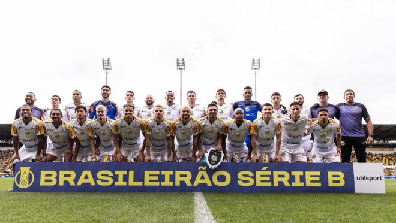

新奥里藏特人是2026赛季巴乙冠军。这支来自圣保罗州内陆的球队队史首次拿到全国冠军。球队本周六在圣卡塔琳娜州客场击败克里丘马后捧起奖杯。上周末击败福塔莱萨后，他们已经提前锁定升级资格。

瓦莱之虎将成为2027赛季巴甲顶级联赛里最年轻的球队。这个冠军也为球队赛季画上完美句号，他们本赛季还拿到了圣保罗州锦标赛亚军。

新奥里藏特人的黄黑军团以73分结束巴乙，战绩为21胜10平7负。新奥里藏特人是联赛进攻火力最强的球队，打进67球，净胜球35个也是最佳。

2026：新奥里藏特人 2025：库里蒂巴 2024：桑托斯 2023：维多利亚 2022：克鲁塞罗 2021：博塔弗戈 2020：沙佩科人 2019：布拉甘蒂诺 2018：福塔莱萨 2017：米内罗美洲 2016：戈亚尼亚竞技 2015：博塔弗戈 2014：若因维利 2013：帕尔梅拉斯 2012：戈亚斯 2011：葡萄牙人 2010：库里蒂巴 2009：瓦斯科达伽马 2008：科林蒂安 2007：库里蒂巴 2006：米内罗竞技 2005：格雷米奥 2004：巴西利亚竞技 2003：帕尔梅拉斯 2002：克里丘马 2001：帕桑杜 2000：巴拉那俱乐部 1999：戈亚斯 1998：加马 1997：米内罗美洲 1996：圣若昂联合 1995：巴拉那竞技 1994：尤文图德 1993：未举行比赛 1992：巴拉那俱乐部 1991：帕桑杜 1990：体育 1989：布拉甘蒂诺 1988：莱美拉国际 1987：未举行比赛 1986：未举行比赛 1985：图纳鲁索 1984：乌贝兰迪亚 1983：圣保罗尤文图斯 1982：里约热内卢州大坎普 1981：瓜拉尼 1980：隆德里纳 1979：未举行比赛 1978：未举行比赛 1977：未举行比赛 1976：未举行比赛 1975：未举行比赛 1974：未举行比赛 1973：未举行比赛 1972：桑帕约科雷亚 1971：米纳斯吉拉斯州维拉诺瓦

库里蒂巴：3次冠军（2007年、2010年和2025年） 戈亚斯：2次冠军（1999年和2012年） 米内罗美洲：2次冠军（1997年和2017年） 博塔弗戈：2次冠军（2015年和2021年） 帕桑杜：2次冠军（1991年和2001年） 帕尔梅拉斯：2次冠军（2003年和2013年） 布拉甘蒂诺：2次冠军（1989年和2019年）

特别声明：以上内容(如有图片或视频亦包括在内)为自媒体平台“网易号”用户上传并发布，本平台仅提供信息存储服务。

Notice: The content above (including the pictures and videos if any) is uploaded and posted by a user of NetEase Hao, which is a social media platform and only provides information storage services.

懂球帝 2026-11-14 18:52:23

懂球帝 2026-11-14 18:52:23

懂球帝 2026-11-14 18:52:23

绿茵狂热者 2026-11-15 03:35:56

懂球帝 2026-11-14 18:52:23

懂球帝 2026-11-14 14:27:09

赛场名场面 2026-11-15 06:14:39

我们的足球记忆 2026-11-13 02:05:51

懂球帝 2026-11-14 22:17:08

悟人性 2026-11-14 05:54:41

懂球帝 2026-11-14 20:19:23

懂球帝 2026-11-15 05:54:52

Shoot体育 2026-11-14 11:11:38

懂球帝 2026-11-14 18:52:24

懂球帝 2026-11-15 04:52:02

坠入温柔晚风 2026-11-15 06:34:52

懂球帝 2026-11-15 06:26:09

懂球帝 2026-11-15 06:26:10

慢享生活集 2026-11-15 06:28:21

快乐加载中21 2026-11-15 06:21:36

咪咕体育 2026-11-14 12:19:12

篮视角 2026-11-15 01:49:59

参考消息 2026-11-13 20:26:04

咪咕体育 2026-11-14 12:21:27

左脚爆射得分 2026-11-14 11:36:26

咪咕体育 2026-11-14 12:22:34

墨策讲历史 2026-11-14 13:33:41

扬子晚报 2026-11-14 11:14:48

人间闲散客 2026-11-13 00:30:55

都市快报橙柿互动 2026-11-14 15:39:31

我AI女排 2026-11-14 17:33:44

领略非凡 2026-11-15 02:51:19

北青网-北京青年报 2026-11-12 21:26:04

DoubleZero 2026-11-14 10:55:32

上游新闻 2026-11-14 17:07:05

澎湃新闻 2026-11-14 19:28:27

夜里的海d 2026-11-13 01:40:43

左脚爆射得分 2026-11-14 11:38:32

老侃体育圈 2026-11-14 14:27:29

环球网资讯 2026-11-14 07:45:05

## 配图

图：篮球（网易体育 · 2026-11-15）

## 来源

- [网易体育 · 原文](https://www.163.com/dy/article/LBOMECTB0549BAP0.html)
