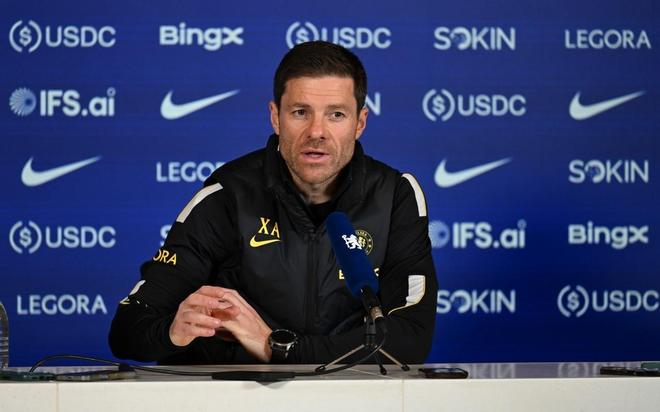

在对阵利兹联的赛前新闻发布会上，切尔西主帅哈维-阿隆索表示，他希望球队能够拥有更多可供选择的球员，并对球队本赛季遭遇的伤病问题表达了担忧。随着冬季转会窗口临近，阿隆索的表态也暗示切尔西可能需要进一步补强阵容。

本赛季至今，阿隆索已经在英超联赛中对球队首发阵容进行了24次调整，只有热刺的调整次数更多，达到28次。这在一定程度上反映出切尔西目前的阵容尚不稳定，球队近期起伏不定的表现也印证了这一点。

周五，当被问及球队阵容选择以及频繁调整首发的问题时，阿隆索表示：“当你拥有完整的选择范围时，就可以挑选自己喜欢的球员，而我知道自己喜欢什么样的阵容。”

“如果全队都能保持健康，我希望能够拥有更多选择。但在赛季进行期间，这很难实现，不过我相信我们会逐渐接近这一目标。”

阿隆索的这番话可能主要是在谈论目前效力于切尔西的球员，同时也不排除他在暗示球队需要在冬季转会窗口进一步补强。

目前，切尔西是有意引进伯恩茅斯中场亚历克斯-斯科特的俱乐部之一。与此同时，俱乐部方面也认为，球队在阵容建设方面仍然有进一步提升的空间。

伤病方面，若昂-佩德罗、马克桑斯-拉克鲁瓦、约雷尔-哈托和里斯-詹姆斯目前均因伤缺阵，而达米安-马丁内斯、乔希-阿昌庞和杰米-吉滕斯则刚刚恢复健康。

考虑到切尔西本赛季没有参加欧洲赛事，比赛数量相对较少，理论上球队应该面临更少的伤病问题。对此，阿隆索被问及是否担心球队目前的伤病情况。

阿隆索回答道：“这确实令人担忧。有时候，你可以通过分析找到伤病发生的原因，但有时候，想要找到原因也并不容易。”

此外，阿隆索还谈到了里斯-詹姆斯和马克桑斯-拉克鲁瓦能否在2026年底前重返赛场。

两人最近几周一直缺席比赛。其中，切尔西队长里斯-詹姆斯此前接受了膝盖小手术，而中后卫拉克鲁瓦则是遭遇了腿筋伤势。两人都在努力争取尽快恢复，但阿隆索此前已经确认，他们都无法赶上周六对阵利兹联的比赛。

对于两人能否在年底前复出，阿隆索给出了进一步说明。

阿隆索表示：“我认为马克(拉克鲁瓦)的机会比里斯更大。这并不意味着里斯肯定无法在那之前复出，但马克的机会确实更大。”

里斯-詹姆斯和拉克鲁瓦都是阿隆索麾下的重要球员。在两人能够出战的英超比赛中，他们几乎场场首发，各自只有一场没有进入首发阵容。与近期同样缺席过比赛的若昂-佩德罗和莫伊塞斯-凯塞多一样，他们的缺阵对任何球队来说都是不小的损失。

不过，阿隆索也清楚，伤病是足球比赛中无法避免的一部分。他强调，自己和其他球员需要做好准备，在有人受伤的情况下找到解决办法。

阿隆索补充道：“我们当然希望拥有一套完整的阵容，这肯定是每一名主教练的目标。”

“我们已经组建了一支很好的球队，也清楚有些球员拥有丰富的经验，承担着特定的角色，他们具备球队非常需要的特点。有他们在场上，我们会成为一支更好的球队。”

“但有人受伤时，我们没必要把事情看得过于严重，因为这种情况本来就会发生。我们需要接受现实，并妥善处理。”

“我们需要找到其他能够出场的球员。他们需要证明自己有足够的能力，这就是我们应对这种情况的方式。”

周六下午15点，切尔西将在斯坦福桥迎战利兹联，阿隆索选择的首发球员也将承担起填补伤员空缺的责任。

此前，阿隆索曾多次表示，到了明年5月赛季结束时，切尔西将会呈现出截然不同的面貌。

当被要求进一步明确这一变化的时间节点时，阿隆索补充道：“希望能在5月之前实现。等到5月可能就有些晚了。”

特别声明：以上内容(如有图片或视频亦包括在内)为自媒体平台“网易号”用户上传并发布，本平台仅提供信息存储服务。

Notice: The content above (including the pictures and videos if any) is uploaded and posted by a user of NetEase Hao, which is a social media platform and only provides information storage services.

体坛观察猿 2026-11-21 03:34:10

懂球帝 2026-11-20 21:51:08

懂球帝 2026-11-20 21:51:08

澜归序 2026-11-20 10:01:56

篮坛第一线 2026-11-21 00:35:43

懂球帝 2026-11-20 22:45:07

马健 2026-11-20 07:12:37

显微镜下的人性 2026-11-20 06:46:38

罗吹终结者 2026-11-19 14:49:43

董老师看竞技 2026-11-19 14:32:02

林间小温柔 2026-11-21 04:56:28

绿茵狂热者 2026-11-21 05:56:45

张二要自律 2026-11-20 06:13:26

慢享生活集 2026-11-21 05:49:47

安安折纸 2026-11-20 04:05:59

我球被偷了 2026-11-19 19:52:55

张二要自律 2026-11-19 02:25:12

看球图一乐 2026-11-20 13:34:38

极酷体育 2026-11-19 22:46:57

足球印象CC 2026-11-20 08:03:21

董老师看竞技 2026-11-19 14:32:03

曹操篮球解说 2026-11-19 12:29:31

观众视角 2026-11-18 11:23:30

丁铗惊悚影视解说 2026-11-20 06:32:55

你是佛的弟子 2026-11-20 03:10:33

你笑的好甜美 2026-11-20 04:55:40

勿忘初心l 2026-11-20 00:40:12

曹操篮球解说 2026-11-19 13:05:20

梦仙境aa 2026-11-19 11:56:17

原谅你 2026-11-21 05:08:42

23号球魁 2026-11-20 23:44:32

篮球过人技巧 2026-11-21 01:05:21

一路荒凉如歌aa 2026-11-21 02:05:42

为了更好 2026-11-19 04:01:59

董老师看竞技 2026-11-19 11:52:25

落雪听梅a 2026-11-20 01:24:41

你的球妹 2026-11-20 23:43:26

快乐加载中21 2026-11-21 06:04:43

热血体育社 2026-11-21 06:20:48

揭秘那些精彩 2026-11-19 16:00:53

## 配图

图：篮球（网易体育 · 2026-11-21）

## 来源

- [网易体育 · 原文](https://www.163.com/dy/article/LC873MHH0549BAP0.html)
