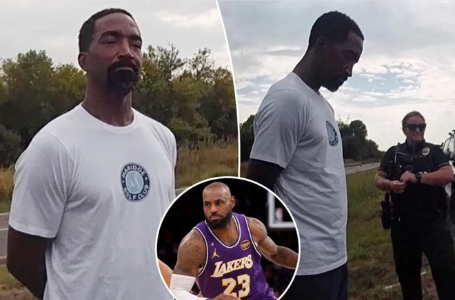

北京时间11月4日，据《加州邮报》获取的最新警方执法录像显示，今年早些时候，J.R.史密斯被捕前几秒，警员还在跟他吐槽勒布朗・詹姆斯。9月28日，J.R.史密斯在得州一条公路上被罗伊斯市警局警员拦下，警方怀疑他有未执行的逮捕令。

执法记录仪拍下了J.R.史密斯被捕前和警员交谈的画面。警员要求他下车配合核查情况，就在他们处理相关事宜时，几人聊起了篮球。

史密斯告诉警员，自己是前NBA球员，2020年退役。他还说起自己如何进入联盟、曾效力过哪些球队。

随后其中一名警员问他，生涯有没有拿过总冠军。

“两枚。”史密斯答道。

史密斯接着解释，这两枚冠军戒指分别来自克利夫兰骑士和洛杉矶湖人时期。

警员问道：“所以你和凯里（欧文）一起拿过冠军？”

“是凯里还有勒布朗。”史密斯回答。

这名警员看起来是达拉斯独行侠球迷，他直言自己并不看好詹姆斯，还把这位前湖人球星称作“那个不能提名字的人”。

史密斯问：“你不喜欢他？”

这名警员说：“他把卢卡（东契奇）从我们这儿抢走了。”他指的是2025年2月那笔轰动联盟的湖人与独行侠交易，东契奇被交易至湖人。“是他把卢卡抢走的，全是他的主意。”

现场另一名警员补充：“没人对这笔交易满意。”

另一位警员接着说：“我到现在还很生气，气到现在。”

没过多久，在确认史密斯确实有在效逮捕令后，警员给他戴上手铐将其逮捕。

之后他们没有再聊篮球相关话题。

后续消息显示，史密斯被南湖市警局通缉，罪名是涉嫌家庭暴力伤人。据称，9月18日他在塔兰特县和一名女子发生肢体冲突。

法庭文件写明，史密斯被指控“故意、明知或过失”对一名女性造成身体伤害，该女子是他的家人、同居者或是他的交往对象。

史密斯因这项指控被拘留，不久后获释。他的律师贾斯汀・A・穆尔在此次事件后发表声明，表示当事人“希望这件事尽快了结，并且完全相信司法程序”。

穆尔补充道：“在被定罪之前，他应被视作无罪。我们会在法庭上应诉。恳请大家在案件审理期间尊重所有相关人员的隐私。”

史密斯该案的下一次庭审定于下月开庭。

特别声明：以上内容(如有图片或视频亦包括在内)为自媒体平台“网易号”用户上传并发布，本平台仅提供信息存储服务。

Notice: The content above (including the pictures and videos if any) is uploaded and posted by a user of NetEase Hao, which is a social media platform and only provides information storage services.

日常碎碎念啊 2026-11-04 03:22:16

一纸情书s 2026-11-01 07:11:18

绿茵狂热者 2026-11-04 06:30:13

你的雷达站 2026-11-01 18:10:28

主宰稳场 2026-11-04 00:19:54

简单清风 2026-11-02 23:13:51

听风喃 2026-11-03 00:17:39

春若秋水 2026-11-02 01:10:28

董老师看竞技 2026-11-03 10:53:29

薛艳艳爱生活 2026-11-03 11:52:31

尺素a 2026-11-01 11:07:39

笑出鹅叫联盟 2026-10-31 16:40:00

酒话醉人 2026-11-04 04:38:18

最佳菜鸟 2026-11-03 10:48:58

创造精彩剧情 2026-11-04 04:35:45

篮坛第一线 2026-11-04 05:47:59

董老师看竞技 2026-11-03 14:31:33

无聊的候 2026-11-04 00:20:18

夜里的海风 2026-11-01 13:02:13

老汆古装影视解说 2026-11-04 02:34:20

紧跟时代脉搏 2026-11-03 02:58:29

董老师看竞技 2026-11-03 09:53:28

大眼睛看看 2026-11-03 02:25:39

无人倾听无人倾听 2026-11-03 13:31:33

本质珺 2026-11-03 13:05:26

体坛速报局 2026-11-03 10:39:27

青山入怀u 2026-11-04 01:13:15

体坛速报局 2026-11-03 11:25:25

体坛速报局 2026-11-03 11:54:25

精彩一网打尽 2026-11-02 02:44:46

紧跟时代脉搏 2026-11-01 07:41:46

夜里的海风 2026-11-03 12:21:41

篮球过人技巧 2026-11-01 17:18:22

泪之魂y 2026-11-04 02:08:25

舌尖小游记 2026-11-04 00:11:47

显微镜下的人性 2026-11-04 05:22:09

酒话醉人 2026-11-04 04:42:05

咪咕体育 2026-11-02 13:52:38

正经球迷 2026-11-03 19:45:57

罗说NBA 2026-11-04 06:32:25

## 配图

图：篮球（网易体育 · 2026-11-04）

## 来源

- [网易体育 · 原文](https://www.163.com/dy/article/LASE19JS0529BA9O.html)
