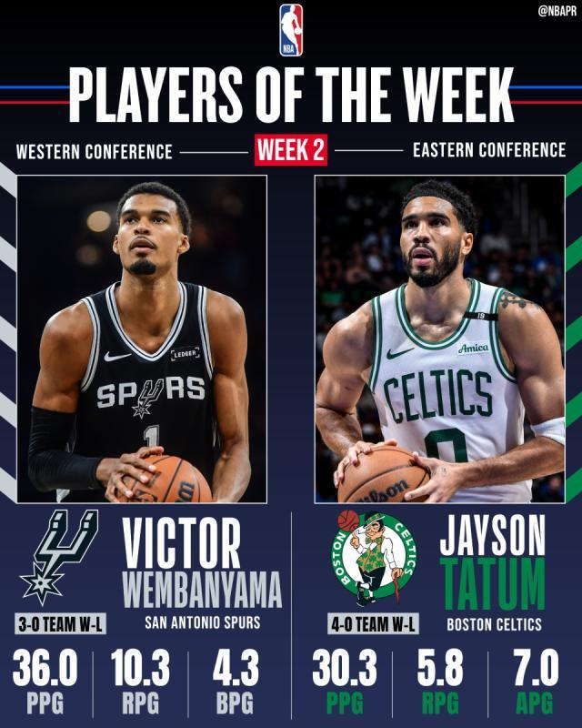

11月3日，NBA官方公布了常规赛第二周的周最佳球员。文班亚马力压库里当选西部最佳球员，这是他生涯第四次当选周最佳球员。塔图姆力压马克西、字母哥等人当选东部周最佳球员，生涯第14次获奖。

西部周最佳：文班亚马（马刺）

文班亚马上周率领马刺打出3胜0负的战绩，场均贡献36.0分10.3篮板4.3盖帽。对国王一战，文班贡献29分10篮板2助攻2抢断5盖帽。对阵爵士一战，文班砍下36分14篮板5助攻3抢断2盖帽。对阵森林狼一战，文班得到43分7篮板4助攻1抢断6盖帽，得分创赛季新高。

尽管勇士球星库里在上周也有出色的表现，但是文班亚马还是加冕西部周最佳。

东部周最佳：塔图姆（凯尔特人）

塔图姆上周率领凯尔特人打出4胜0负的战绩，场均贡献30.3分5.8篮板7.0助攻。对阵公牛一战，塔图姆得到23分7篮板6助攻1抢断。对阵篮网一战，塔图姆轰下40分5篮板8助攻1盖帽。再次对阵公牛队，塔图姆砍下26分7篮板7助攻。对阵魔术一战，塔图姆得到32分4篮板7助攻。

76人队马克西、热火队字母哥等人在上周也表现出色，但最终塔图姆力压众人夺得东部周最佳。

获得周最佳提名的其他球星——西部：阿卡夫（国王）、库里（勇士）、东契奇（湖人）、弗拉格（独行侠）；东部：字母哥（热火）、巴恩斯（猛龙）、马克西（76人）、莫布利（骑士）。

特别声明：以上内容(如有图片或视频亦包括在内)为自媒体平台“网易号”用户上传并发布，本平台仅提供信息存储服务。

Notice: The content above (including the pictures and videos if any) is uploaded and posted by a user of NetEase Hao, which is a social media platform and only provides information storage services.

罗说NBA 2026-11-03 05:49:34

咪咕体育 2026-11-02 13:52:38

正经球迷 2026-10-31 16:46:27

随遇而安之心 2026-11-02 03:58:05

夜里的海风 2026-10-31 15:30:00

各地精彩不容错过 2026-11-01 07:00:35

各地精彩不容错过 2026-11-02 03:36:13

司峰阿道 2026-10-31 14:46:32

凉了时光人 2026-11-02 01:19:43

董老师看竞技 2026-10-31 14:40:45

为了更好 2026-11-02 03:31:39

笑脸猫咪察 2026-11-02 11:41:24

主宰稳场 2026-10-31 21:11:28

主宰稳场 2026-11-02 16:55:08

黑曼巴谈球 2026-11-01 02:19:01

看球图一乐 2026-10-31 13:43:56

董老师看竞技 2026-11-02 13:44:18

听风喃 2026-11-01 11:40:12

华夏云海 2026-10-30 23:04:43

酒话醉人 2026-11-01 10:42:12

体坛速报局 2026-11-02 13:27:06

董老师看竞技 2026-10-31 14:26:21

知新使者 2026-11-03 02:46:51

输在感情刀 2026-11-01 10:18:45

林间小温柔 2026-11-03 04:46:06

篮球盛世 2026-11-01 13:39:02

篮球过人技巧 2026-11-02 13:42:59

体坛速报局 2026-10-31 13:35:42

乌雅恺歌 2026-11-01 05:07:11

看球图一乐 2026-11-01 14:45:04

体坛速报局 2026-11-02 11:28:39

篮球过人技巧 2026-11-01 22:35:17

小叶子侃球FM 2026-11-01 18:25:10

喜光懂天下 2026-11-01 02:07:27

黑曼巴谈球 2026-11-01 02:24:46

嘴角上翘 2026-10-31 13:23:42

平行宇证h 2026-11-02 10:21:29

月光婉儿f 2026-11-02 09:31:41

青川入画 2026-11-02 04:23:00

萌萌乐翔事 2026-11-03 02:17:57

## 配图

图：篮球（网易体育 · 2026-11-03）

## 来源

- [网易体育 · 原文](https://www.163.com/dy/article/LAPQMO2B05299JMD.html)
