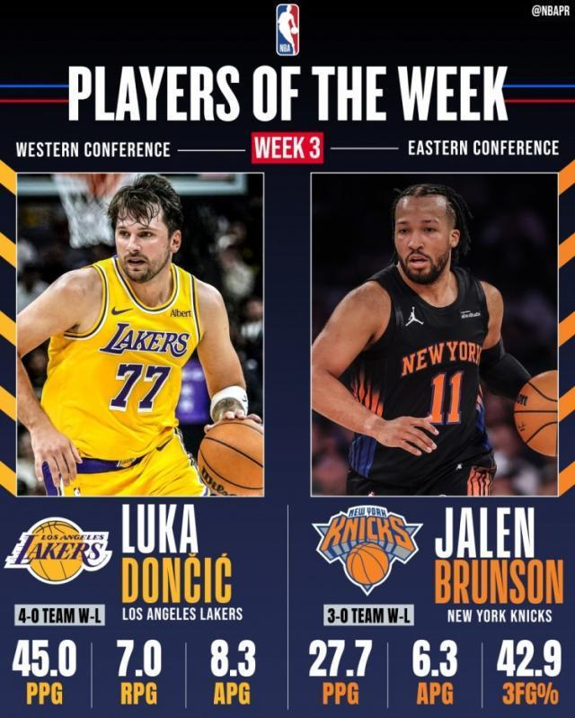

北京时间11月10日，NBA官方宣布了2026-27赛季第三周最佳球员。湖人后卫卢卡・东契奇当选西部周最佳球员，生涯第19次获得这一奖项。尼克斯后卫杰伦・布伦森获得东部周最佳球员，生涯第10次获此殊荣。

西部周最佳：东契奇（湖人）

湖人上周取得4胜0负的战绩，东契奇出战其中三场比赛，场均得到45.0分8.3次助攻7.0个篮板1.3次抢断。11月3日对阵热火，东契奇砍下42分7篮板13助攻。11月5日对阵国王，东契奇得到40分9篮板7助攻。11月7日对阵开拓者，东契奇更是轰下53分5篮板5助攻。

东部周最佳：杰伦·布伦森（尼克斯）

尼克斯上周取得3胜0负的战绩，布伦森在这3场比赛场均砍下27.7分3.3个篮板6.3次助攻，投篮、三分、罚球命中率为48.3%、42.9%、75.0%。在2026‑27赛季开局0胜3负之后，布伦森助力卫冕冠军尼克斯在最近6场比赛里拿下5场胜利。

获得周最佳提名的其他球员如下——西部：阿夫迪亚、鲍尔、库里、亚历山大、里夫斯、文班亚马；东部：亚历山大・沃克、字母哥、克莱·汤普森、杰伦・布朗、唐斯

特别声明：以上内容(如有图片或视频亦包括在内)为自媒体平台“网易号”用户上传并发布，本平台仅提供信息存储服务。

Notice: The content above (including the pictures and videos if any) is uploaded and posted by a user of NetEase Hao, which is a social media platform and only provides information storage services.

慕名而来只为你 2026-11-09 02:22:36

人间闲散客 2026-11-10 01:59:38

沙雕道具制造局 2026-11-10 01:59:52

家禽搞笑事务所 2026-11-10 01:59:27

创造精彩剧情 2026-11-09 03:29:03

骄阳之夏明 2026-11-09 01:14:24

体育篮球弟 2026-11-08 01:31:23

一路荒凉如歌a 2026-11-10 02:26:29

邻家二蛋不靠谱 2026-11-10 01:57:52

老王日常犯傻 2026-11-10 01:59:52

暮雨咋歇着 2026-11-10 00:56:45

搞笑脑洞研究所 2026-11-10 01:59:52

咪咕体育 2026-11-09 17:49:12

体育吐槽 2026-11-07 15:10:18

主宰稳场 2026-11-09 00:13:59

山野探险家c 2026-11-08 03:38:27

篮球盛世 2026-11-08 15:31:49

辛苦的啊欣啊 2026-11-10 03:25:50

紧跟时代脉搏 2026-11-08 03:50:45

萌萌乐翔事 2026-11-09 04:46:39

爱顺的球 2026-11-07 16:27:08

德瀚文 2026-11-08 05:47:29

咪咕体育 2026-11-09 17:49:07

你是佛的弟子 2026-11-10 03:22:47

咪咕体育 2026-11-09 17:47:50

人间闲散客 2026-11-08 01:16:21

你是佛的弟子 2026-11-10 03:26:55

赵或是个热血青年 2026-11-10 05:31:09

看球图一乐 2026-11-07 15:08:27

宗介说体育 2026-11-09 13:49:26

尺素a 2026-11-10 04:45:06

黑曼巴谈球 2026-11-08 05:56:14

看球图一乐 2026-11-07 14:33:44

酒话醉人 2026-11-10 04:40:09

上班摸鱼一级选手 2026-11-09 02:33:15

咪咕体育 2026-11-09 17:49:05

体坛速报局 2026-11-07 12:22:38

孤单是寂寞的毒 2026-11-09 03:04:12

夜里的海风 2026-11-08 04:13:44

老汆古装影视解说 2026-11-09 02:59:29

## 配图

图：篮球（网易体育 · 2026-11-10）

## 来源

- [网易体育 · 原文](https://www.163.com/dy/article/LBBQUECB05299JMD.html)
