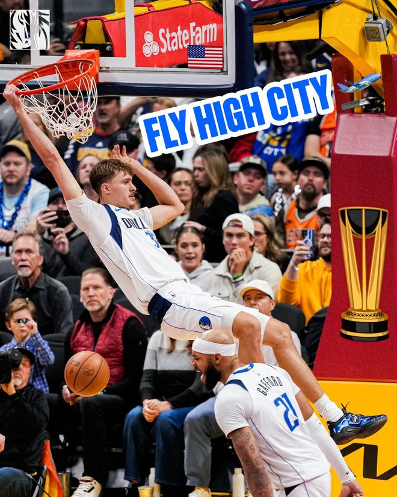

北京时间11月25日，NBA杯继续进行，达拉斯独行侠队（11胜7负）延续连胜。弗拉格得到24分、6个篮板和12次助攻，他带领球队7人得分上双，独行侠队第四节重新拉开比分，他们在客场以120-101战胜丹佛掘金队（10胜6负）。独行侠队拿到4连胜，他们以3胜0负排名西部A组首位。掘金队结束3连胜，杯赛战绩变为2胜1负。

独行侠队的弗拉格得到24分、6个篮板和12次助攻，华盛顿得到14分和6个篮板，马绍尔得到14分，马丁得到13分、4个篮板和4次助攻，里萨切得到12分和6个篮板，欧文得到11分、5个篮板和6次助攻，加福德得到11分和6个篮板。掘金队的穆雷得到20分，约基奇得到18分、11个篮板和5次助攻，约翰逊得到17分和5个篮板，布劳恩得到15分，德罗赞得到9分和5个篮板。

掘金队在主场先发制人，先拿5分领跑。独行侠队外线手感不错，马丁连中两记三分，弗拉格也锦上添花，华盛顿替补连进两球，他们引领球队打出15-3的小高超反超领跑。掘金队暂停后约基奇单打暂时止血，马绍尔和华盛顿各中三分，独行侠队以21-12领先。穆雷和巴格利追回5分，弗拉格两罚一中，马绍尔跑投得分，首节结束时独行侠队以24-17领先。

第二节开始后两队各得几分，琼斯三分中的，掘金队追至24-28。加福德两罚一中，约翰逊二次进攻得手，掘金队只落后3分。华盛顿挺身而出连拿3分，阿尔达马弧顶投中三分，一轮10-2的攻击波让独行侠队再次拉开。掘金队暂停后连中3个三分球追近，华盛顿保持攻击性还击两球，弗拉格也拿下5分，他们带领球队以15-0的攻击波结束第二节，独行侠队以58-39领先19分。

独行侠队的华盛顿上半场得到14分，弗拉格得到11分、4个篮板和7次助攻，马丁得到10分；掘金队的约基奇得到9分和4个篮板，约翰逊得到8分。

加福德空接扣篮揭开第三节大幕，掘金队外线开始回暖，穆雷、约翰逊各中三分，约基奇也罚中两球，本节进行了3分钟时他们追至49-62。欧文回应三分，布劳恩和穆雷四罚全中，加福德勾手打进，独行侠队继续保持领先。布劳恩的手感越来越好，连中3个三分球，第三节还有5分35秒时掘金队追至65-71。加福德空接扣篮暂时稳住局势，约基奇带领球队又是一轮5-1的反击波，他们把差距缩小到4分。独行侠队替补表现不俗，克莱顿、M-约翰逊各中三分，双方分差回到10分。掘金队不甘示弱，德罗赞打3分率队又追7分，克莱顿中投得手，M-约翰逊突破暴扣，三节结束时独行侠队以84-77领先。

独行侠队在第四节开始后不久掀起新的攻势，马丁三分命中率队连拿7分，他们以93-79领先。巴格利二次进攻得手，穆雷突破打3分成功，掘金队追至88-97。弗拉格单打回应，里萨切翼侧命中三分，第四节还有5分30秒时独行侠队以102-88领先。掘金队暂停后进攻仍无起色，弗拉格连取4分扩大优势。约基奇打3分回应，弗拉格跳投命中，里萨切突破得手，独行侠队以112-93领先。最后时刻掘金队无力回天，他们以101-120落败。

独行侠队首发阵容：欧文、马丁、弗拉格、里萨切、加福德

掘金队首发阵容：穆雷、布劳恩、约翰逊、戈登、约基奇

特别声明：以上内容(如有图片或视频亦包括在内)为自媒体平台“网易号”用户上传并发布，本平台仅提供信息存储服务。

Notice: The content above (including the pictures and videos if any) is uploaded and posted by a user of NetEase Hao, which is a social media platform and only provides information storage services.

鱼崖大话篮球 2026-11-25 13:40:00

汪星人哟 2026-11-25 14:20:36

姜大叔侃球 2026-11-25 13:46:48

显微镜下的人性 2026-11-24 04:43:44

许侶很机智 2026-11-25 02:44:24

董老师看竞技 2026-11-25 14:49:27

冷饭说球 2026-11-24 11:30:49

篮球盛世 2026-11-24 09:55:00

安逸安逸 2026-11-25 17:10:41

一纸情书s 2026-11-24 05:51:56

大眼睛看看 2026-11-24 02:22:01

孤城落日 2026-11-25 01:47:07

大眼睛看看 2026-11-24 02:20:50

球盲姐 2026-11-25 19:53:20

看尽人间百态 2026-11-25 12:23:46

大眼睛看看 2026-11-24 02:23:14

北青网-北京青年报 2026-11-25 08:43:05

显微镜下的人性 2026-11-24 07:33:36

篮球大视野 2026-11-25 13:44:25

荒野老五 2026-11-25 00:42:08

慕名而来只为你 2026-11-25 03:56:38

坠入温柔晚风 2026-11-25 16:45:50

阿嬍体育评论 2026-11-23 04:01:50

荒野老五 2026-11-22 21:26:01

球盲姐 2026-11-25 15:49:45

阿嬍体育评论 2026-11-25 04:08:40

黒溯KuroHush 2026-11-25 04:06:59

骄阳之夏明 2026-11-23 01:21:42

大眼睛看看 2026-11-23 01:53:27

家居老余 2026-11-23 01:39:56

小王趣味社 2026-11-23 05:54:39

揭秘那些精彩 2026-11-23 18:34:11

篮球实战宝典 2026-11-25 18:27:50

正经球迷 2026-11-25 14:36:58

小叶子侃球FM 2026-11-24 16:04:09

大海体娱 2026-11-24 11:48:23

人间闲散客 2026-11-24 01:10:37

体坛速报局 2026-11-24 12:14:18

董老师看竞技 2026-11-25 14:47:17

孤城落日 2026-11-24 01:42:31

## 配图

图：篮球（网易体育 · 2026-11-25）

## 来源

- [网易体育 · 原文](https://www.163.com/dy/article/LCJ3LPID0529AL9S.html)
