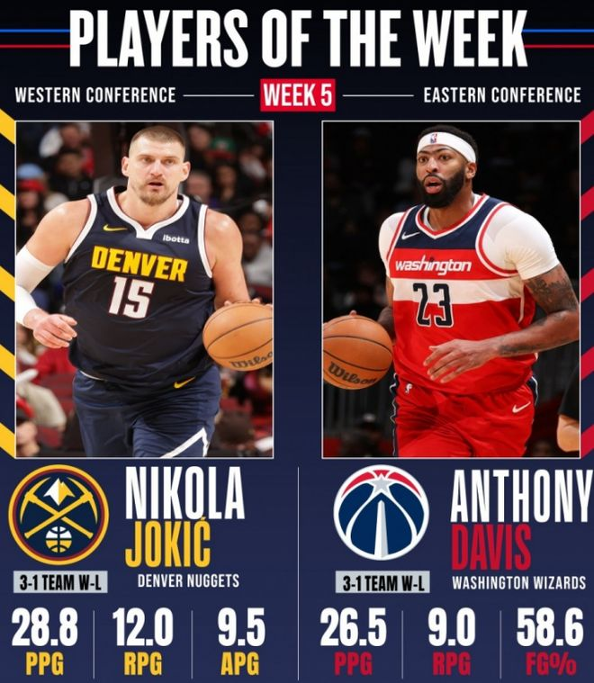

北京时间11月24日，NBA官方公布了本赛季第五周的周最佳球员，约基奇击败了布克、东契奇、弗拉格、麦丹、文班亚马和自己的队友穆雷当选西部周最佳，而浓眉哥则力压沃克、丹尼尔斯、布伦森、唐斯、哈登和瓦格纳，成为了东部第五周的最佳球员。

西部周最佳球员：约基奇

虽然本赛季的丹佛掘金，依旧保留着当年的争冠核心二人组约基奇和穆雷，但是角色球员整体实力的下滑，导致球队战绩没有达到预期，在这一周之前，掘金前11场常规赛战罢，只取得了7胜4负的战绩，不过靠着约基奇极具统治力的表现，掘金在第五周强势反弹，在爆冷输给菲尼克斯太阳之后，连续击败了波士顿凯尔特人、休斯顿火箭和芝加哥公牛，取得了一波三连胜。

作为球队绝对核心的约基奇，则打出了联盟顶尖中锋的统治力，四场比赛场均能够贡献28.8分、12个篮板和9.5次助攻的准三双数据，其中面对太阳砍下了28+15+7+1+1的全能数据，无奈队友不给力，导致掘金主场爆冷，接下来的三连胜中，约基奇在和公牛的加时苦战中，打出了37分、18个篮板和11次助攻的表现，职业生涯第202次三双，正在无限逼近威少保持的209次三双神迹，21次当选周最佳，也让约基奇刷新了掘金队史纪录。

东部周最佳球员：浓眉哥

本赛季的华盛顿奇才，虽然打造了浓眉哥安东尼戴维斯、特雷杨、迪班萨的三核心阵容，但是球队赛季初的表现，却让所有人大跌眼镜，依旧是熟悉的东部鱼腩味道，在本周首战主场16分劣势，输给孟菲斯灰熊之后，奇才直接遭遇到了一波八连败，在东部积分榜上倒数，不过就在球迷认为奇才将一蹶不振时，他们在浓眉哥的率领下触底反弹，连续拿下了多伦多猛龙、芝加哥公牛和奥兰多魔术。

相比于还处于成长期的新科状元郎迪班萨，以及状态神鬼莫测的特雷杨，浓眉哥绝对是奇才三连胜的最佳功臣，在本周的四场比赛中，浓眉哥场均能够以58.6%的命中率，砍下了26.5分和9个篮板，其中面对猛龙和公牛分别砍下25分14板和36分11板的两双数据，上一次浓眉哥当选周最佳球员，还是在24年的10月29日，时隔两年再获殊荣，也让不少球迷感慨今夕是何年。

特别声明：以上内容(如有图片或视频亦包括在内)为自媒体平台“网易号”用户上传并发布，本平台仅提供信息存储服务。

Notice: The content above (including the pictures and videos if any) is uploaded and posted by a user of NetEase Hao, which is a social media platform and only provides information storage services.

阅尽天下大事 2026-11-23 21:43:05

篮球实录 2026-11-24 03:03:15

篮球人物 2026-11-19 23:25:24

热血体育社 2026-11-23 22:26:45

董老师看竞技 2026-11-21 17:29:40

钉钉陌上花开 2026-11-23 10:19:49

老汆古装影视解说 2026-11-22 01:21:14

好火子 2026-11-24 04:25:35

醉卧浮生 2026-11-23 10:19:19

大眼睛看看 2026-11-24 02:20:50

宋垀搞笑配音 2026-11-24 04:19:35

一纸情书s 2026-11-24 05:51:56

懂球帝 2026-11-23 10:18:05

大眼睛看看 2026-11-24 02:23:14

显微镜下的人性 2026-11-24 04:43:44

看球图一乐 2026-11-21 08:37:00

篮坛第一线 2026-11-23 07:14:26

赛场速报局 2026-11-24 03:27:43

荒野老五 2026-11-22 21:26:01

咪咕体育 2026-11-21 16:21:56

梅亭谈 2026-11-24 04:52:27

咪咕体育 2026-11-24 01:44:18

鸿锦篮球 2026-11-24 05:46:41

咪咕体育 2026-11-21 16:21:54

咪咕体育 2026-11-24 01:42:42

全球风情大揭秘 2026-11-21 04:08:01

大眼睛看看 2026-11-22 02:08:00

大话火箭队 2026-11-21 16:45:14

大眼睛看看 2026-11-24 02:25:49

阿嬍体育评论 2026-11-23 04:01:50

原谅你 2026-11-22 04:54:04

体育新角度 2026-11-23 22:52:10

痞子时代 2026-11-23 18:21:35

小王趣味社 2026-11-23 05:54:39

阿嬍体育评论 2026-11-24 04:04:49

紧跟时代脉搏 2026-11-23 02:47:54

平方秒和立方吨 2026-11-22 08:43:50

一纸情书s 2026-11-24 05:47:39

人间闲散客 2026-11-24 01:47:29

老付聊体育 2026-11-22 06:48:20

## 配图

图：篮球（网易体育 · 2026-11-24）

## 来源

- [网易体育 · 原文](https://www.163.com/dy/article/LCFT6FMN0549753N.html)
