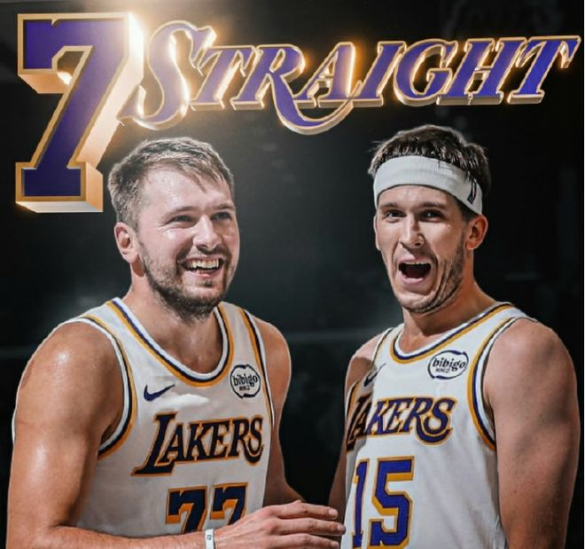

NBA新赛季已经开战52天，依然呈现显著的“西强东弱”特点，西部有10队胜率超5成，其中8队胜率超7成，东部仅6队胜率超5成，且仅3队胜率超7成。更为关键的是，西部前六对阵东部球队16胜1负，东部前六对阵西部球队却仅1胜8负。

其一，西部高胜率球队各阶梯数量完胜东部球队。

西部2队胜率超8成，8队胜率超7成，10队胜率超5成

东部1队胜率超8成，3队胜率超7成，6队胜率超5成

目前西部有两队胜率超过8成，分别是湖人10胜2负胜率83.3%高居联盟第一，马刺9胜2负胜率81.8%，东部第一的凯尔特人9胜2负胜率81.8%，联盟仅有如此3队胜率超过8成。

至于胜率超过7成的球队，西部前八球队均是胜率超过7成，且有多达10队胜率超过5成。反观东部只有3队胜率超过7成，分别是东部前三的凯尔特人、76人与活塞，而西部第八的开拓者与东部第三的活塞同为7胜3负，东部超过5成胜率的球队只有6队。

西部在8成胜率、7成胜率与5成胜率的球队数量当中，均是完胜东部球队，足见西部更加残酷的竞争大环境。

其二，西部前六vs东部16胜1负，东部前六vs西部1胜8负。

西部前六vs东部全部球队：16胜1负

东部前六vs西部全部球队：1胜8负

除此之外，在截至目前的东西部对决当中，西部前六球队对阵东部球队豪取16胜1负的骄人战绩，胜率高达94.1%，唯一的一场败仗是森林狼10月27日森林狼客场125-127加时惜败骑士。

反观东部前六面对西部球队只有1胜8负的糟糕战绩，唯一的一胜是11月3日猛龙客场125-118险胜快船。

今年西部的竞争极为激烈，西部第一的湖人10胜2负正打出一波6连胜，西部第二的马刺9胜2负豪取9连胜，西部第三的森林狼缺少爱德华兹目前一波4连胜，勇士8胜3负豪取8连胜。反观东部目前最长连胜是东部第一的凯尔特人与东部第四的尼克斯打出4连胜。

西部第一梯队的球队扎堆：湖人、马刺、森林狼、勇士、火箭、雷霆等，排名咬得很紧竞争极为激烈，且西部前十胜率普遍偏高。反观东部除凯尔特人、76人与活塞3队胜率达到7成，中段球队竞争力偏弱，同样是“西强东弱”的直观体现。

特别声明：以上内容(如有图片或视频亦包括在内)为自媒体平台“网易号”用户上传并发布，本平台仅提供信息存储服务。

Notice: The content above (including the pictures and videos if any) is uploaded and posted by a user of NetEase Hao, which is a social media platform and only provides information storage services.

篮视角 2026-11-10 07:22:56

咪咕体育 2026-11-12 03:05:09

小轲搞笑解说 2026-11-12 00:48:11

篮球实战宝典 2026-11-12 04:26:20

篮球小布丁 2026-11-12 03:58:33

落梅如雪乱飞 2026-11-11 20:49:02

董老师看竞技 2026-11-10 15:54:06

董老师看竞技 2026-11-11 14:15:54

众生的世界观 2026-11-12 03:09:46

阿嬍体育评论 2026-11-11 04:12:32

蕾爸退休日记 2026-11-11 19:52:15

小郭聊球 2026-11-09 20:47:07

糖炒小栗子 2026-11-11 14:31:47

猴姐不好惹 2026-11-12 01:09:49

正经球迷 2026-11-10 20:20:36

看球图一乐 2026-11-11 12:42:59

紧跟时代脉搏 2026-11-12 03:39:19

咪咕体育 2026-11-09 17:49:12

小熊回收站 2026-11-12 03:23:18

你是我的小甜甜 2026-11-11 00:04:42

笑饮孤鸿非 2026-11-12 01:23:12

上班摸鱼一级选手 2026-11-12 02:44:05

好火子 2026-11-12 02:56:31

大眼睛看看 2026-11-10 02:51:46

琴音似君语 2026-11-12 03:41:03

初心不负y 2026-11-12 00:22:30

体坛速报局 2026-11-11 11:59:25

体坛速报局 2026-11-11 11:45:21

老王日常犯傻 2026-11-10 01:59:52

为了更好 2026-11-12 03:52:48

尘中见月q 2026-11-12 04:27:33

阿嬍体育评论 2026-11-12 03:47:54

福娃谈体育 2026-11-11 13:45:56

小步胡侃 2026-11-12 02:38:28

光辉与阴暗 2026-11-12 03:51:01

沙雕道具制造局 2026-11-10 01:58:32

DoubleZero 2026-11-11 20:30:14

月影沙丘d 2026-11-11 13:24:42

紧跟时代脉搏 2026-11-11 03:42:34

落雪听梅a 2026-11-12 01:12:09

## 配图

图：篮球（网易体育 · 2026-11-12）

## 来源

- [网易体育 · 原文](https://www.163.com/dy/article/LBFIJJ400529RKNN.html)
