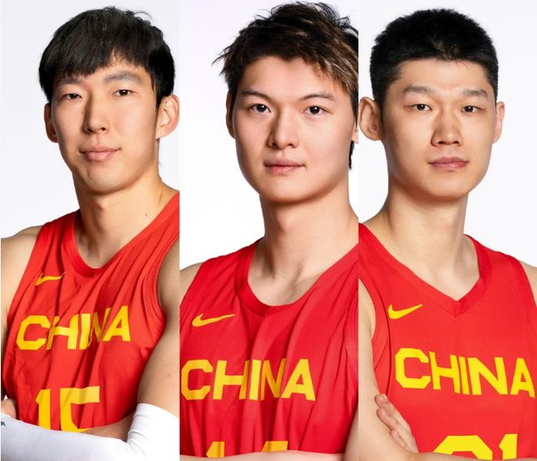

中国男篮将在11月26日21点对阵沙特男篮，双方将在卡塔尔中立球馆进行比赛。中国男篮虽然缺少杨瀚森与王俊杰两位留洋主力，但周琦、王哲林、赵继伟与张镇麟等主力回归，整体竞争力显著提升。面对沙特男篮对决，中国男篮的内线依然是优势所在，周琦需要发挥内线攻防核心的作用，王哲林回归的表现也是令人期待，只要限制沙特男篮双核的表现，中国男篮取胜概率极大。

1、无杨瀚森+王俊杰，多位主力回归整体竞争力提升

中国男篮依然不是完全体阵容，杨瀚森与王俊杰两位主力球员均在留洋，杨瀚森跟随开拓者征战NBA，王俊杰跟随麻省大学征战NCAA，他们均将无缘本窗口期的比赛。

不过中国男篮还是迎来多位主力的回归，周琦与王哲林两位内线主力回归，尤其是王哲林时隔3年重返国家队阵容。除此之外，张镇麟与赵继伟等也回归，多位主力球员回归，成为中国男篮目前能够派出的最强阵容，自然是极大提升整体竞争力。唯有赵睿因为身体原因离队，外加贺希宁重伤赛季报销成为遗憾。

2、周琦+王哲林回归搭档胡金秋，内线仍是优势所在

在杨瀚森无法参赛情况下，周琦与王哲林回归，联手胡金秋组成的内线阵容，面对沙特男篮将占据优势。中国男篮的优势历来都在内线，周琦与王哲林在CBA联赛重新证明了自己，王哲林上赛季率领上海男篮时隔22年夺冠，而周琦本赛季第一阶段率领北京男篮成为唯一8胜0负的球队。

3、限制沙特双核拉赫曼+阿尔苏韦莱姆成为争胜关键

沙特男篮的强点在双核拉赫曼+阿尔苏韦莱姆，拉赫曼是强攻型外线球员，具备不俗的突破与三分威胁，成为中国外线防守的重点。

至于阿尔苏韦莱姆作为一位2.08米的内线球员，他此前世预赛面对韩国男篮曾经狂轰31+15，亚运会面对中国男篮也有22+10的表现。中国男篮的内线球员当中，周琦是内线防守核心，他需要最大限度限制阿尔苏韦莱姆的发挥，成为郭士强指导需要合理布置战术的所在。

4、交锋战绩+心理层面占优，改在中立球场全力争胜

双方过往3次FIBA层面交锋，中国男篮全部取胜。当然，最具参考价值的两次交锋，在2025年亚洲杯中国男篮93-88险胜沙特男篮，今年亚运会八强战中国男篮87-78再胜沙特男篮。

中国男篮最近两次战胜沙特男篮均赢得不轻松，但在交锋战绩与心理层面均是占优。更为关键的是，双方本场比赛由沙特男篮主场改为在卡塔尔中立球馆比赛，从而让沙特男篮失去主场优势，中国男篮需要全力争胜，尤其是需要争取尽可能“速胜”与“大胜”。

锋线：张镇麟（上海）、曾凡博（北京）、赵嘉义（北控）、李弘权（上海）

后卫：赵继伟（辽宁）、胡明轩（广东）、廖三宁（北控）、姜伟泽（吉林）、程帅澎（浙江）、庞峥麟（江苏）

内线：周琦（北京）、王哲林（上海）、胡金秋（广厦）、余嘉豪（浙江）

特别声明：以上内容(如有图片或视频亦包括在内)为自媒体平台“网易号”用户上传并发布，本平台仅提供信息存储服务。

Notice: The content above (including the pictures and videos if any) is uploaded and posted by a user of NetEase Hao, which is a social media platform and only provides information storage services.

上游新闻 2026-11-25 12:09:07

新民周刊 2026-11-25 09:06:31

泰州微视听 2026-11-25 08:39:48

极目新闻 2026-11-25 18:42:19

中国经济网 2026-11-23 17:47:08

证券时报 2026-11-25 22:28:04

极目新闻 2026-11-25 10:13:12

极目新闻 2026-11-25 19:23:29

星星没有你亮 2026-11-26 05:58:38

扬子晚报 2026-11-25 15:56:48

看看新闻Knews 2026-11-25 17:02:28

极目新闻 2026-11-25 13:24:23

新民晚报 2026-11-25 14:44:54

红星新闻 2026-11-25 21:12:07

中国新闻周刊 2026-11-25 17:52:34

极目新闻 2026-11-23 12:29:01

界面新闻 2026-11-25 15:14:23

人民资讯 2026-11-25 17:50:30

北京日报 2026-11-25 19:55:25

南方都市报 2026-11-25 11:02:31

央视新闻客户端 2026-11-25 08:52:19

央视新闻客户端 2026-11-24 19:21:44

界面新闻 2026-11-25 21:21:35

吉刻新闻 2026-11-26 01:58:50

北京网络举报 2026-11-25 17:16:06

金台资讯 2026-11-26 06:36:08

## 配图

图：篮球（网易体育 · 2026-11-26）

## 来源

- [网易体育 · 原文](https://www.163.com/dy/article/LCK04U1B0529RKNN.html)
