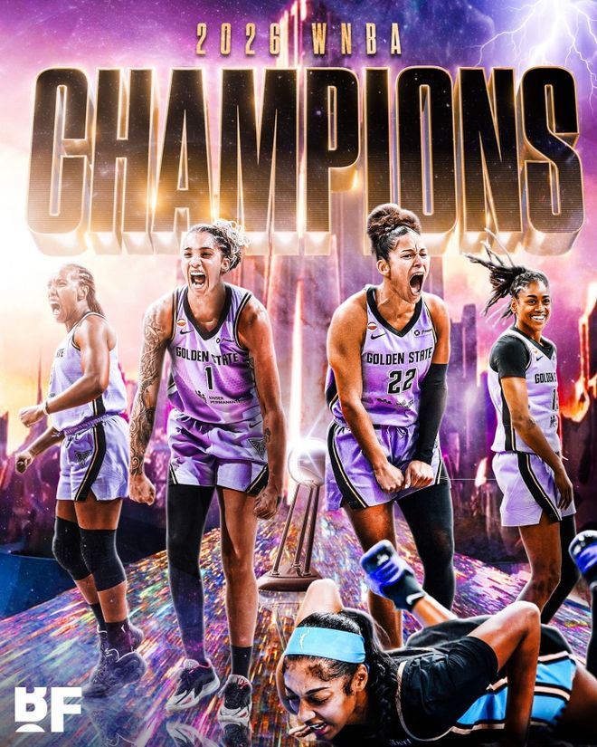

北京时间11月1日，WNBA总决赛历史首次抢七大战，金州女武神主场对阵亚特兰大梦想，勇士球星追梦格林与伦德博格到场观战。双方开启低比分鏖战，上半场梦想30-24领先女武神，加比第三节狂轰15分率领女武神反超1分。末节加比继续给力表现率队逐步取得领先优势，最终女武神68-63战胜梦想，女武神总分4-3战胜梦想夺得队史首冠。

女武神：加比4记三分30分4盖帽，海耶斯11分，斯托克斯8分13篮板，伯顿10分11篮板5助攻。

梦想：卡纳达18分4篮板5助攻，格雷16分6篮板，里斯8分12篮板。

在WNBA总决赛前六场比赛，双方维持总分3-3，让WNBA迎来历史首次总决赛抢七对决。本场女武神回到主场对阵梦想，双方开启一场低比分防守大战，两队首节持续紧咬比分均是单节不足15分，首节结束梦想13-14落后女武神。

次节比赛，双方连续两节单节不足20分，且女武神被限制连续两节不足15分。梦想率先一波6-0攻势取得领先，并在之后继续压制女武神，梦想单节17-10再赢7分，上半场结束梦想30-24领先女武神。

纵观前两节比赛，梦想36中12，其中三分16中3，卡纳达10中5得到13分；女武神30中9，其中三分11中1打铁，全队没有球员得分上双。

易边再战，加比大爆发第三节狂轰15分，且她一人得分比梦想全队还多出1分。加比引领女武神第三节21-14净胜7分，三节结束梦想44-45被女武神反超1分。前三节比赛，加比16中7得到17分，卡纳达16+3+4。

进入第四节比赛，女武神率先一波6-2攻势扩大5分优势，梦想回敬一波7-2攻势追到53-53。双方之后连续打铁不中，加比与格雷均是两罚全中，加比与霍华德均上篮得分，加比超远三分打停梦想。格雷空篮不中，加比造犯规两罚全中，斯托克斯补篮扩大7分优势打停梦想。格雷三分命中，海耶斯两罚全中，里斯两罚一中，格雷造犯规两罚全中，伯顿被犯规罚球扩大优势锁定胜局，最终女武神险胜梦想，女武神总分4-3战胜梦想夺得队史首冠。

女武神：查尔斯、加比、斯托克斯、海耶斯、伯顿

梦想：霍华德、希尔蒙、里斯、卡纳达、格雷

特别声明：以上内容(如有图片或视频亦包括在内)为自媒体平台“网易号”用户上传并发布，本平台仅提供信息存储服务。

Notice: The content above (including the pictures and videos if any) is uploaded and posted by a user of NetEase Hao, which is a social media platform and only provides information storage services.

全景体育V 2026-11-01 10:23:38

体育新角度 2026-11-01 17:49:44

绿茵狂热者 2026-11-01 06:09:05

乌雅恺歌 2026-11-01 05:07:11

更大的功夫吧 2026-11-01 11:16:35

德译洋洋 2026-11-01 12:40:17

带你领略世界风采 2026-10-30 23:09:53

体坛周报 2026-11-01 10:29:19

探长影视解说 2026-11-01 17:45:37

小哆说体育 2026-11-01 16:57:56

正经球迷 2026-10-29 21:07:00

各地精彩不容错过 2026-11-01 07:00:35

懂球帝 2026-11-01 05:36:35

董老师看竞技 2026-10-31 14:40:45

叨叨话影 2026-11-01 17:43:36

小蒋爱唠嗑 2026-11-01 02:25:44

骄阳之夏明 2026-10-31 01:04:07

兵哥篮球故事 2026-11-01 18:42:07

球事记 2026-11-01 13:34:11

篮球小方 2026-11-01 18:22:26

篮球小布丁 2026-11-01 18:14:51

黑曼巴谈球 2026-11-01 02:24:46

兵哥篮球故事 2026-11-01 18:43:49

走过海棠 2026-11-01 11:09:37

激情与荣耀并存 2026-11-01 18:49:22

精彩一网打尽 2026-11-01 06:49:50

体坛周报 2026-11-01 18:50:15

篮球实战宝典 2026-11-01 19:31:05

火山口的普林尼 2026-11-01 19:26:54

曦言说 2026-11-01 17:10:45

体坛周报 2026-11-01 19:12:14

足球印象CC 2026-10-31 10:59:39

参考消息 2026-10-31 20:35:09

一路荒凉如歌aa 2026-11-01 08:03:47

莼侃体育 2026-10-29 23:16:35

甜度百分百21 2026-11-01 07:15:18

令狐蓝雀的球星图鉴 2026-11-01 10:59:49

江南晚报 2026-11-01 12:18:22

小欣欣聊体育 2026-11-01 18:27:05

看看新闻Knews 2026-10-31 21:35:15

## 配图

图：篮球（网易体育 · 2026-11-01）

## 来源

- [网易体育 · 原文](https://www.163.com/dy/article/LAL3294Q0529RKNN.html)
