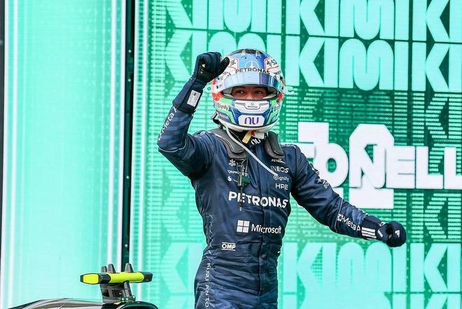

北京时间11月2日，梅赛德斯20岁意大利车手安东内利在墨西哥站正赛提前夺得2026赛季F1世界冠军，提前4站成功加冕，同时成为F1历史上最年轻的世界冠军。

墨西哥大奖赛赛后，安东内利已经拉开第二名超过100分分差，提前加冕本赛季世界冠军。正式成为F1车手的第2个赛季，安东内利为梅赛德斯夺得暌违5年的车手世界冠军。

安东内利同时以20岁68天的年纪大幅刷新了F1历史最年轻的世界冠军的纪录。此前这一纪录由维特尔保持，他在2010年以23岁133天的年纪加冕世界冠军，刷新了更早之前汉密尔顿的纪录。

F1历史上最年轻世界冠军TOP8

1.安东内利（2026年世界冠军） 20岁68天（按欧洲出生时间）

2.维特尔（2010年世界冠军） 23岁133天

3.汉密尔顿（2008年世界冠军）23岁300天

4.阿隆索（2005年世界冠军）24岁58天

5.维斯塔潘（2021年世界冠军）24岁73天

6.埃默森-菲蒂帕尔迪（1972年世界冠军）25岁273天

7.迈克尔-舒马赫（1994年世界冠军）25岁314天

8.诺里斯（2025年世界冠军）26岁24天

特别声明：以上内容(如有图片或视频亦包括在内)为自媒体平台“网易号”用户上传并发布，本平台仅提供信息存储服务。

Notice: The content above (including the pictures and videos if any) is uploaded and posted by a user of NetEase Hao, which is a social media platform and only provides information storage services.

快乐加载中21 2026-11-02 06:29:37

体育妞世界 2026-11-01 17:25:14

绿叶贝贝 2026-11-01 09:41:04

晚风知我意21 2026-10-30 03:10:46

赛场名场面 2026-11-02 02:50:22

赛场名场面 2026-11-02 02:03:31

星河漫山野 2026-10-31 04:55:14

五星体育 2026-11-02 06:37:23

日常碎碎念啊 2026-11-02 04:54:10

竞技风云录 2026-11-02 05:23:02

日常碎碎念啊 2026-11-02 05:53:13

王芸爱搞笑 2026-10-31 15:34:16

星河漫山野 2026-11-02 04:56:43

科学大搜索 2026-10-30 18:16:30

赛场名场面 2026-11-02 01:01:37

阿友田侃故事 2026-10-31 19:20:46

贵生搞笑 2026-10-30 09:49:57

盼秋爱搞笑 2026-11-01 11:18:29

赛场名场面 2026-11-02 03:30:02

lume情感语录 2026-10-30 10:44:32

喵喵侠 2026-10-31 19:57:44

极速章鱼 2026-10-31 19:02:40

风筝视频 2026-11-01 07:24:02

大咖说智科 2026-11-01 16:10:03

7诺说车 2026-10-31 22:25:35

竞技追梦人 2026-11-01 00:00:00

天晴剪辑 2026-10-31 23:15:28

创造精彩剧情 2026-11-02 05:25:42

青色雨音r 2026-11-02 04:49:26

阿友田侃故事 2026-10-31 17:51:07

输在感情刀 2026-11-02 02:40:15

阿友田侃故事 2026-11-01 19:30:49

小六热游 2026-11-01 23:54:59

阿友田侃故事 2026-11-01 20:11:45

装甲铲史官 2026-09-30 11:30:50

重庆城市TV 2026-10-30 17:08:14

灰机咕咕 2026-10-31 16:11:49

一顿八斤米 2026-11-01 10:14:51

7诺说车 2026-11-01 23:10:28

异环 2026-11-02 00:43:50

## 配图

图：F1（网易体育 · 2026-11-02）

## 来源

- [网易体育 · 原文](https://www.163.com/dy/article/LAN8L2K90549BAP0.html)
