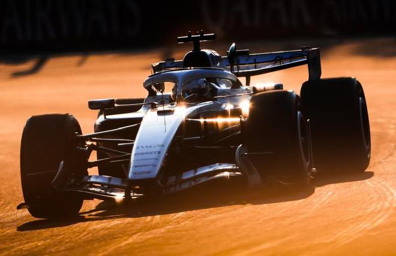

据英国《卫报》记者马特-休斯报道，利物浦所有者芬威体育集团（FSG）已经就收购凯迪拉克F1车队多数股权展开谈判，潜在交易金额超过20亿英镑。与此同时，凯迪拉克车队共同所有者马克-沃尔特因涉嫌保险业务欺诈受到调查，正在陆续出售旗下体育资产。

凯迪拉克车队于今年正式进入F1，由通用汽车和沃尔特旗下的TWG Global共同投资成立。今年夏天，TWG Global已经出售了NBA洛杉矶湖人队的控股权以及切尔西俱乐部13%的股份，目前还在寻求出售WNBA球队洛杉矶火花队。

现年66岁的沃尔特正因旗下保险公司Delaware Life、Clear Spring和EquiTrust的资金管理涉嫌欺诈，接受美国司法部和证券交易委员会的调查。不过，TWG方面否认相关指控，表示“并不存在任何欺诈行为”。

沃尔特同时也是美国职业棒球大联盟洛杉矶道奇队的控股股东，但他坚称不会出售道奇队。

尽管TWG否认即将出售凯迪拉克车队，但《卫报》了解到，该公司已经与多家潜在买家进行接触，其中包括芬威体育集团。除了利物浦，芬威集团还持有美国职业棒球大联盟波士顿红袜队以及北美职业冰球联盟匹兹堡企鹅队的多数股权。

一位了解芬威集团计划的消息人士透露，今年夏天出售利物浦38%的股份后，芬威集团正在寻找其他体育领域的投资机会。

此前，一个包括亚马逊创始人杰夫-贝索斯和Facebook联合创始人爱德华多-萨维林在内的财团收购了利物浦38%的股份，并获得了在2027年8月之前完成俱乐部全面收购的选择权。

如果芬威集团最终收购凯迪拉克车队的控股权，可能会对其在利物浦的持股安排产生影响。

今年夏天的部分股权出售完成后，利物浦俱乐部的估值达到55亿英镑。相比之下，芬威集团在2010年收购利物浦全部股权时仅支付了3亿英镑，因此未来如果进一步出售股份，将有机会获得巨额投资回报。

芬威集团此前已经涉足赛车运动，目前持有美国纳斯卡赛车系列赛车队RFK Racing的50%股份。

消息人士表示，芬威集团对F1产生兴趣，主要是看中了这项赛事过去十年的快速增长，尤其是其在美国市场的发展。

自2017年自由媒体集团收购F1以来，这项赛事的年度收入已经增长一倍以上，达到40亿美元（约合30亿英镑），电视转播权的价值也在持续上升。

据体育商业媒体Sportico此前报道，沃尔特对其持有的凯迪拉克车队股份估值约为22.4亿英镑。不过，TWG Global与通用汽车各自持有的具体股份比例尚未公开。

竞技层面，凯迪拉克车队在进入F1的首个赛季表现不佳，目前排名车队积分榜末位，尚未获得任何积分。

对于潜在的收购交易及未来投资计划，芬威体育集团拒绝发表评论。

特别声明：以上内容(如有图片或视频亦包括在内)为自媒体平台“网易号”用户上传并发布，本平台仅提供信息存储服务。

Notice: The content above (including the pictures and videos if any) is uploaded and posted by a user of NetEase Hao, which is a social media platform and only provides information storage services.

驴驴老baby 2026-10-31 00:57:17

少数派报告Report 2026-11-03 15:10:41

长江商报 2026-11-02 10:51:52

娱乐课代表孙小寒 2026-10-31 22:53:38

知己影视界 2026-11-01 07:53:44

手机评测室 2026-11-04 12:33:15

搞笑谁在行 2026-10-31 21:39:33

网上车市 2026-11-02 13:12:01

小步胡侃 2026-11-04 04:34:58

蓝鲸新闻 2026-11-02 15:50:23

懂球帝 2026-11-04 18:58:22

界面新闻 2026-11-04 17:13:08

米粒爱搞笑 2026-11-03 12:37:06

量子位 2026-09-12 15:37:51

界面新闻 2026-11-04 17:11:47

热搜摘要官 2026-11-02 06:27:44

翻车选手小李 2026-11-03 00:47:01

肆无忌惮的哭 2026-11-01 04:47:56

蓝鲸新闻 2026-11-04 18:06:36

舊事別提 2026-11-02 15:10:00

探秘全球 2026-11-04 04:09:48

扬子晚报 2026-11-03 07:20:39

夏正经 2026-11-03 16:22:48

秋梨电影 2026-11-01 10:31:49

爱笑西红柿 2026-11-03 15:27:47

封面新闻 2026-11-04 06:03:01

爱范儿 2026-11-04 18:18:20

懂球帝 2026-11-04 03:17:39

懂球帝 2026-11-04 07:51:23

有故事的人0501 2026-11-02 23:18:17

嵩仔聊剧 2026-10-31 19:46:55

仔仔娯探 2026-10-31 14:05:54

华商网 2026-11-04 11:16:48

天天汽车 2026-11-01 11:38:00

天天汽车 2026-11-02 13:45:16

搞笑小捣蛋 2026-11-03 00:00:00

天天汽车 2026-11-01 10:26:00

小仙女T99 2026-11-03 00:18:50

36氪 2026-07-12 15:19:23

大威说改车 2026-11-03 14:29:36

## 配图

图：F1（网易体育 · 2026-11-04）

## 来源

- [网易体育 · 原文](https://www.163.com/dy/article/LATNNTE20549BAP0.html)
