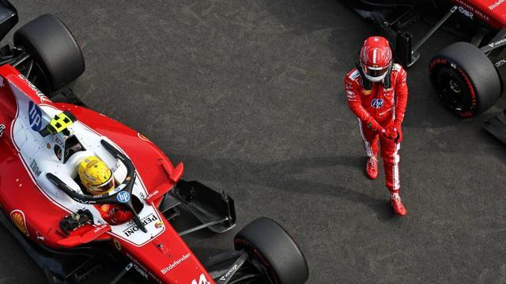

本文转载并翻译自Motosport Week，原文发布于当地时间11月10日，作者Fleur Rogerson。

F1有11支车队，每支车队上千名员工，从工程、公关到管理，各司其职。每一年，所有人通力合作，打造出最好的赛车，好让两位车手去争夺车队总冠军——这是团队努力的结晶。

但硬币还有另一面：每位车手当然都在为车队而战，也都乐于赢下车队总冠军，可他们同样渴望车手总冠军，很多人甚至认为那更有价值。那是把自己的名字写进F1历史的机会，跻身少数可以自称世界冠军的人之列。

冠军只有一个，队友之间的拼杀从这项运动诞生之日起就没有停过。墨西哥城大奖赛的周末，再次点燃了关于「对车队的职责」与「争夺胜利」之间如何取舍的讨论：和队友缠斗是否该格外谨慎？到什么程度算过分？

而最重要的是——法拉利是否比任何车手都重要？

随着F1粉丝群体不断壮大，车迷内部也分化出各种类型。有以车队为先的车迷，谁开车无所谓，他们首先是法拉利、迈凯伦或红牛的车迷，车手排在其次。但我认为更常见的是车手优先的车迷。

当一位车手整个职业生涯都待在同一支车队时，车手与车队的界限会变得模糊，勒克莱尔与法拉利、维斯塔潘与红牛、诺里斯与迈凯伦都是典型。这些车手的粉丝或许会说他们两者都支持，但在汉密尔顿离开效力多年后的梅赛德斯时，人们的反应说明多数情况下车手还是排在第一位的。

这并不令人意外。车手才是车迷看得见、能共情、与之同胜同负的人。车队当然很重要，但它是一个更大、更缺乏个人色彩的实体；单个车手则是车迷可以在个人层面建立联系的对象。

社交媒体放大了这一点：诺里斯在Twitch和YouTube上的直播，让粉丝觉得他是自己的朋友，这种连接是迈凯伦给不了的。如果有一天诺里斯离开木瓜军团另投他队，毫无疑问大部分粉丝会跟着他走。还有一个更根本的问题：车队内部本身就是分裂的。车房分两边，每辆车有各自的团队、各自的比赛工程师。尽管大家朝着同一个总体目标努力，但两边同样是各自独立的。

无论你认为车手该把车队还是自己的冠军争夺放在首位，这项运动都有一些虽非明文、却通常被遵守的规则。最重要的一条是：当冠军悬而未决时，车手应当配合车队战略。具体规则又取决于争的是哪个冠军。

如果是车队总冠军，两位车手都应始终努力把成绩最大化，甚至要尽量减少互相缠斗，以免危及结果——队友领先时你若觉得能超，要么谨慎超过去、别把两人都拖进和第三名的缠斗，要么接受第二，为车队拿下一个双领奖台。

如果是车手总冠军，事情就变得更需要牺牲。佩雷斯2021赛季常被誉为最佳队友，他为维斯塔潘的首个冠军分担了很多重任。

他的角色赛季初就很明确：在规则允许范围内尽一切可能帮助维斯塔潘。他在阿布扎比把汉密尔顿挡在身后，让这位七届世界冠军在与维斯塔潘的较量中损失了八秒，由此赢得「国防部长」的绰号。

佩雷斯并不专注于自己的成绩，他打的是团队战，也因此得到了感谢。

这种模式来自一号车手与二号车手之间的清晰界线。车队一旦做出这种选择，日子会好过得多：优先级始终明确，策略决策也容易得多。可惜车队很少让事情这么简单——既然可以有两个一号车手，为什么要选一个一号一个二号？有什么比一位能争冠的车手更好？两位。

“Brocedes”、“Multi-21”和“Papaya Rules”只是拥有两位一号车手而导致正面冲突、队友相撞和媒体风波不断的三个典型案例，事实上这样的情况数不胜数。

拥有两位有能力争冠的车手，机会自然翻倍。但如果没有规则或交战条款，你就有可能重演2016年西班牙站——当时同为梅赛德斯争冠的汉密尔顿和罗斯伯格在开场圈相撞；或者2016年奥地利站，或者斯帕。

当两位车手并驾齐驱时，控制会变得更难。车队不仅不能偏袒任何一方，而且你怎么能要求一位正在争夺世界冠军的车手不去争胜？你做不到。或者当你这样做时，维特尔会无视你，不管「Multi-21」，照样去争胜利。

即使两位车手并非都在争冠，局势同样难以控制。如果你一直把两位车手都当作一号车手对待，那凭什么期望其中一位无论何时都去扮演二号？每位车手都想赢，机会出现时，他们是否应该仅仅因为队友在前面就退让？

看看墨西哥：勒克莱尔和汉密尔顿都没有冠军可争，法拉利在车队积分榜上落后梅赛德斯超过100分，安东内利也即将锁定车手总冠军。那么，当胜利的机会摆在眼前时，凭什么要求其中一位安然待在另一位后面？

墨西哥的碰撞之所以越来越显得奇怪，是因为事件本身并不严重。两人都刹车过晚，勒克莱尔切了弯、吃到处罚，但两人并没有相撞。勒克莱尔很可能会让回位置，只是他做不到，因为汉密尔顿已经被别人超过了。这位摩纳哥人接受了处罚，也因此丢掉了领先。

争论的焦点是：一位车手是否应该放弃争胜来确保车队胜利。可当时勒克莱尔怎么可能知道维斯塔潘会击败汉密尔顿？他不可能知道。他看到的是取得领先的机会，然后抓住了它。他不是第一个这样做的车手，也肯定不会是最后一个。

无论车手是不是世界冠军，他们与媒体以及外界看法的关系都很复杂，总有一种「怎么做都不对」的感觉。时间也会改变人们的看法：很少有世界冠军在赢得冠军的当下被喜爱。

维斯塔潘曾被贴上激进的标签，如今人们却称赞他务实的作风；汉密尔顿的冠军曾因梅赛德斯的统治被视为无聊，随着时间推移，人们又开始欣赏他建立起的王朝。

车手在夺冠前若自信或直言不讳，会被看作傲慢，但时间过去，人们又会赞扬他们如何拼下每一场胜利。作为车手，做也挨骂，不做也挨骂，唯一的好处是：只要你赢过冠军，就永远可以拿它来反驳。

多年来，勒克莱尔一直因为没能在法拉利给他失败策略、车队指令、缓慢进站或一连串可批评的操作时站出来而受到指责，因为他没有自己做决定、掌控自己的比赛。在墨西哥，你完全可以说他就是在掌控局面，看到了胜利的曙光，结果却发现自己成了被抨击的对象。

勒克莱尔挨批，仅仅是因为维斯塔潘赢了那场比赛吗？如果这位摩纳哥人守住了领先，那次举动还会被质疑吗？车手是否只应在结果有保证时才在赛道上做决定？还是说，这一切最终都归结到「法拉利」三个字上？

威尔-巴克斯顿曾说，意大利有两种宗教：天主教和法拉利。这话不只是真的，它还深植于意大利人的头脑，也深植于F1本身。

法拉利自F1诞生起就在场，是这项运动历史上最成功的车队，无数伟人身穿红色赛车服在其旗帜下比赛。赢是一回事，为法拉利赢则完全是另一回事。跃马尽管声名显赫，却已近二十年没有拿到冠军。维特尔曾试图追随偶像舒马赫的脚步，让车队重返荣耀，结果面对的却是改变一个已写进F1本身的制度的终极挑战。

法拉利对车手有规则和期望。第一条：没有车手高于车队。法拉利的成绩不只影响车队和那些为车队目标工作的人，还影响Tifosi——那群极其忠诚投入的球迷，以及赞助商和股东。第二条：永远不要向媒体批评法拉利。一切内部处理，你可以批评组织，但要放在私下会议里。勒克莱尔很快就习惯了这一点，在2022年的灾难中成了应对媒体的高手。

这也是瓦塞尔在墨西哥之后如此恼火的原因，他公开表达了自己认为双方都存在的不尊重：勒克莱尔危及了车队的成绩，汉密尔顿危及了车队的声誉。在法拉利，这两者都不可接受。

勒克莱尔对这套逻辑并不陌生，他职业生涯除了一年之外都在法拉利度过。而汉密尔顿拿过七个冠军，没有一个来自法拉利。他的到来对双方都被视为历史性事件，提升了车队的股价，也广受赞誉。但法拉利无疑会提醒自己的车手：无论你赢过多少冠军、登过多少次领奖台，总有一天你会退役，法拉利会继续走下去。可问题在于：如果车手不敢批评、不敢做出可能惹恼队友或车队本身的选择，法拉利还能赢得冠军吗？

特别声明：以上内容(如有图片或视频亦包括在内)为自媒体平台“网易号”用户上传并发布，本平台仅提供信息存储服务。

Notice: The content above (including the pictures and videos if any) is uploaded and posted by a user of NetEase Hao, which is a social media platform and only provides information storage services.

元气满分吖 2026-11-11 02:06:10

林间小温柔 2026-11-11 08:31:35

绿茵狂热者 2026-11-10 22:10:28

泛舟碧波湖水 2026-11-11 03:41:05

新华社 2026-11-09 15:39:27

笑到地老天荒号 2026-11-09 16:50:41

洋葱驾享时光 2026-11-07 10:58:29

胖爷科技 2026-11-10 17:45:13

搞笑谁在行 2026-11-07 22:25:52

AL 频道 2026-11-09 10:22:58

星视频 2026-11-09 14:43:18

果果哥哥 2026-11-10 14:19:27

阿友田侃故事 2026-11-10 14:04:38

阿友田侃故事 2026-11-11 18:54:08

综合资讯 2026-11-09 22:21:32

战甲观测者 2026-11-11 18:21:46

星视频 2026-11-09 16:57:44

小兔子的快乐 2026-11-10 03:36:51

中国北方 2026-11-11 17:53:33

一颗柠檬精 2026-11-10 06:43:09

雾以泪聚i 2026-11-11 14:48:01

阿友田侃故事 2026-11-11 18:55:55

车视界科技 2026-11-10 20:55:12

优视汽车 2026-11-10 18:58:01

拾光纪闻 2026-11-09 06:14:11

财联社 2026-11-10 16:28:02

新鲜看点号 2026-11-11 07:33:32

冯哥科普 2026-11-11 06:42:00

狗圣哥剪辑 2026-11-10 14:32:22

夏正经 2026-11-10 16:06:54

笑料匣子 2026-11-11 08:19:27

逗趣创意间 2026-11-11 09:22:08

环球军武 2026-11-11 11:15:58

搞笑小捣蛋 2026-11-09 00:00:00

参考消息 2026-11-10 22:41:30

娱妮啵啵啊 2026-11-11 11:27:57

扬子晚报 2026-11-11 07:52:23

极目新闻 2026-11-10 08:00:38

小莉帮忙 2026-11-08 20:02:27

人间闲散客 2026-11-11 01:28:58

## 配图

图：F1（网易体育 · 2026-11-11）

## 来源

- [网易体育 · 原文](https://www.163.com/dy/article/LBFNOHAJ0549BAP0.html)
