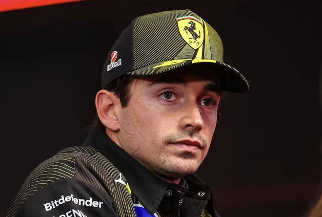

北京时间11月22日，F1拉斯维加斯大奖赛结束，法拉利F1车队车手勒克莱尔在比赛中取得了第10，赛后他接受了采访。

勒克莱尔赛后接受F1电视台采访时表示：“归根结底，赛会干事们尽了最大努力，试图在每次发生碰撞时找出责任方。今天，我被认定为有过错，并被罚时10秒。我不会对此提出异议，我会重新审视回放。”

“由于前面刘易斯和迈凯伦赛车的缠斗，感觉7号弯内侧有很多空间，我认为待在内侧绝对安全。

“很遗憾，我觉得刘易斯由于赛车的角度问题，没能从后视镜里看到我，之前在弯心处的差距已经不大了。但我不能责怪刘易斯，我觉得他确实没看到我，我只是再次为车队感到非常抱歉。”

当被问及两人最近一次接触时，勒克莱尔回顾了墨西哥大奖赛事件后进行的讨论，并解释了他为什么认为这些事件有所不同。

“我们已经进行过讨论，而且我认为讨论进行得非常顺利，”他解释说。“但今天的情况与墨西哥的情况不同，在墨西哥，我们俩可能都超速行驶了，有点超过了限制。”

“那或许更像是一起赛车事故，但赛车之间发生碰撞仍然是不可接受的。我会承担这次事故的一切责任，因为最终我接受了处罚。但我会回顾并分析事故经过。”

“我当时真的为整个团队感到很尴尬，”他坦言，“我会好好反思的。”

特别声明：以上内容(如有图片或视频亦包括在内)为自媒体平台“网易号”用户上传并发布，本平台仅提供信息存储服务。

Notice: The content above (including the pictures and videos if any) is uploaded and posted by a user of NetEase Hao, which is a social media platform and only provides information storage services.

甜份超标的我 2026-11-22 15:45:04

晚风知我意21 2026-11-22 16:37:41

林间小温柔 2026-11-22 16:45:23

余生妩媚小妖精 2026-11-22 16:17:24

星河漫山野 2026-11-22 16:29:48

阿抽崽 2026-11-21 02:22:28

元气八眉菌 2026-11-21 13:08:25

RonnieFei赛车视角 2026-11-22 16:09:56

快乐加载中21 2026-11-22 17:45:02

温柔且自由 2026-11-22 11:07:02

长安一片月 2026-11-18 12:25:46

坠入温柔晚风 2026-11-22 18:21:57

贵生搞笑 2026-11-20 17:01:42

快科技 2026-11-22 16:32:24

爱笑的小怡子 2026-11-20 09:12:38

快科技 2026-11-22 08:56:13

雾以泪聚i 2026-11-22 04:39:51

星视频 2026-11-18 18:03:15

观象视频 2026-11-22 18:12:50

元气满分吖 2026-11-22 19:07:22

南方都市报 2026-11-22 11:56:59

篮坛第一线 2026-11-22 18:21:33

南方都市报 2026-11-22 12:48:25

你笑的好甜美 2026-11-22 04:09:22

月光倾城p 2026-11-21 12:24:27

凌雨肖大面包 2026-11-22 00:27:37

鬼叔黍 2026-11-22 04:26:01

一只小太阳 2026-11-22 02:05:55

禾通信息 2026-11-22 14:02:24

AI绘千禧 2026-11-21 11:07:06

跨越式 2026-11-20 17:43:46

台海风云 2026-11-22 08:47:25

国+社区 2026-11-22 08:54:58

王哈哈娱乐大赏 2026-11-19 10:13:56

极目新闻 2026-11-21 20:11:56

新言生活 2026-11-19 17:31:39

装备解析室 2026-11-21 10:47:36

夜猫户外科普 2026-11-20 16:56:01

台海风云 2026-11-22 08:31:37

圆梦的小老头 2026-11-22 19:05:48

## 配图

图：F1（网易体育 · 2026-11-22）

## 来源

- [网易体育 · 原文](https://www.163.com/dy/article/LCC5GSQO0549BAP0.html)
