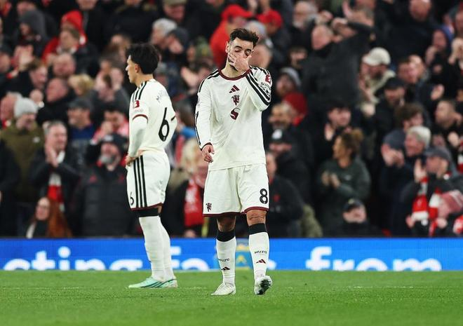

在北京时间11月23日结束的英超第11轮1场焦点战中，十人曼联客场0-4不敌利物浦。上半场，德里赫特漏人致约罗8分钟染红，索博斯洛伊任意球破门，维尔茨神仙球为利物浦扩大优势。下半场，恩古莫哈和穆尼奥斯连续破门为利物浦锁定胜局，恩古莫哈和维尔茨此役均完成传射。

曼联队史首次遭遇9轮不胜（5平4负），11轮后1胜5平5负积8分，暂列倒数第2位，54岁的新帅波切蒂诺遭遇上任开门黑。

利物浦获得英超2连胜后，11轮6胜3平2负积21分，继续位列第4位，距离榜首阿森纳7分。

第8分钟，利物浦后场长传，德里赫特漏人，伊萨克带球进入禁区前被约罗放倒，主裁直接红牌将约罗罚下，曼联剩10人应战。

第10分钟，索博斯洛伊主罚任意球直接攻门，皮球直入左下死角，利物浦1-0领先曼联。

第13分钟，恩古莫哈左路突破传中，维尔茨禁区潇洒回旋勾射破门，利物浦3分钟2球，2-0领先曼联。

第66分钟，巴尔科拉边路超车后送出横传助攻，恩古莫哈破门完成传射，利物浦3-0领先曼联。

第82分钟，维尔茨直塞助攻，替补登场穆尼奥斯单刀破门，利物浦4-0曼联。

第5分钟，B费任意球直接攻门，皮球偏出立柱。

第7分钟，巴尔科拉带球推进，伊萨克迎球打门被扑。

第39分钟，麦卡利斯特凌空抽射，拉门斯倒地将球没收。

第40分钟，伊萨克近距离调整打门，皮球被挡出。

第59分钟，巴尔科拉接到队友传球获得单刀机会，想盘过门将但趟球直接出了底线。

第63分钟，德里赫特抢断失误，伊萨克单刀好机会直接踢飞。

第64分钟，巴尔科拉再次错失良机，禁区转身打门，皮球高出横梁。

第75分钟，拉门斯先后扑出伊萨克禁区内的射门和索博禁区外的左脚远射。

利物浦首发：1-阿利松、33-阿劳霍（85’2-乔·戈麦斯）、5-雅凯、4-范戴克、6-凯尔凯兹、8-索博斯洛伊、10-麦卡利斯特（72’42-尼奥尼）、29-巴尔科拉（72’23-穆尼奥斯）、7-维尔茨、73-恩古莫哈（78’30-弗林蓬）、9-伊萨克（85’67-库马斯）

替补未出场：25-马马尔达什维利、21-齐米卡斯、53-麦康奈尔、14-基耶萨

曼联首发：1-拉门斯、2-达洛特、15-约罗（8’红牌）、4-德里赫特、6-利桑德罗、18-蒂莱曼斯（65'7-芒特）、37-梅努（87’17-安德雷·桑托斯）、19-姆伯莫（22’5-马奎尔）、8-B费、13-多尔古（65'3-马兹拉维）、10-库尼亚（46'11-齐尔克泽）

替补未出场：22-希顿、26-海文、16-阿玛德、31-莱西

特别声明：以上内容(如有图片或视频亦包括在内)为自媒体平台“网易号”用户上传并发布，本平台仅提供信息存储服务。

Notice: The content above (including the pictures and videos if any) is uploaded and posted by a user of NetEase Hao, which is a social media platform and only provides information storage services.

西北望长安 2026-11-23 08:28:09

流年顛簸 2026-11-23 09:41:59

软妹酸奶 2026-11-23 06:03:35

之乎者也小鱼儿 2026-11-23 09:31:26

猫熊说体育 2026-11-23 07:19:39

足球周刊 2026-11-23 18:48:17

6个果子说球 2026-11-23 10:08:35

罗克 2026-11-23 11:12:50

痞子时代 2026-11-23 18:23:06

精彩背后的故事 2026-11-22 03:46:12

时光礼记p 2026-11-23 04:38:58

我们的足球记忆 2026-11-22 15:00:37

火星猪同学 2026-11-22 04:01:56

足球印象CC 2026-11-21 19:59:18

花信来时e 2026-11-23 04:32:06

一路荒凉如歌aa 2026-11-21 02:04:15

懂球帝 2026-11-23 19:20:05

晚风知我意21 2026-11-23 19:09:51

全景体育V 2026-11-23 06:01:31

一个香蕉说球 2026-11-22 17:53:38

佳客体育 2026-11-21 05:27:27

海星动画 2026-11-21 13:35:30

运营小周 2026-11-23 13:09:03

孤酒老巷QA 2026-11-22 12:00:04

冰封情书熵增中r 2026-11-23 01:31:50

你笑的好甜美 2026-11-23 04:18:08

孤酒老巷QA 2026-11-23 15:15:40

生活小图鉴 2026-11-22 09:18:41

夜里的海风 2026-11-23 03:47:48

懂球帝 2026-11-23 18:38:44

一个香蕉说球 2026-11-22 17:53:15

海浪星体育 2026-11-23 11:12:23

海浪星体育 2026-11-23 10:40:14

慢享生活集 2026-11-23 18:54:27

足球几何麦克雷 2026-11-21 09:39:57

风霜侃球 2026-11-23 13:11:55

足球印象CC 2026-11-23 16:00:34

草莓信箱 2026-11-22 16:10:38

懂球帝 2026-11-23 19:10:24

清风月影j 2026-11-23 04:12:48

## 配图

图：足球（网易体育 · 2026-11-23）

## 来源

- [网易体育 · 原文](https://www.163.com/dy/article/LCCRJII20529CA1F.html)
