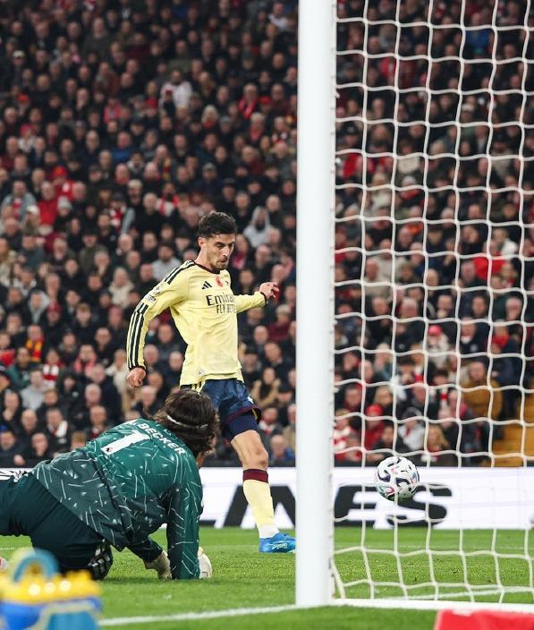

北京时间11月2日，本赛季的英超联赛第九轮，迎来了一场焦点对决，利物浦坐镇安菲尔德球场，迎战卫冕冠军阿森纳，本场比赛两支球队都创造出了有威胁的进攻机会，赖斯助攻哈弗茨打入全场唯一进球，帮助阿森纳1-0攻克安菲尔德球场，打破了英超客场14年不胜利物浦的魔咒，凭借这一场胜利，阿森纳超越曼城坐上了积分榜第一的宝座。

在上月的国际比赛日结束之后，阿森纳在英超连斩利兹联、诺丁汉森林和埃弗顿，取得了一波三连胜，再加上主要竞争对手曼城上一轮联赛输给了阿斯顿维拉，枪手在积分上追平了蓝月军团，但因为净胜球的劣势，依旧排名第二。

本周中阿森纳在英联杯的赛场爆冷不敌英乙的球队福利特伍德，而此战的对手利物浦则和切尔西在英联杯1/8决赛激战90分钟，最终通过点球大战涉险过关，都面临多线作战考验的阿森纳和利物浦，谁能够赢下这一场焦点对决，也就成为了双方球迷最为关心的话题。

第5分钟，加克波在右路尝试一脚远射，皮球偏出直接出了底线。

第8分钟，利物浦反击打穿阿森纳后防，拉亚及时出击化解险情。

第15分钟，赖斯大禁区外起脚远射，皮球高出横梁出界。

第16分钟，阿利松出球失误付出惨痛代价，赖斯助攻哈弗茨破门得分，阿森纳在客场取得了1-0的领先，本赛季已经送出5次助攻的赖斯领跑助攻榜，而打破近两个月进球荒的哈弗茨，也以46粒进球超越京多安，成为了英超历史上进球最多的德国球员。

第18分钟，阿森纳后卫孔萨送大礼，直接被巴尔科拉抢断，可惜后者趟球过大，皮球被回防的球员解围。

第24分钟，吉马良斯右路肋部传中，后点包抄的哈弗茨差一步，没有能够碰到皮球。

第28分钟，利物浦右侧角球开出，门前包抄的伊萨克，接到队友头球摆渡后射门，可惜被孔萨封堵出了底线。

第39分钟，利物浦赢得一个位置非常好的定位球机会，维尔茨直接轰门，可惜运气不佳，皮球击中横梁被弹出。

第73分钟，措利斯接到队友长传转移后，直接迎球怒射打远角，阿利松迅速飞身扑出。

第79分钟，麦卡利斯特在放倒厄德高后，刻意拍头嘲讽，引发了双方球员的冲突，好在被主裁判及时制止。

利物浦首发：1-阿利松、6-凯尔凯兹、4-范戴克、5-雅凯、33-阿劳霍、42-尼奥尼、10-麦卡利斯特、7-维尔茨、18-加克波、29-巴尔科拉、9-伊萨克

阿森纳首发：1-戴维-拉亚、12-廷贝尔、15-孔萨、6-加布里埃尔、33-卡拉菲奥里、41-赖斯、39-吉马良斯、8-厄德高、20-马杜埃凯、17-措利斯、29-哈弗茨

特别声明：以上内容(如有图片或视频亦包括在内)为自媒体平台“网易号”用户上传并发布，本平台仅提供信息存储服务。

Notice: The content above (including the pictures and videos if any) is uploaded and posted by a user of NetEase Hao, which is a social media platform and only provides information storage services.

狍子歪解体坛 2026-11-02 02:31:43

CR7足球频道 2026-10-31 17:32:30

秘密即将揭晓 2026-11-02 19:00:06

懂球帝 2026-11-02 17:47:52

雷叔聊球 2026-11-01 03:17:00

懂球帝 2026-11-02 19:22:57

足球印象CC 2026-10-31 20:31:22

咪咕体育 2026-10-31 04:30:29

本泽体育 2026-11-02 18:23:51

旧纸讲非遗 2026-11-01 01:20:04

超喜欢我 2026-11-01 09:39:55

足球推文C 2026-11-02 19:21:32

足球印象CC 2026-10-31 18:01:12

全球风情大揭秘 2026-11-01 14:07:36

一路荒凉如歌aa 2026-11-02 04:34:42

嗨皮看球 2026-11-02 17:40:26

一路荒凉如歌aa 2026-11-01 07:10:34

阿嬍体育评论 2026-11-01 06:57:16

懂球帝 2026-11-02 17:25:05

懂球帝 2026-11-02 18:08:26

超话看世界 2026-11-02 14:58:11

一纸情书s 2026-11-02 03:46:18

篮球人物故事会 2026-11-02 12:21:48

足球印象CC 2026-11-02 10:54:12

左脚爆射得分 2026-11-02 11:42:21

爱足球的谢宇宁 2026-11-01 07:03:51

足球印象CC 2026-10-31 16:02:16

米奇兔 2026-11-01 21:54:58

墨史轩 2026-11-02 01:18:02

颜强 2026-11-01 01:36:46

颜强 2026-11-01 01:43:54

语妍视频剪辑 2026-11-02 10:19:10

铭记人类辉煌 2026-11-02 03:54:18

懂球帝 2026-11-02 19:22:57

CR7足球频道 2026-11-02 13:41:57

足球故事GOAL 2026-11-01 03:58:25

罗氏看球 2026-11-01 12:28:46

全球风情大揭秘 2026-10-29 04:57:18

陈赩爱体育 2026-11-02 16:36:33

HC王楚淇 2026-11-01 06:59:37

## 配图

图：足球（网易体育 · 2026-11-02）

## 来源

- [网易体育 · 原文](https://www.163.com/dy/article/LAMQ3GQ90549753N.html)
