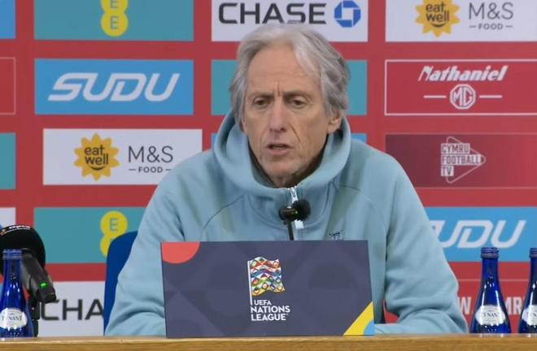

北京时间11月17日，72岁的葡萄牙主帅热苏斯出席了欧国联末轮赛前发布会，而他也回应了此前C罗母亲炮轰自己的言论。

此前，C罗在接受采访时语出惊人表示，葡萄牙1-4输给丹麦纯粹活该、咎由自取，自己的儿子在国家队被欺骗，缺少队友的应有尊重。而当媒体把这番言论抛给热苏斯时，这位葡萄牙老帅也被问烦了，他回应道：“因为我完全理解你们提出这些问题的出发点，我也完全理解C罗的母亲所发表的那些言论，母亲终究是母亲，而且据我所了解的情况，她是一位当年很不容易地才把孩子拉扯大的母亲，她是一位母亲的榜样。因此，对我来说，这一切都是非常自然、非常正常的！”

“C罗母亲的言论不会影响任何事情，我不知道这什么时候会结束。是你们在提问。我不会逃避任何话题，你们了解我的。”再次被问到C罗，葡萄牙老帅有些不耐烦表示：“C罗是葡萄牙足球的传奇，葡萄牙国家队永远不会忘记他。作为他的朋友，我和他共事过一年。他邀请我去利雅得胜利执教。我对他说：‘我会去的，我会帮你成为冠军’。我没有食言。所以，这是一个我们都知道的现实。”

截止目前，热苏斯依然拒绝向C罗道歉。而C罗也因此拒绝重返国家队，参加告别赛。甚至在上轮欧国联致敬自己的仪式上，没有来到现场见证。

特别声明：以上内容(如有图片或视频亦包括在内)为自媒体平台“网易号”用户上传并发布，本平台仅提供信息存储服务。

Notice: The content above (including the pictures and videos if any) is uploaded and posted by a user of NetEase Hao, which is a social media platform and only provides information storage services.

跨越式 2026-11-15 12:40:50

海浪星体育 2026-11-17 15:06:52

浮云过影r 2026-11-15 05:46:42

精彩背后 2026-11-15 14:25:04

创造精彩剧情 2026-11-17 16:44:08

懂球帝 2026-11-17 18:24:42

足球印象CC 2026-11-15 18:05:13

懂球帝 2026-11-17 18:03:16

万灵缝合厂 2026-11-17 00:40:30

懂球帝 2026-11-17 18:14:29

雪夜千寻 2026-11-16 04:20:46

一个香蕉说球 2026-11-15 14:04:49

弄月公子 2026-11-17 17:12:04

狍子歪解体坛 2026-11-15 04:08:37

小木的不完美家 2026-11-17 01:50:24

风起天阑c 2026-11-16 02:25:43

夜里的海风 2026-11-15 03:33:35

神秘研究院 2026-11-16 11:32:06

独特l 2026-11-16 18:22:46

足球印象CC 2026-11-17 10:08:37

看看新闻Knews 2026-11-15 11:25:26

搞笑的汪仔 2026-11-16 11:58:27

福幼怡 2026-11-16 10:19:29

罗克 2026-11-15 12:05:15

足球印象CC 2026-11-15 16:34:56

篮球过人技巧 2026-11-15 20:07:20

足球印象CC 2026-11-16 15:59:25

精彩背后 2026-11-15 14:20:56

足球印象CC 2026-11-13 19:58:28

锌之助吖 2026-11-17 01:08:45

慕名而来只为你 2026-11-17 02:03:13

你得漂亮 2026-11-17 02:43:16

风尚搭配师g 2026-11-17 06:37:02

一点儿雨心 2026-11-16 11:06:11

揭秘那些精彩 2026-11-16 02:31:00

旧梦难寻c 2026-11-16 06:04:09

薛艳艳爱生活 2026-11-17 17:58:39

天雪之楠 2026-11-16 04:42:03

语妍视频剪辑 2026-11-17 11:54:48

最佳菜鸟 2026-11-17 10:55:00

## 配图

图：足球（网易体育 · 2026-11-17）

## 来源

- [网易体育 · 原文](https://www.163.com/dy/article/LBTSPT2R0529CA1F.html)
