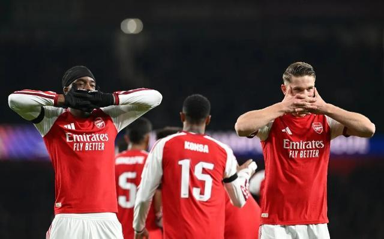

今晨欧冠联赛阶段第5轮，阿森纳主场1比1战平多特蒙德。目前，枪手5战11分暂列积分榜第5，黄黑军团以10分排在第7。

全场比赛，阿森纳控球63%，射门30比13，射正4比4，预期进球2.34比0.92。10月以来，阿森纳已各线保持11场不败。但最近9场比赛，他们只有1场能以2+球优势取胜，大部分比赛赢得艰难或无法取胜，他们总能在部分时段打出高水平，但难以建立更大优势。

枪手多达30次射门却只有4次射正，阿尔特塔表示：“考虑到今天的对手，以及我们的表现，我们应该非常非常满意，你几乎无法再要求球队做得更多了。但当你创造出如此多的机会，我们本该得到更多回报。这里有运气因素，也有我们需要更好完成最后一击的因素。我们必须坚持下去，因为球队今天展现出来的东西，说明我们正朝着正确的方向前进。”

相比上周末战平纽卡斯尔联的比赛，阿尔特塔对首发作出了6处调整，其中之一是让哈弗茨休息，哲凯赖什进入首发。瑞典中锋本季遭遇挑战，他的7次首发中有4次是在欧冠——普遍是阿森纳面对纸面上明显弱于自己的对手时，何况欧冠联赛阶段的容错空间远高于英超。

此役，哲凯赖什打进远射世界波，却错失了不止一次绝佳机会，特别是比赛尾声的近距离头球，那本可帮助枪手全取三分。

哲凯赖什和队友们为什么屡失良机？究竟是心态、运气不佳，还是临门一脚缺乏冷静造成的？阿尔特塔回应道：“心态？我不知道。这里有运气因素，因为有些球为什么就是没能进门，我也不知道。最后的处理可以做得更好，但除此之外，我认为一切都非常出色。”

哲凯赖什常被批评与队友串联能力不足，但他本场表现令阿尔特塔感到满意，“我最喜欢的是，哲凯赖什与球队的整体配合非常紧密。我们多次以不同方式利用他的特点。他与队友的配合、他的护球方式、他向防线身后穿插并拉开场上空间的方式，都非常出色。这就是我们所需要的维克托。”

10’哲凯赖什/55’拜尔

10’马杜埃凯传球，本·怀特前插为哲凯赖什创造了空当，后者20米外拔脚远射破网，阿森纳1比0。

43’马杜埃凯前场抢断斯洛特贝克，厄德高横传，哲凯赖什在加杜干扰下射高。

55’加杜后场得球过掉措利斯，随即长驱直入带球至前场分球右侧，拜尔晃开加布里埃尔低射近角破门，多特蒙德1比1。

68’乔布·贝林厄姆补射破门，但越位在先。

75’厄德高传中，哲凯赖什绝佳机会顶偏。

84’埃泽直塞，赖斯小角度射中门柱。

【12】阿森纳在欧冠小组赛/联赛阶段主场12连胜止步。

【1】最近10次在欧冠做客英格兰球队，多特蒙德输掉8场，只有1平（本场）1胜（2023年击败纽卡斯尔联）。

【20】不计点球大战，阿森纳在欧冠已连续20场保持不败（14胜6平），这是冠军联赛史上第3长不败，仅次于曼城2022-23至2024-25赛季期间的26场不败，以及曼联2007-08至2008-09赛季期间的25场不败。

【8】厄德高本场创造8次运动战机会，为本季欧冠之最。

【4】哲凯赖什本季欧冠直接参与4球，为队内之最。

阿森纳阵容（4231）：凯帕/本·怀特（65’廷伯）、孔萨、加布里埃尔、因卡皮耶/赖斯、刘易斯-斯凯利（65’吉马良斯）/马杜埃凯、厄德高、措利斯（65’埃泽）/哲凯赖什（87’梅里诺）

特别声明：以上内容(如有图片或视频亦包括在内)为自媒体平台“网易号”用户上传并发布，本平台仅提供信息存储服务。

Notice: The content above (including the pictures and videos if any) is uploaded and posted by a user of NetEase Hao, which is a social media platform and only provides information storage services.

懂球帝 2026-11-25 19:13:47

天下足球资讯 2026-11-25 20:58:10

澎湃新闻 2026-11-25 18:49:07

嗨皮看球 2026-11-25 19:04:13

懂球帝 2026-11-25 19:13:46

海浪星体育 2026-11-25 11:19:06

张硜卤说体育 2026-11-23 00:48:41

一顿八斤米 2026-11-23 09:10:54

曹操篮球解说 2026-11-24 11:52:02

弦泉说球 2026-11-24 11:45:23

足球印象CC 2026-11-24 07:13:16

薛艳艳爱生活 2026-11-24 12:13:23

6个果子说球 2026-11-25 12:01:35

人间闲散客 2026-11-25 01:03:31

落雪听梅a 2026-11-23 01:04:08

剪辑师八条 2026-11-25 00:39:36

智慧教育空间站 2026-11-25 00:49:47

我们的足球记忆 2026-11-25 00:25:20

足球周刊 2026-11-25 19:03:04

大海体娱 2026-11-25 12:06:24

懂球帝 2026-11-25 15:40:12

懂球帝 2026-11-25 18:52:35

懂球帝 2026-11-25 18:52:35

一个香蕉说球 2026-11-25 03:12:09

冷峻视角下的世界 2026-11-25 20:40:36

足球印象CC 2026-11-25 13:53:44

詹妹侃体育 2026-11-25 10:37:45

猫熊说体育 2026-11-23 07:19:39

懂球帝 2026-11-25 20:48:10

徐骧老表哥 2026-11-24 00:37:36

痞子时代 2026-11-25 16:24:48

揭秘那些精彩 2026-11-25 16:35:51

林中小呜 2026-11-25 02:16:32

三亿岁的石头 2026-11-25 13:19:09

一个香蕉说球 2026-11-25 03:13:08

懂球帝 2026-11-25 20:27:07

懂球帝 2026-11-25 20:06:57

AI小屋的日常随笔 2026-11-24 15:27:37

精彩一网打尽 2026-11-25 16:17:20

荒野老五 2026-11-25 00:44:48

## 配图

图：足球（网易体育 · 2026-11-25）

## 来源

- [网易体育 · 原文](https://www.163.com/dy/article/LCIPD28N05299JMD.html)
