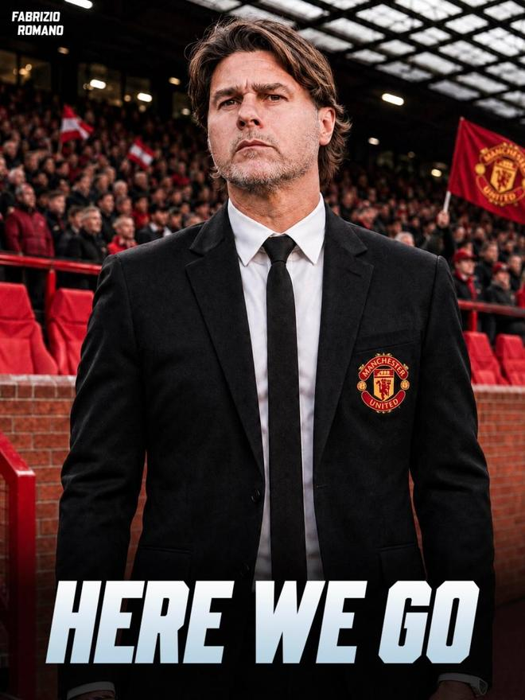

北京时间11月13日，知名转会专家罗马诺以标志性的“Here we go”确认，54岁的阿根廷名帅波切蒂诺确定接替卡里克，成为曼联新任主帅。

罗马诺表示，交易已经落定，美国足协方面也放行。波切蒂诺已于周三和曼联谈妥全部个人条款。这也是波切蒂诺时隔2年半，再次重返英超执教。

2009年，波切蒂诺在西班牙人开始了自己的执教生涯。2013年转战英超执教南安普顿。2014年波切蒂诺成为热刺主帅，执教球队超5个赛季共293场比赛，曾带队在2018-19赛季闯入欧冠决赛，但最终0-2不敌利物浦。

随后波切蒂诺又辗转大巴黎和切尔西，带队时长均不到两个赛季。2024年9月波切蒂诺成为美国队主帅，今夏作为东道主参世界杯，波切蒂诺带队取得16强的成绩。

世界杯结束后波切蒂诺原本可以自由离任，但波切蒂诺选择与美国足协续约，双方于8月公布的新合同持续至2030年世界杯。

据悉，波切蒂诺在入主曼联之后，计划对阵容展开全方位的推倒重建，开启大换血。阿根廷名帅已经拟定清晰的引援框架，他希望在转会市场上签下两名顶级中卫、两名实力过硬的精英中场，以及一名具备世界级水准的锋线终结者，从后防、中场到进攻端全面升级球队骨架。

按照目前的规划，马奎尔、齐尔克泽等多名现有球员，大概率会在下赛季开始前告别老特拉福德。除了这两名球员之外，队内还有一批边缘球员，同样进入离队名单。

特别声明：以上内容(如有图片或视频亦包括在内)为自媒体平台“网易号”用户上传并发布，本平台仅提供信息存储服务。

Notice: The content above (including the pictures and videos if any) is uploaded and posted by a user of NetEase Hao, which is a social media platform and only provides information storage services.

足球推文C 2026-11-13 16:34:02

体育吐槽 2026-11-11 17:33:01

曼巴体育6 2026-11-13 19:10:32

彼岸雨露j 2026-11-12 02:22:22

一个香蕉说球 2026-11-13 04:55:42

陈赩爱体育 2026-11-11 18:41:05

曹老师评球 2026-11-13 19:30:34

罗克 2026-11-12 11:47:18

晨光如昨v 2026-11-13 02:01:02

嘛呢八十分 2026-11-13 02:40:33

颜强 2026-11-12 23:40:01

斯坦福桥看更人 2026-11-13 16:53:06

领创体育君 2026-11-13 16:37:18

懂球帝 2026-11-13 16:55:54

足球印象CC 2026-11-13 16:02:32

一个香蕉说球 2026-11-10 20:23:41

一个香蕉说球 2026-11-10 20:24:21

足球印象CC 2026-11-12 08:47:01

米奇兔 2026-11-13 18:27:01

足球印象CC 2026-11-13 08:04:55

深情鱼摆摆 2026-11-10 14:18:45

疯狂阿滨 2026-11-11 23:26:56

一个香蕉说球 2026-11-10 20:24:22

足球人物志 2026-11-12 09:46:48

一个香蕉说球 2026-11-13 04:55:30

摸鱼佬临风 2026-11-12 03:32:51

足球印象CC 2026-11-12 16:01:08

足球印象CC 2026-11-09 17:02:21

流萤Zz 2026-11-12 04:13:02

狍子歪解体坛 2026-11-13 06:27:05

左脚爆射得分 2026-11-12 11:38:02

宇宙观察 2026-11-13 02:10:02

河北早知道 2026-11-12 11:28:17

曹老师评球 2026-11-13 19:13:20

颜强 2026-11-12 23:41:20

界面新闻 2026-11-12 18:52:55

马三看世界 2026-11-13 00:23:29

咪咕体育 2026-11-12 03:08:05

小山的篮球 2026-11-12 12:32:52

量子纠缠心跳链a 2026-11-13 02:57:18

## 配图

图：足球（网易体育 · 2026-11-13）

## 来源

- [网易体育 · 原文](https://www.163.com/dy/article/LBJKNHQA0529CA1F.html)
